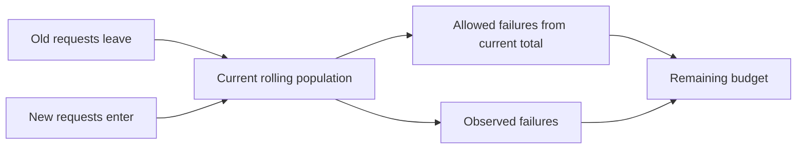

# How to Explain Error Budget Recovery in a Rolling SLO Window

Author: [nawazdhandala](https://www.github.com/nawazdhandala)

Tags: SLO, Prometheus, Python

Description: Calculate rolling error-budget changes as old requests leave the window and distinguish recovered budget from recent service improvement.

A rolling error budget can recover without any extraordinary improvement today. The window moves: old failures leave while new requests enter. For a request-based SLO, both the failure count and the total request count can change. Explain those two movements explicitly instead of describing the budget as a bank account that refills at a fixed rate.

This walkthrough uses a 99% request-success objective and a short four-day fixture so the arithmetic is visible. Production queries use a 28-day window. The custom counters represent eligible requests and failed eligible requests; they are not built-in Prometheus metrics. Define eligibility before calculating the budget.

## Calculate budget from the current population

For total requests N, failed requests F, and target T, the allowed failures are N multiplied by one minus T. Remaining budget is allowed failures minus observed failures. The remaining fraction can be negative when the objective is missed. Do not clamp it to zero if the dashboard needs to show how far the service exceeded its budget.

```python
target = 0.99
old_window = [(1000,30),(1000,0),(1000,0),(1000,0)]
new_window = old_window[1:] + [(1000,1)]
def budget(days):
    total = sum(n for n,f in days)
    failed = sum(f for n,f in days)
    allowed = total*(1-target)
    return {"total":total,"failed":failed,"remaining":round(allowed-failed,6)}
print(budget(old_window),budget(new_window))
assert budget(old_window)["remaining"] == 10
assert budget(new_window)["remaining"] == 39
```

The budget rises from ten to thirty-nine failures because thirty old failures leave and one new failure enters. The current day is not perfectly healthy, and the old incident has not been erased from history. It simply falls outside this reporting window. Keep the incident timeline available alongside the rolling score.

## Preserve numerator and denominator

In Prometheus, calculate increases per counter series before summing so resets are handled at the series level. Use the same filters for numerator and denominator. The following request-success ratio assumes the failed counter is a subset of the total counter.

```promql
1 - (
  sum(increase(service_failed_requests_total{service="checkout"}[28d]))
  /
  sum(increase(service_eligible_requests_total{service="checkout"}[28d]))
)
```

A long range requires sufficient retained data and can be expensive. Recording rules or an SLO backend may be appropriate, but preserve event weighting when aggregating. Averaging daily percentages gives each day equal weight and can produce a different result from counting requests.



## Explain changing traffic volume

The allowed failure count itself changes when traffic changes. A quieter new day replacing a busy old day can shrink the budget even if no new failures occur. This second fixture isolates that effect.

```python
target = 0.99
before_total,before_failed = 10000,50
after_total,after_failed = 5000,50
before = before_total*(1-target)-before_failed
after = after_total*(1-target)-after_failed
print(round(before,2),round(after,2))
assert round(before,2) == 50 and round(after,2) == 0
```

## Separate reporting from response decisions

Show current burn rate beside remaining budget. A recovered 28-day score can coexist with a severe outage happening now, especially at low traffic. Conversely, a healthy current service can retain a negative rolling budget until a previous incident ages out. Use the budget policy to decide release constraints and current symptom alerts to decide incident response.

When the chart jumps unexpectedly, inspect incoming requests, outgoing requests, counter resets, missing series, and a changed eligibility filter. A policy change should be versioned rather than silently rewriting the meaning of the chart. If no eligible requests exist, the request ratio is undefined; show an explicit no-traffic state. This makes recovery understandable as a property of a moving population, while preserving an honest view of present reliability.

Initialize both eligible and failed counters so a service with zero failures still has a valid numerator. If the failure series exists only after the first error, an empty numerator can make the ratio disappear even when request traffic is present. Review this behavior in a fresh deployment before any failures occur. For historical comparisons, preserve the policy version and label mapping as well as the raw counts; renaming a service midway through the window can otherwise look like budget recovery because older failures no longer match the selector.

## References

The [community question](https://stackoverflow.com/questions/70290789/how-do-i-measure-error-budget-consumption-for-rolling-windows) motivated this walkthrough. Implementation references:

- [Official reference 1](https://sre.google/workbook/implementing-slos/)
- [Official reference 2](https://prometheus.io/docs/prometheus/latest/querying/functions/)
