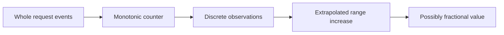

# How to Explain Fractional Prometheus Request Counts with Sparse Traffic

Author: [nawazdhandala](https://www.github.com/nawazdhandala)

Tags: Prometheus, Monitoring

Description: Understand increase extrapolation, inspect raw counter samples, and choose honest displays for low-volume request counts.

A counter increments by whole requests, yet `increase()` can return 1.33. Prometheus is estimating the increase across a time range from discrete scrape samples. The first and last samples usually fall inside the range rather than exactly on its boundaries, so the function extrapolates according to its counter rules.

The fractional result is not evidence that the application handled a fraction of a request. It is an estimate of the counter increase over the selected window. Sparse traffic makes the extrapolation visible because one observed increment is a large fraction of the total.

## Compare the estimate with the samples

Start with one series so aggregation does not hide resets or missing samples.

```promql
increase(http_requests_total{job="checkout", instance="10.0.0.7:8080"}[1m])
```

Then inspect the raw range vector at the same evaluation timestamp:

```promql
http_requests_total{job="checkout", instance="10.0.0.7:8080"}[1m]
```

Use an instant query for the range-vector expression. A graph's query step and display interpolation can conceal the actual scrape timestamps. Record the evaluation time, scrape interval, and any failed scrapes when explaining the result.



## Understand a simple numeric example

Suppose four samples cover 45 seconds of a 60-second window and show one increment. In a simple case where the algorithm extends across the whole window, scaling one observed increment by 60 divided by 45 produces 1.333. This model illustrates the mechanism; Prometheus also handles counter resets, zero-point constraints, and gaps near boundaries.

```python
observed_delta = 1
observed_seconds = 45
requested_seconds = 60
illustrative_estimate = observed_delta * requested_seconds / observed_seconds
print(round(illustrative_estimate, 3))
assert round(illustrative_estimate, 3) == 1.333
```

Do not implement this short formula as a replacement for `increase()`. It deliberately omits the details that make the real counter function work across resets and irregular scrapes.

## Choose the query for the question

For a service throughput panel, a per-second rate over a longer interval is often easier to interpret:

```promql
sum by (service) (rate(http_requests_total[5m]))
```

For a rough request total over a dashboard interval, `increase()` remains useful, but label it as an estimated increase. Rounding the displayed value can improve readability while concealing uncertainty; it does not make the estimate an exact accounting record.

If you need exact counts for billing, reconciliation, or a specific incident, use durable event or transaction records. Scraping cannot observe increments that occur and reset entirely between scrapes. A process that starts, handles one request, and exits before its first scrape may leave no sample at all.

## Investigate unexpectedly large errors

Check counter resets with `resets()`, scrape failures through `up`, and changes in target identity. If two series represent the same underlying counter because of duplicate scraping, summing them doubles the apparent traffic. If a label changes frequently, each new series begins with limited history and may create edge effects.

Do not substitute `delta()` for a counter merely because its output looks closer to an integer. It has gauge semantics and does not repair counter resets. Likewise, subtracting an offset value can miss resets and produce negative counts.

Use a controlled counter fixture with known increments to explain the dashboard to your team. Compare raw samples and the estimate at several evaluation times. The important distinction is between the exact application counter values at scrape instants and an estimated increase over an arbitrary time window.

## References

The [community question](https://stackoverflow.com/questions/38665904/why-does-increase-return-a-value-of-1-33-in-prometheus) motivated this investigation. The implementation references are [official reference 1](https://prometheus.io/docs/prometheus/latest/querying/functions/), [official reference 2](https://prometheus.io/docs/prometheus/latest/querying/basics/).
