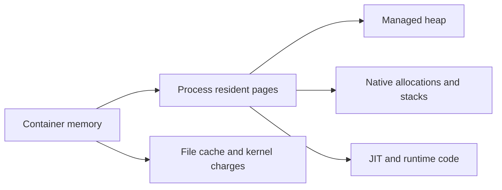

# How to Explain .NET Pod Memory Growth with a Small Managed Heap

Author: [nawazdhandala](https://www.github.com/nawazdhandala)

Tags: .NET, Kubernetes

Description: Compare .NET heap, process mappings, and cgroup memory to identify native allocations, committed GC memory, and file-backed growth.

A small managed heap does not imply a small .NET process. The container also pays for runtime structures, JIT code, thread stacks, native libraries, memory mappings, allocator arenas, and file-backed pages. The managed heap's live-object size can also differ from memory reserved or committed by the garbage collector.

Investigate the gap by aligning runtime, process, and cgroup measurements. Do not immediately tune garbage collection when the growing memory is outside the managed heap.

## Establish the runtime view

Use a compatible `dotnet-counters` tool in the target diagnostic environment. List processes, then observe the runtime provider:

```bash
dotnet-counters ps
dotnet-counters monitor --process-id 1 --counters System.Runtime
```

Replace PID 1 if a supervisor owns that PID. Counter names and presentation differ across .NET versions, so record the runtime and tool versions. Track heap size, allocation rate, GC collections, working set, and thread count together.

If live managed objects grow steadily after comparable collections, a managed retention investigation is appropriate. If live objects remain stable while working set grows, continue to OS accounting rather than concluding the GC is leaking.



## Compare process mappings and cgroup totals

On Linux, inspect the process and container views:

```bash
cat /proc/1/smaps_rollup
cat /proc/1/status
cat /sys/fs/cgroup/memory.current
cat /sys/fs/cgroup/memory.stat
```

`smaps_rollup` requires kernel support and permissions. It summarizes mappings for one process, while the cgroup includes all charged processes and relevant kernel or file memory. A sidecar or child process can explain a Pod-level gap that the main .NET process cannot.

Capture the same values repeatedly during equivalent workload phases. Compare anonymous growth, file-backed growth, thread count, and total usage. A one-time snapshot cannot distinguish warm-up from a leak.

## Inspect managed retention only when evidence supports it

A dump can answer which managed types and roots retain objects:

```bash
dotnet-dump collect --process-id 1 --output /tmp/application.dmp
dotnet-dump analyze /tmp/application.dmp
```

Inside the analysis session, start with:

```text
dumpheap -stat
```

Dump collection can pause the process and consume significant memory and disk. Use a staging reproduction or a controlled production diagnostic window with sufficient headroom. A dump near an OOM boundary can worsen the incident.

For native growth, inspect the libraries in use and their own allocation tools. Image processing, compression, database drivers, and interop buffers can allocate outside the GC heap. Thread proliferation can add stack mappings even when the managed object count stays stable.

## Evaluate runtime memory policy carefully

.NET's container-aware GC settings and heap hard limits influence managed heap behavior, but they do not cap every native allocation in the process. A heap hard limit set too close to the container limit leaves insufficient room for the rest of the runtime.

Avoid copying a GC environment variable from another runtime version without checking its naming and numeric format. Use the official runtime configuration documentation and record the effective setting in your experiment. Server GC, heap count, container CPU visibility, and workload allocation patterns can change the result.

Test a representative warm-up, steady-state load, and idle period. A working set that plateaus after warm-up may be expected reuse, whereas anonymous memory increasing across repeated identical cycles deserves further investigation. Compare application latency and GC pause behavior while changing limits.

The useful conclusion identifies the category that grows and the code or subsystem responsible. Raising Kubernetes memory may be a temporary mitigation, but the diagnosis should distinguish managed retention, native growth, runtime reservation, and reclaimable file pages rather than labeling every gap as a .NET heap leak.

## References

The [community question](https://stackoverflow.com/questions/74186819/high-working-set-size-in-dotnet-under-kubernetes) motivated this investigation. The implementation references are [official reference 1](https://learn.microsoft.com/en-us/dotnet/core/diagnostics/debug-memory-leak), [official reference 2](https://learn.microsoft.com/en-us/dotnet/core/diagnostics/dotnet-counters), [official reference 3](https://learn.microsoft.com/en-us/dotnet/core/runtime-config/garbage-collector), [official reference 4](https://docs.kernel.org/admin-guide/cgroup-v2.html).
