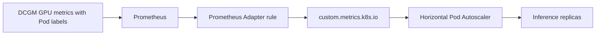

# How to Expose GPU Utilization to the Kubernetes HPA

Author: [nawazdhandala](https://www.github.com/nawazdhandala)

Tags: GPU, Kubernetes, Prometheus

Description: Map DCGM workload metrics through Prometheus Adapter and validate the custom-metrics API before configuring GPU autoscaling.

The Horizontal Pod Autoscaler does not read arbitrary Prometheus metrics directly. GPU utilization must be exposed through a supported metrics API, commonly the custom metrics API provided by Prometheus Adapter. The metric must also identify the Pods controlled by the workload you intend to scale.

Start with correct DCGM Pod attribution and a meaningful scaling signal. A device-level GPU metric without workload labels cannot automatically become a per-Pod metric. Shared devices and multi-GPU Pods require an explicit aggregation policy.

## Verify the Prometheus input

Inspect the series used for autoscaling:

```promql
avg by (namespace, pod) (
  DCGM_FI_DEV_GPU_UTIL{namespace="inference",pod!=""}
)
```

This averages devices assigned to a Pod. That may be appropriate for a balanced multi-GPU service, but it can hide one saturated device. Choose average or maximum based on the workload's scaling behavior, and verify duplicate exporter samples are not biasing the result.



## Configure discovery and resource association

A Prometheus Adapter rule can expose the metric as `gpu_utilization`:

```yaml
rules:
  - seriesQuery: 'DCGM_FI_DEV_GPU_UTIL{namespace!="",pod!=""}'
    resources:
      overrides:
        namespace:
          resource: namespace
        pod:
          resource: pod
    name:
      matches: '^DCGM_FI_DEV_GPU_UTIL$'
      as: gpu_utilization
    metricsQuery: 'avg by (<<.GroupBy>>) (<<.Series>>{<<.LabelMatchers>>})'
```

This is the adapter's configuration schema, not an HPA manifest. Chart values may wrap it under another key. Use the schema supported by your installed adapter and Helm chart, and ensure the adapter can reach Prometheus and discover recent series.

Query the custom metrics API before creating the autoscaler:

```bash
kubectl get --raw \
  '/apis/custom.metrics.k8s.io/v1beta1/namespaces/inference/pods/*/gpu_utilization'
```

Confirm the response includes only the intended Pods with fresh values. Kubernetes quantities can display milli-units; interpret the numeric quantity rather than assuming every displayed suffix represents a percentage.

## Define a Pod metric target

This `autoscaling/v2` example targets an average value of 70 for a metric whose unit is percentage points:

```yaml
apiVersion: autoscaling/v2
kind: HorizontalPodAutoscaler
metadata:
  name: inference
  namespace: inference
spec:
  scaleTargetRef:
    apiVersion: apps/v1
    kind: Deployment
    name: inference
  minReplicas: 2
  maxReplicas: 8
  metrics:
    - type: Pods
      pods:
        metric:
          name: gpu_utilization
        target:
          type: AverageValue
          averageValue: "70"
```

This is an absolute custom metric target, not the resource-metric `averageUtilization` field. Validate that the target workload exposes a scale subresource; operator-managed serving resources may require autoscaling the correct underlying resource or using the operator's supported integration.

## Test the full control loop

Apply load in staging and inspect HPA conditions, current metrics, desired replicas, scheduling events, and application throughput. New Pods need available GPUs and may spend substantial time loading models before becoming ready. HPA decisions alone do not create node capacity.

Missing metrics and unready Pods affect scaling calculations. Do not convert missing GPU telemetry to zero just to make the API return a value; that can suppress necessary scale-up or encourage scale-down.

GPU utilization may be a poor demand signal when batching, input starvation, or memory capacity dominates. Queue depth or request concurrency can provide a more direct signal for inference services. Compare the chosen metric with latency and throughput before trusting it operationally.

Finally, configure stabilization and rollout behavior appropriate to model startup time. Validate scale-down safety, in-flight request draining, and node autoscaler interaction. A successful design demonstrates stable application performance under changing demand, not merely a custom metric visible in `kubectl`.

## References

The [community question](https://stackoverflow.com/questions/77454212/autoscaling-seldon-deployments-based-on-gpu-metric) motivated this investigation. The implementation references are [official reference 1](https://kubernetes.io/docs/tasks/run-application/horizontal-pod-autoscale/), [official reference 2](https://raw.githubusercontent.com/kubernetes-sigs/prometheus-adapter/master/docs/config.md), [official reference 3](https://docs.nvidia.com/datacenter/dcgm/latest/installation/install-dcgm-exporter.html).
