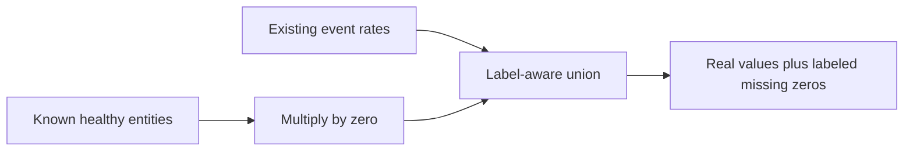

# How to Fill Missing Prometheus Series with Labeled Zeros

Author: [nawazdhandala](https://www.github.com/nawazdhandala)

Tags: Prometheus, Grafana

Description: Use a known label universe for zero filling and avoid turning scrape failures or unknown services into healthy measurements.

`or vector(0)` adds an unlabeled zero. It does not create one zero for every missing service, instance, or status code. To preserve labels, the fallback must come from another vector that already describes the entities you expect.

Zero filling is also a semantic decision. A missing event counter can mean no events have occurred, but it can also mean the exporter failed, a target disappeared, or instrumentation changed. Choose a fallback source whose meaning matches the question and keep telemetry-health checks separate.

## Use the scrape target as a simple universe

For a per-instance counter that is created only after its first event, `up` can supply job and instance labels. Restrict the fallback to successfully scraped targets:

```promql
rate(queue_failures_total{job="worker"}[5m])
or on (job, instance)
(0 * (up{job="worker"} == 1))
```

This works when the event series and fallback have matching identity at the intended grain. If the event metric also has a `queue` label, one `up` series cannot invent every expected queue. You need an inventory metric that names the queues.



## Build a service-level fallback

Aggregate both sides to the same label set before the union. The following assumes an `app_service_info` metric with one or more series per known service:

```promql
sum by (service) (rate(app_failures_total[5m]))
or on (service)
(0 * max by (service) (app_service_info))
```

The info metric is an illustrative application schema, not a built-in Prometheus metric. Its lifecycle matters: if it remains present after a service is retired, the query can display an obsolete zero indefinitely. Connect inventory lifecycle to your deployment or catalog contract.

## Understand why scalar fallback fails

This expression produces a single unlabeled fallback rather than a zero for each missing label set:

```promql
sum by (service) (rate(app_failures_total[5m])) or vector(0)
```

If some services already exist, the unlabeled series can appear as an extra line. It cannot infer that `payments` should exist because PromQL has no inherent catalog of your services.

For a queue-specific example, construct the universe from a queue information metric:

```promql
sum by (service, queue) (rate(queue_failures_total[5m]))
or on (service, queue)
(0 * max by (service, queue) (queue_info))
```

## Keep absence alerts separate

Do not use zero-filled values to decide whether telemetry collection is healthy. Alert on `up == 0`, absent expected targets, or an explicit freshness timestamp independently. An outage should not become a reassuring flat zero because a dashboard fallback hid missing data.

A newly created counter may have fewer than two samples, so `rate()` returns no value even though the series exists. Zero filling can bridge that display interval, but it hides the distinction between insufficient history and an observed zero rate. Document that behavior if the panel drives operational decisions.

## Test label matching deliberately

Create a fixture with three services: one reporting events, one healthy with no event series, and one with failed scraping. The desired output might be a real value, a labeled zero, and no value plus a separate availability alert. Write that contract before changing the query.

Check for duplicate inventory rows and aggregate them with `max by` or another justified operation. Use `on(...)` matching only on labels that uniquely describe the result. Extra labels on the left can still create several series per entity, so inspect the complete output label set.

For bounded status counters, preinitializing known label combinations in instrumentation is often simpler. For dynamic entities, a deliberate inventory vector is more flexible. In either case, the zero should mean something you can explain, not merely fill an unattractive gap in a chart.

## References

The [community question](https://stackoverflow.com/questions/69410425/time-series-from-prometheus-source-how-to-set-nulls-as-zero) motivated this investigation. The implementation references are [official reference 1](https://prometheus.io/docs/prometheus/latest/querying/operators/), [official reference 2](https://prometheus.io/docs/prometheus/latest/querying/functions/).
