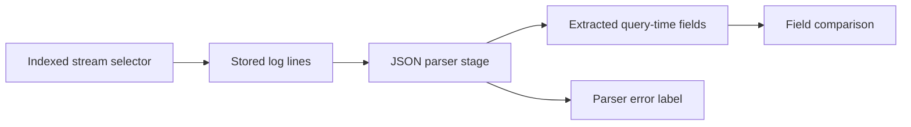

# How to Filter JSON Fields in LogQL When Grafana Does Not Detect Them

Author: [nawazdhandala](https://www.github.com/nawazdhandala)

Tags: Loki, Grafana

Description: Parse JSON explicitly, inspect nested fields and parser errors, and distinguish query-time extraction from indexed Loki labels.

Grafana's detected fields are a convenience in the interface. They are not a prerequisite for filtering a JSON field in LogQL. A query can parse the log line explicitly and compare the extracted value, even when the field list is incomplete or the sample displayed by Grafana does not contain that key.

First determine what Loki actually stores as the line. A JSON object, a JSON string containing another JSON object, and plain text with a JSON suffix need different parsing steps.

## Start with a known line shape

Assume the stored line is this JSON object:

```json
{
  "level": "error",
  "message": "request rejected",
  "http": {"status": 403},
  "tenant": "alpha",
  "duration_ms": 84
}
```

Use an existing stream label selector to restrict the search, then parse and filter:

```logql
{app="gateway"}
  | json
  | __error__=""
  | tenant="alpha"
```

The parsed field is available after the JSON stage. Putting `tenant="alpha"` inside the initial selector would require `tenant` to be an indexed stream label, which is a separate ingestion choice.



## Extract nested fields explicitly

Automatic extraction can flatten nested names, but an explicit parser expression makes the intended field name clear and avoids ambiguity:

```logql
{app="gateway"}
  | json http_status="http.status", elapsed="duration_ms"
  | __error__=""
  | http_status >= 400
  | elapsed > 50
```

Numeric comparisons require values that can be interpreted numerically. A string such as `"84ms"` needs duration-aware handling rather than the numeric comparison used for `84`. Inspect errors after the relevant conversion stage instead of assuming every record has the same schema.

Use line formatting to verify what was extracted:

```logql
{app="gateway"}
  | json tenant="tenant", http_status="http.status"
  | line_format "tenant={{.tenant}} status={{.http_status}}"
```

This changes the displayed line for the query; it does not rewrite stored logs. Keep the original line accessible when investigating parsing discrepancies.

## Handle wrappers and malformed records

Container collection can store a wrapper object whose `log` field contains the application JSON as a string. In that case, parse the wrapper, expose the inner string with a line-format stage, and parse again. Verify the exact wrapper field rather than copying a two-stage parser into every query.

A log stream may mix JSON and non-JSON startup messages. The JSON stage can attach a parser error to malformed lines. Filtering `__error__=""` keeps successfully parsed records, but it also excludes evidence about broken logging. Run a separate query for parser failures when diagnosing a schema rollout.

If a parsed field collides with an existing stream label, Loki can rename the extracted label with a suffix. Inspect the query output or use an explicit extraction alias to avoid filtering the wrong field.

## Keep labels bounded and queries selective

Promoting every JSON field to a stream label is not necessary for query-time filtering. High-cardinality fields such as request IDs and customer-supplied values can create excessive streams. Keep indexed labels focused on stable operational dimensions and parse detailed fields during investigation.

For a large search, narrow namespace, application, and time range first. A JSON field filter usually requires reading the selected log content, so a query returning only one line can still scan a large volume.

Finally, save a small set of representative lines and queries as a regression fixture: valid nested JSON, a missing field, a string-typed number, and a malformed line. That makes field-filter behavior explicit and prevents a dashboard's detected-field list from being mistaken for the authoritative schema of your logs.

## References

The [community question](https://stackoverflow.com/questions/72055752/loki-parse-json-and-filter-by-field) motivated this investigation. The implementation references are [official reference 1](https://grafana.com/docs/loki/latest/query/log_queries/).
