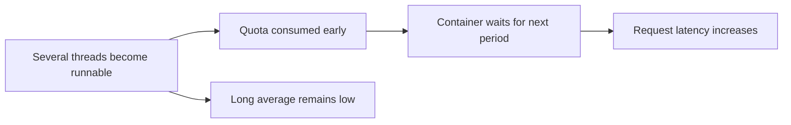

# How to Find CPU Bursts Behind Kubernetes Throttling and Low Average Usage

Author: [nawazdhandala](https://www.github.com/nawazdhandala)

Tags: Kubernetes, Prometheus

Description: Compare quota periods, throttled periods, and short-window CPU rates to explain latency despite low average container CPU.

A container can average a fraction of a CPU over one minute and still be throttled during short bursts. CPU limits are enforced over much shorter scheduling periods. Several runnable threads can consume the period's quota quickly, then wait until capacity is replenished.

The dashboard average hides this timing. Diagnose throttling using enforcement counters and application latency, not only a smoothed CPU utilization line. The examples assume Linux containers and cAdvisor metrics exposed by the kubelet.

## Compare throttled periods with total periods

Start with the fraction of enforcement periods that experienced throttling:

```promql
sum by (namespace, pod, container) (
  rate(container_cpu_cfs_throttled_periods_total{container!="",container!="POD"}[5m])
)
/
sum by (namespace, pod, container) (
  rate(container_cpu_cfs_periods_total{container!="",container!="POD"}[5m])
)
```

This is a fraction of periods, not the fraction of all wall time lost and not the fraction of CPU demand denied. A period with brief throttling counts as throttled just like one with a long pause. Interpret it alongside latency and throttled duration.

Compare a shorter CPU window with the usual dashboard window:

```promql
sum by (namespace, pod, container) (
  rate(container_cpu_usage_seconds_total{container!="",container!="POD"}[1m])
)
```

The value is CPU cores consumed on average. A one-minute window still cannot reveal every subsecond burst, but it may expose peaks hidden by a fifteen-minute panel.



## Inspect the actual cgroup limit

On a cgroup v2 system, read these files from the target container's cgroup. The visible root may represent that container inside its cgroup namespace; verify the path rather than assuming the node root is correct.

```bash
cat /sys/fs/cgroup/cpu.max
cat /sys/fs/cgroup/cpu.stat
cat /sys/fs/cgroup/cpu.pressure
```

A value such as `50000 100000` in `cpu.max` represents a 0.5-CPU bandwidth limit over the specified period. `max` indicates no bandwidth quota at that level, but an ancestor can still impose a limit. Read the hierarchy when the observed behavior contradicts the container's own file.

## Test a change against the latency problem

An illustrative resource fragment gives a service room to burst while retaining a smaller scheduling request:

```yaml
resources:
  requests:
    cpu: 250m
  limits:
    cpu: "1"
```

This is not a universal recommendation. Requests influence scheduling and relative CPU allocation under contention; limits cap CPU bandwidth. Increasing a limit can help quota-driven bursts, but it cannot create physical CPU capacity on an overloaded node.

In staging, compare the same request load with the current limit and a measured higher limit. Record tail latency, throttled periods, CPU usage, and node pressure. If latency improves while throttling falls, the evidence supports quota as a contributor. If latency remains high, inspect run-queue contention, locks, I/O, or downstream dependencies.

## Check runtime concurrency

Thread pools and language runtimes may schedule work according to available CPUs or container limits. Excessive parallelism can spend quota early without increasing useful throughput. Compare queue depth and worker concurrency before simply adding CPU.

A low average CPU metric is especially misleading for bursty request traffic, stop-the-world work, and synchronized batch jobs. Retain a short diagnostic capture around the event, but avoid scraping every container at extreme frequency without a cost budget.

Finally, do not equate every nonzero throttling counter with a user-visible defect. Correlate with service latency and throughput objectives. The actionable finding is that a particular workload's bursts exhaust a specific quota and delay useful work, supported by a controlled comparison.

## References

The [community question](https://stackoverflow.com/questions/54099425/pod-cpu-throttling) motivated this investigation. The implementation references are [official reference 1](https://kubernetes.io/docs/concepts/configuration/manage-resources-containers/), [official reference 2](https://docs.kernel.org/admin-guide/cgroup-v2.html), [official reference 3](https://raw.githubusercontent.com/google/cadvisor/master/docs/storage/prometheus.md).
