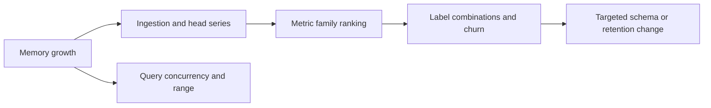

# How to Find Prometheus Memory Costs Before Dropping Labels

Author: [nawazdhandala](https://www.github.com/nawazdhandala)

Tags: Prometheus, Performance

Description: Use TSDB statistics, active-series queries, and churn indicators to locate costly metrics without corrupting series identity.

High Prometheus memory is not explained by one label count alone. Active series, label strings, recent churn, query concurrency, and storage structures all contribute. Begin by separating ingestion growth from query-driven pressure, then identify which metric families and label pairs changed.

Dropping labels before understanding identity can merge distinct samples into the same series. That is not aggregation and can create duplicate timestamps or invalid counters. Treat cardinality analysis as a diagnostic step before choosing a remedy.

## Inspect TSDB statistics

Prometheus exposes head statistics and cardinality information through its status API. Query the server directly from a trusted environment:

```bash
curl --fail --silent http://localhost:9090/api/v1/status/tsdb \
  > tsdb-status.json
```

The response includes lists such as series counts by metric name and label-value counts by label name. These are useful rankings, not precise per-metric resident-memory measurements. Preserve a snapshot before and after a suspected rollout.

Inspect the busiest active metric families within a bounded job:

```promql
topk(20, count by (__name__) ({job="checkout"}))
```

Compare that with the server's head series and series creation rate:

```promql
rate(prometheus_tsdb_head_series_created_total[10m])
```

Verify metric availability in your deployed version. A flat current active count with a high creation rate suggests churn rather than simple growth in simultaneously active series.



## Estimate the multiplication in one metric

For a classic histogram, each label combination produces bucket series plus sum and count. The following local calculation illustrates why a seemingly small new label can be expensive.

```python
services = 20
routes = 50
status_classes = 5
replicas = 8
buckets = 12
series = services * routes * status_classes * replicas * (buckets + 2)
print(series)
assert series == 560000
```

This assumes every combination exists, which is an upper bound for many workloads. Measure actual combinations rather than summing independent distinct-label counts. Correlated dimensions may create fewer combinations; unbounded request IDs can create far more over time.

## Distinguish head cost from historical storage

A label removed today does not immediately remove historical series from retained blocks, and recently inactive series can remain in the head until normal lifecycle cleanup. Evaluate the change over an appropriate interval instead of expecting RSS to fall instantly.

A long-range dashboard or many concurrent cardinality queries can consume memory independently of ingestion. Compare memory changes with query activity and use narrower selectors. Avoid running expensive whole-server diagnostics repeatedly while the server is already under pressure.

If the expensive label is a raw URL, replace it in instrumentation with a route template. If it is a customer or request identifier, move it to logs, traces, or exemplars. If it is a replica identity needed for correctness, retain raw series and create aggregated recording rules for common queries.

## Validate the proposed reduction

Before dropping any label, count how many distinct original series would map to the same remaining label set. If multiple counters collide, aggregate at a supported processing stage or change the source instrumentation. A metric relabel rule that removes the label cannot add their values correctly.

Test the change on one job or canary deployment. Compare ingestion sample rate, active series, creation rate, query results, and scrape errors. Check that dashboards and alerts still distinguish the dimensions they require.

Record the result as a measured reduction in series or resource usage under a specified workload. Avoid claiming a fixed number of bytes per series across all Prometheus versions and metric types. The durable outcome is a bounded label contract with an owner and a cardinality budget that can be checked before the next deployment.

## References

The [community question](https://www.reddit.com/r/devops/comments/16s7hmq/) motivated this investigation. The implementation references are [official reference 1](https://prometheus.io/docs/prometheus/latest/querying/api/), [official reference 2](https://prometheus.io/docs/prometheus/latest/storage/), [official reference 3](https://prometheus.io/docs/practices/naming/).
