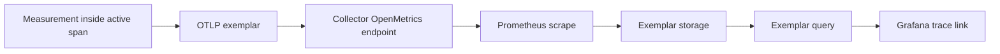

# How to Find Where Prometheus Exemplars Disappear After a Collector

Author: [nawazdhandala](https://www.github.com/nawazdhandala)

Tags: OpenTelemetry, Prometheus

Description: Check exemplar generation, OTLP transport, OpenMetrics exposition, Prometheus storage, and query retrieval one boundary at a time.

A histogram can scrape successfully while its exemplars disappear. Metric samples and exemplars travel together through some stages, but they have different generation, exposition, storage, and query requirements. A healthy scrape target therefore does not prove metric-to-trace links should exist.

Use one known sampled request that records a histogram observation while its span is active. Keep its trace ID and timestamp. Then check each boundary before changing the dashboard.

## Confirm the Collector receives exemplars

Inspect a controlled OTLP metric fixture or a temporary debug export. The datapoint should contain an exemplar with a trace ID, span ID, value, and timestamp. If it does not, troubleshoot the SDK's exemplar filter and the context active during measurement.

An observation made after the request span's scope closes may have no eligible trace context. Likewise, an unsampled trace may be excluded by a trace-based exemplar filter. Increasing Prometheus storage cannot recover exemplars the SDK never produced.



## Enable the required exposition format

For Collector Contrib 0.120.0, the Prometheus exporter needs OpenMetrics enabled to expose exemplars. This fragment is an exporter definition, not a complete metrics pipeline.

```yaml
exporters:
  prometheus:
    endpoint: 0.0.0.0:9464
    enable_open_metrics: true
```

Attach the exporter to the metrics pipeline, then request OpenMetrics explicitly:

```bash
curl --fail --silent \
  -H 'Accept: application/openmetrics-text; version=1.0.0' \
  http://localhost:9464/metrics > metrics.openmetrics
rg 'trace_id|span_id|# EOF' metrics.openmetrics
```

Inspect the response Content-Type as well. A response in the older Prometheus text format can contain normal samples while omitting exemplar annotations. In this Collector version, supported exemplar exposition is limited to histograms and monotonic sums; do not expect every gauge to carry them.

## Query exemplar storage directly

Use Prometheus's exemplar API for a narrow range around the request. Replace the metric and time range with your fixture's actual values.

```bash
curl --fail --silent --get http://localhost:9090/api/v1/query_exemplars \
  --data-urlencode 'query=http_server_request_duration_seconds_bucket' \
  --data-urlencode 'start=2026-11-15T12:00:00Z' \
  --data-urlencode 'end=2026-11-15T12:05:00Z'
```

If the scrape response contains exemplars but this API does not, inspect the deployed Prometheus version, exemplar-storage feature configuration, storage capacity, and scrape protocol negotiation. Feature flags and defaults change across versions, so check the binary's effective flags rather than copying an old startup command uncritically.

If remote write or another metrics backend sits between Prometheus and Grafana, repeat the same check at that boundary. Ordinary sample forwarding does not imply exemplar forwarding is enabled or supported.

## Separate storage from navigation

When the API returns the expected trace ID, the remaining problem is usually Grafana's exemplar-to-trace mapping or the trace backend. Ensure the configured exemplar label matches the actual label name and points to the correct trace data source.

An exemplar can outlive the referenced trace or refer to a trace dropped by downstream tail sampling. In that case, the link is correctly formed but the destination has no trace to display. Align retention and sampling expectations, and document that exemplars are sparse examples rather than a trace for every metric observation.

A useful regression test preserves the observed trace ID, raw OpenMetrics response, and exemplar API response. Those three artifacts identify the disappearing boundary far more precisely than a screenshot of a dashboard without dots.

## References

The [community question](https://stackoverflow.com/questions/79443856/prometheus-not-scraping-exemplars) motivated this investigation. The implementation references are [official reference 1](https://raw.githubusercontent.com/open-telemetry/opentelemetry-collector-contrib/v0.120.0/exporter/prometheusexporter/README.md), [official reference 2](https://prometheus.io/docs/prometheus/latest/querying/api/), [official reference 3](https://prometheus.io/docs/prometheus/latest/feature_flags/).
