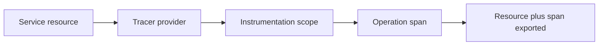

# How to Fix a Go Service Name That Span Attributes Do Not Change

Author: [nawazdhandala](https://www.github.com/nawazdhandala)

Tags: OpenTelemetry, Go

Description: Set service.name on the Go SDK resource, share it across providers, and verify resource merge order before exporting.

Calling `span.SetAttributes` with `service.name` does not change the service resource exported by the Go SDK. It adds an attribute to that individual span. Most backends group services using the resource's service name, so the display can remain unchanged even though the new attribute is visible on the span.

Construct the resource before creating the provider and attach it with `WithResource`. Keep the SDK packages on compatible versions. The examples use the stable Go resource and trace-provider APIs and string attribute keys to avoid tying the tutorial to one semantic-conventions package version.

## Create the resource at startup

This complete helper returns a resource with an explicit service name merged over the SDK's default resource. Imports are included so the merge order is visible.

```go
package telemetry

import (
    "go.opentelemetry.io/otel/attribute"
    "go.opentelemetry.io/otel/sdk/resource"
)

func ServiceResource() (*resource.Resource, error) {
    explicit := resource.NewSchemaless(
        attribute.String("service.name", "inventory-api"),
        attribute.String("service.version", "2026.11.15"),
    )
    return resource.Merge(resource.Default(), explicit)
}
```

When attributes collide, the second resource wins in this merge. Handle the returned error, especially when combining resources with schema URLs. A schemaless explicit resource avoids introducing a second schema URL in this small example, but it does not remove the need to understand schema conflicts in larger setups.

## Attach it to the actual provider

The following startup fragment assumes an exporter has already been initialized and an error handler is available:

```go
res, err := ServiceResource()
if err != nil {
    return err
}
provider := sdktrace.NewTracerProvider(
    sdktrace.WithResource(res),
    sdktrace.WithBatcher(exporter),
)
otel.SetTracerProvider(provider)
```

Import `go.opentelemetry.io/otel` and alias `go.opentelemetry.io/otel/sdk/trace` as `sdktrace`. Shut down the provider during application shutdown with an appropriate timeout so pending telemetry can flush.



A tracer name describes the instrumentation scope, usually a library or package. It is not the service name. Renaming `otel.Tracer("inventory-api")` may change the scope shown in details while leaving service grouping unchanged.

## Verify all configuration sources

If you want environment-driven naming, configure the SDK's resource detection path and avoid overriding it later with a hard-coded resource. The standard variables are:

```bash
export OTEL_SERVICE_NAME=inventory-api
export OTEL_RESOURCE_ATTRIBUTES=service.version=2026.11.15,deployment.environment.name=staging
```

Do not assume these affect a resource built only with `NewSchemaless`; that constructor uses the attributes supplied to it. Check which detector options your application actually invokes and where resource merges happen.

Send one synthetic span to a diagnostic exporter and inspect the resource section. Confirm that no Collector resource processor replaces `service.name` afterward. If the resource is correct but a dashboard still shows the old name, narrow the time range and check whether the query includes historical data.

## Keep identity consistent across signals

Reuse the same resource for the meter provider and logger provider where your application configures them explicitly. Otherwise traces can be grouped under `inventory-api` while metrics retain an unknown or legacy service name.

Avoid constructing a new provider per request. Besides expensive lifecycle management, that can create inconsistent resources, duplicate exporters, and lost shutdown flushes. Initialize telemetry once, then obtain tracers from the shared provider.

A useful regression test exports a span and asserts the resource service name, scope name, and span name independently. Those are three different dimensions: the emitting service, the instrumentation library, and the operation. Keeping them separate makes backend service discovery predictable and avoids spreading a misleading service attribute across every span.

## References

The [community question](https://stackoverflow.com/questions/77755084/set-opentelemetry-span-service-name-in-go) motivated this investigation. The implementation references are [official reference 1](https://opentelemetry.io/docs/languages/go/resources/), [official reference 2](https://opentelemetry.io/docs/specs/semconv/resource/service/).
