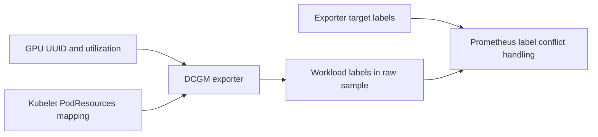

# How to Fix DCGM Metrics That Show the Exporter Pod as the Workload

Author: [nawazdhandala](https://www.github.com/nawazdhandala)

Tags: GPU, Kubernetes, Prometheus

Description: Separate Prometheus target labels from DCGM workload attribution and verify the kubelet PodResources mapping.

A GPU metric labeled with the DCGM exporter Pod can mean two different things. The exporter may lack workload attribution, or Prometheus target labels may have collided with the workload labels already present in the metric. Diagnose the raw exposition before changing the exporter.

DCGM measures GPU hardware. Kubernetes attribution requires mapping allocated devices to Pods and containers, typically through the kubelet PodResources API. A scrape target's Pod identity only tells you where the exporter runs.

## Inspect the raw endpoint

Read one known GPU metric directly from the exporter in a controlled network path:

```bash
curl --fail --silent http://localhost:9400/metrics > dcgm-metrics.txt
rg '^DCGM_FI_DEV_GPU_UTIL' dcgm-metrics.txt
```

Check GPU UUID, device identity, and any `namespace`, `pod`, and `container` labels. Compare this with the same series in Prometheus. If raw output names the workload but Prometheus shows the exporter, inspect label conflicts and relabeling first.

With the usual `honor_labels: false` behavior, conflicting labels from the scraped sample can be renamed with an `exported_` prefix. A query can reveal both identities:

```promql
DCGM_FI_DEV_GPU_UTIL{job="dcgm-exporter"}
```

Inspect the full label set in table view rather than relying on a legend that selects only `pod`.



## Preserve both identities deliberately

One approach is to rename the scrape target's Pod label so it does not collide with the workload label. This fragment belongs in the appropriate scrape configuration:

```yaml
relabel_configs:
  - source_labels: [__meta_kubernetes_pod_name]
    target_label: exporter_pod
```

Ensure another relabel rule does not still create a conflicting `pod` label. Alternatively, carefully use `honor_labels` where the target is trusted and you understand all label conflicts. Do not switch it globally to fix one dashboard.

## Check Kubernetes attribution prerequisites

If raw output lacks workload labels, inspect the exporter's Kubernetes integration configuration and its access to the kubelet PodResources socket. The commonly mounted directory is `/var/lib/kubelet/pod-resources`, but use the path supported by your node configuration and exporter release.

```bash
kubectl -n gpu-operator get daemonsets
kubectl -n gpu-operator describe pod dcgm-exporter-example
kubectl -n training get pod trainer-example -o yaml
```

The names and namespace are examples. Verify the workload actually requests an NVIDIA device through the device plugin and that the exporter runs on the same node. An idle GPU with no allocated workload should not be assigned to the exporter merely to fill empty labels.

Inspect exporter logs for PodResources connection or permission errors. Confirm the device-plugin allocation identifiers match the GPU or MIG entities exported by DCGM. Time slicing, shared GPUs, and MIG require careful interpretation because hardware utilization may not be independently attributable to each sharing process.

## Verify with a known workload

Run a bounded GPU workload in a test namespace and record its Pod, container, node, and allocated device. Compare those values with raw exporter output, then Prometheus, then the dashboard. This sequence identifies whether attribution failed at the source or changed during scraping.

Do not treat duplicated per-Pod labels on one shared device as additive GPU utilization. Summing identical hardware measurements can report more than the device's actual activity. Keep device UUID as the hardware identity and document how sharing affects attribution.

A correct dashboard can display both the exporter instance and the workload owner, but they should have distinct labels. That distinction prevents monitoring infrastructure from appearing to consume every GPU in the cluster.

## References

The [community question](https://stackoverflow.com/questions/69647019/not-getting-pod-gpu-metrics-from-dcgm-exporter) motivated this investigation. The implementation references are [official reference 1](https://docs.nvidia.com/datacenter/dcgm/latest/installation/install-dcgm-exporter.html), [official reference 2](https://docs.nvidia.com/datacenter/dcgm/latest/reference/command-line-reference/dcgm-exporter.html), [official reference 3](https://docs.nvidia.com/datacenter/dcgm/latest/reference/dcgm-exporter-metrics.html).
