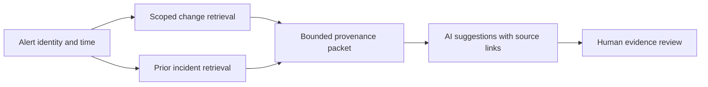

# How to Give AI Incident Assistants Recent Change and Outage Context

Author: [nawazdhandala](https://www.github.com/nawazdhandala)

Tags: AI, Incident Management, Python

Description: Build a bounded context packet with relevant deployments, prior incidents, source timestamps, and explicit trust boundaries for AI-assisted triage.

An incident assistant needs more than the latest alert text. Recent deployments can suggest useful comparisons, and earlier incidents can reveal failed experiments or service-specific pitfalls. But dumping every ticket into a prompt creates stale, contradictory context. Build a bounded packet with provenance, time limits, and explicit relevance criteria.

The examples use Python 3 and internal records. They do not call a model or a deployment API. Start with read-only exports from your existing systems and preserve the identifiers needed to reopen the source. The assistant should propose investigations from this context, not treat a recent deployment as proof of cause.

## Normalize the service identity

Use a stable service identifier shared by alerts, deployment records, runbooks, and incident history. Human names such as payments API and checkout backend may refer to the same system or to different systems. Resolve that mapping before retrieval so the assistant does not combine unrelated outages.

```json
{"service_id":"checkout-api","environment":"prod","region":"eu","alert_time":"2026-11-15T10:00:00Z","context_policy":"incident-context-v2","requested_sources":["deployments","runbooks","prior-incidents"]}
```

Include environment and region because a staging deployment or another region's incident may be irrelevant. Preserve dependency relationships where they matter, but avoid expanding to every service in the organization. A small relevant packet is easier for a responder to review than an exhaustive archive.

## Filter recent changes by availability and scope

The fixture selects deployments for the same service and environment within a two-hour window before the alert. It excludes future changes and unrelated services. Real systems should distinguish rollout start, first affected instance, and completion time rather than storing only one ambiguous timestamp.

```python
from datetime import datetime,timedelta
alert = datetime.fromisoformat("2026-11-15T10:00:00+00:00")
changes = [
 {"id":"d1","service":"checkout-api","env":"prod","time":"2026-11-15T09:30:00+00:00"},
 {"id":"d2","service":"catalog","env":"prod","time":"2026-11-15T09:45:00+00:00"},
 {"id":"d3","service":"checkout-api","env":"prod","time":"2026-11-15T11:00:00+00:00"},
]
selected = [c["id"] for c in changes if c["service"] == "checkout-api" and c["env"] == "prod"
            and alert-timedelta(hours=2) <= datetime.fromisoformat(c["time"]) <= alert]
print(selected)
assert selected == ["d1"]
```

## Retrieve prior incidents by mechanism, not just wording

Search by service, dependency, symptom class, and failure scope. A previous connection timeout caused by DNS differs from one caused by pool saturation, despite similar text. Return the evidence and failed attempts alongside the final mitigation so the assistant can distinguish the mechanisms.

```yaml
# Internal prior-incident context entry.
incident_id: inc-31
service_id: checkout-api
symptom: connection-acquisition-timeout
mechanism: pool-exhaustion
relevant_versions: [release-190, release-191]
failed_attempt: restarting one worker
successful_mitigation: reduce concurrency
source: incidents/inc-31
reviewed_at: 2026-10-10T12:00:00Z
```



## Make uncertainty and trust boundaries explicit

Mark stale runbooks, incomplete deployment logs, and inaccessible evidence. An unavailable source should appear as missing context, not silently disappear. Keep retrieved text in a data section and ensure it cannot redefine tool permissions or operational policy. Logs and tickets may contain instructions or secrets that are not appropriate to follow or repeat.

Limit packet size with a documented ranking rule: exact service and environment first, then time proximity and mechanism similarity. Preserve a list of omitted sources so reviewers know what the assistant did not see. Avoid trimming the contradictory evidence merely because it is less convenient than the suspected deployment.

Test the packet with a known incident and inspect it before invoking any model. Confirm that all records were available at the alert time, source links resolve, and unrelated changes are excluded. Then evaluate whether the assistant proposes a useful comparison rather than declaring the newest change guilty. Context retrieval succeeds when it narrows the next investigation while keeping the underlying evidence and uncertainty visible.

Represent change absence carefully. A packet containing no deployment records can mean no changes occurred, the source was unavailable, or the query searched the wrong service identity. Include source health and query coverage in the packet so these cases remain distinguishable. The same rule applies to prior incidents: no retrieved match is not proof that the failure has never happened. Keep a clear path for the responder to broaden the search deliberately.

## References

The [community question](https://www.reddit.com/r/devops/comments/1o5w30f/anyone_else_experimenting_with_ai_assisted_on/) motivated this walkthrough. Implementation references:

- [Official reference 1](https://sre.google/sre-book/effective-troubleshooting/)
- [Official reference 2](https://sre.google/workbook/incident-response/)
- [Official reference 3](https://docs.python.org/3/library/datetime.html)
