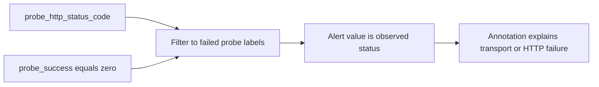

# How to Include HTTP Status Codes in Blackbox Probe Alerts

Author: [nawazdhandala](https://www.github.com/nawazdhandala)

Tags: Prometheus, Alertmanager, Monitoring

Description: Carry the HTTP status metric into a failed-probe alert value while preserving transport failures and stable alert identity.

An alert based on `probe_success == 0` has a value of zero, so printing `$value` does not reveal the HTTP response code. Use the HTTP status metric as the returned value while filtering it to failed probes. Keep the status in an annotation so a changing response code does not create a new alert identity.

This example assumes Blackbox Exporter HTTP probes scraped under `job="blackbox-http"` and a unique `instance` per target within that job. If the same target is probed from multiple locations or modules, include those labels in vector matching. The metric names are exported by Blackbox Exporter, while job and location labels depend on your scrape configuration.

## Select the status value for failed probes

The `and` operator keeps the left-hand sample and value when matching right-hand samples exist. That lets the alert carry the HTTP status while using `probe_success` to determine failure. The comparison must filter, not use `bool`, because a Boolean zero series would still exist for successful probes.

```promql
probe_http_status_code{job="blackbox-http"}
and on (job, instance)
(probe_success{job="blackbox-http"} == 0)
```

A returned value of zero is still an active vector element and can fire an alert. It normally means no usable HTTP status was obtained, such as a DNS, TCP, TLS, or timeout failure. Do not label it HTTP 0 as if zero were a real protocol status code.

## Put the value in the message

The rule below describes zero explicitly and keeps alert labels stable. Add your actual service and owner labels through the scrape configuration or rule labels. Ensure the selected status metric is present for the HTTP module you use.

```yaml
groups:
  - name: blackbox-http
    rules:
      - alert: HttpProbeFailed
        expr: |
          probe_http_status_code{job="blackbox-http"}
          and on (job, instance)
          (probe_success{job="blackbox-http"} == 0)
        for: 2m
        labels:
          severity: critical
        annotations:
          summary: 'HTTP probe failed for {{ $labels.instance }}'
          description: 'Observed status {{ $value }}. Zero means no HTTP status was received.'
```

A failed probe can still have status 200 when a body check or another module requirement fails. The message should say probe failed with observed status, not assume every failure is a non-2xx response. Link the runbook to the module definition and debug procedure.



## Verify label matching with a fixture

The following Python illustration mirrors the selection idea for three targets. It is not a PromQL evaluator, but it makes the expected output clear: retain the failing HTTP response and the transport failure, and omit the healthy target.

```python
status = {"healthy":200,"forbidden":403,"dns-failure":0}
success = {"healthy":1,"forbidden":0,"dns-failure":0}
alerts = {target:code for target,code in status.items() if success.get(target) == 0}
print(alerts)
assert alerts == {"forbidden":403,"dns-failure":0}
```

## Preserve independent exporter monitoring

If Prometheus cannot scrape the exporter, both probe metrics can disappear and this alert may have no input. Alert separately on exporter scrape failure and unexpected target disappearance. The status-enriched rule is not a replacement for monitoring the monitoring path.

Test HTTP 403, HTTP 500, DNS failure, TLS failure, a successful page, and a body-validation failure returning 200. Check the actual annotation rendering in a test receiver. If the expression returns no data for a known failed target, inspect label sets before changing the query: mismatched module or location labels are common causes.

Finally, keep status out of grouping labels unless separate groups by response code are a deliberate operational choice. A target moving from 503 to timeout should remain one ongoing target incident with updated evidence, rather than a stream of new alerts created by changing labels.

If several probes share a target URL, retain a bounded location or module label in both metrics and in the matching clause. Otherwise a status from one probe can be paired with failure evidence from another, producing a misleading annotation. Inspect the actual label sets in the expression browser and test the same URL from two locations with different outcomes. The alert should identify the failing observation point, not merely the shared destination string.

## References

The [community question](https://stackoverflow.com/questions/57022903/blackbox-exporter-alert-with-value-of-the-probe-http-status-code-metric) motivated this walkthrough. Implementation references:

- [Official reference 1](https://github.com/prometheus/blackbox_exporter/blob/master/README.md)
- [Official reference 2](https://prometheus.io/docs/prometheus/latest/querying/operators/)
- [Official reference 3](https://prometheus.io/docs/prometheus/latest/configuration/alerting_rules/)
