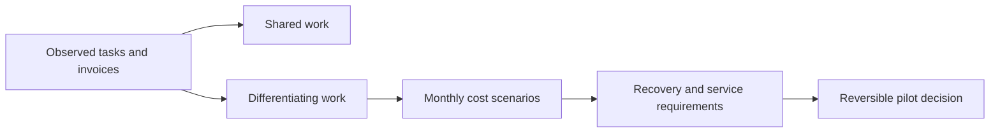

# How to Include Self-Hosting Work in Observability Cost Comparisons

Author: [nawazdhandala](https://www.github.com/nawazdhandala)

Tags: Observability, SRE, Python

Description: Model upgrades, incidents, recovery drills, and engineering time alongside infrastructure when comparing hosted and self-hosted observability.

A self-hosted observability stack can have a smaller infrastructure bill and a larger total operating cost. The reverse can also be true. A useful comparison makes engineering work visible and keeps measured expenses separate from assumptions. Treat the system as a production service with owners, upgrades, failures, and recovery requirements.

This walkthrough uses a simple CSV-style inventory and Python 3 arithmetic. It does not use vendor list prices or claim that one hosting model is universally cheaper. The goal is a reviewable monthly model that can be updated after a pilot instead of a spreadsheet that hides labor in a single unexplained percentage.

## Inventory recurring work

List the activities required to meet your own service expectations. Include version upgrades, capacity review, authentication changes, certificate rotation, backup verification, restore drills, and support for broken dashboards. Distinguish recurring manual work from one-time engineering that reduces future work. Google's SRE discussion of toil provides a useful vocabulary for that distinction.

```csv
activity,hours_per_month,owner,evidence
upgrades,6,platform,change-records
capacity-review,2,platform,monthly-review
incident-response,5,oncall,incident-log
restore-drill,3,platform,drill-report
user-support,4,observability,support-queue
```

Record time over several weeks and include interruptions. An engineer spending ten minutes on six failed scrape targets has done an hour of work even if no ticket was created. Avoid treating every minute of platform work as a hosting penalty: some instrumentation and dashboard work exists under either model.

## Separate shared costs from differentiating costs

Calculate costs that differ between the options. Both may require application instrumentation, alert design, and data governance. Self-hosting may add operational ownership; a hosted service may add data-transfer, support-plan, or integration costs. Migration effort should be shown separately and amortized over an explicit decision horizon.

```python
hourly_cost = 110
self_infra = 950
self_hours = 20
hosted_subscription = 2500
hosted_hours = 6
migration_cost = 7200
horizon_months = 24
self_monthly = self_infra + self_hours*hourly_cost
hosted_monthly = hosted_subscription + hosted_hours*hourly_cost + migration_cost/horizon_months
print({"self_hosted":self_monthly,"hosted":hosted_monthly})
assert self_monthly == 3150 and hosted_monthly == 3460
```

These invented inputs make the options relatively close. They are a scenario, not an observed result. Change the loaded hourly cost, support effort, and infrastructure budget to match your organization. Show a cash-only view as well if staffing costs cannot change in the decision period; opportunity cost and immediate cash savings answer different questions.



## Price the service level you actually need

A single local Prometheus server is not equivalent to a multi-region managed service. Compare retention, query availability, recovery time, support, and data durability explicitly. If the self-hosted plan needs replicas, object storage, backups, and a standby environment, include them. If the hosted plan does not meet a required feature, include the workaround or mark the option infeasible.

```python
base_infra = 950
hourly_cost = 110
for maintenance_hours in [10,20,35]:
    total = base_infra + maintenance_hours*hourly_cost
    print(f"{maintenance_hours} hours: {total} currency units/month")
assert base_infra + 35*hourly_cost == 4800
```

The sensitivity table shows where the decision depends on uncertain labor. Perform the same exercise for ingestion growth and retained volume. Do not collapse all uncertainty into a precise annual total; give a range and identify the two assumptions that change the outcome most.

## Validate maintenance assumptions with a pilot

Run an upgrade, restore a backup into an isolated environment, rotate a credential, and simulate loss of a collector. Record elapsed engineering time and actual recovery behavior. A system that has never been restored should not receive a zero-hour recovery budget. Likewise, measure the hosted service's onboarding and support effort rather than assuming it is zero.

Finish with an ownership decision. Someone must maintain the instrumentation, access policy, alert rules, and cost guardrails in either model. Review the model after the first quarter using actual invoices and work records. The best comparison explains what service is being purchased, who operates the remaining pieces, and which future changes would justify revisiting the choice.

## References

The [community question](https://www.reddit.com/r/devops/comments/1og42rk/how_do_smaller_teams_manage_observability_costs/) motivated this walkthrough. Implementation references:

- [Official reference 1](https://sre.google/sre-book/eliminating-toil/)
- [Official reference 2](https://prometheus.io/docs/prometheus/latest/storage/)
