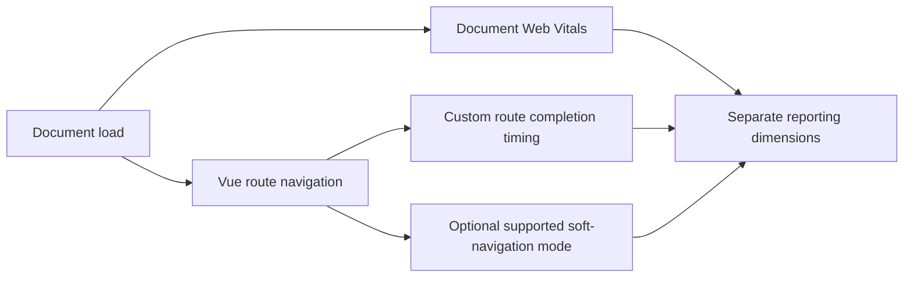

# How to Interpret Core Web Vitals Across Vue SPA Route Changes

Author: [nawazdhandala](https://www.github.com/nawazdhandala)

Tags: Vue.js, JavaScript, Monitoring

Description: Separate document Web Vitals from Vue route timings, preserve metric identity, and evaluate soft-navigation support as a distinct reporting mode.

A Vue Router navigation usually changes the URL without creating a new document. Traditional Core Web Vitals measurement follows the document lifecycle, so calling the registration functions again after every route change does not create valid independent page-load metrics. Keep document metrics, route-transition timings, and any supported soft-navigation metrics explicitly separated.

The baseline below uses Vue 3, Vue Router 4, and the standard `web-vitals` callbacks. Pin the package version in your lockfile. The current upstream documentation also describes a separate soft-navigation reporting path with browser and package requirements; evaluate that path deliberately rather than assuming every installed browser and library supports it.

## Register document metrics once

Install the callbacks during application startup. Preserve the library's metric ID so repeated reports can update the same observation. Capture the entry path once for document attribution; reading the current URL when a late callback fires can incorrectly assign a document metric to a later route.

```javascript
import { onCLS, onINP, onLCP } from 'web-vitals';
const entryPath = location.pathname;
function report(metric) {
  const payload = {
    scope: 'document', entryPath,
    name: metric.name, id: metric.id, value: metric.value,
    navigationType: metric.navigationType,
  };
  navigator.sendBeacon('/rum', JSON.stringify(payload));
}
onCLS(report);
onINP(report);
onLCP(report);
```

Normalize route paths before sending them if they contain customer IDs or other sensitive values. The `/rum` endpoint is your own ingestion service, not a built-in library API. It must validate payloads, apply sampling and retention policies, and deduplicate updates by metric identity.

## Measure route transitions with a separate name

Router hooks can measure the interval between navigation start and completion, but completion does not necessarily mean all data and images are ready. The following fragment measures router completion only. Call a separate application readiness marker if the product needs a data-ready metric.

```javascript
// Fragment after creating your Vue Router instance.
let routeStart;
router.beforeEach(() => { routeStart = performance.now(); });
router.afterEach((to, from, failure) => {
  if (failure || routeStart === undefined) return;
  navigator.sendBeacon('/rum', JSON.stringify({
    scope: 'route', name: 'router_completion_ms',
    route: String(to.name ?? 'unnamed'),
    value: performance.now() - routeStart,
  }));
  routeStart = undefined;
});
```

This minimal example assumes one active navigation measurement. Production code should handle overlapping or redirected navigations with an identifier and explicit cancellation. Do not label this value LCP: it measures a different boundary and has no automatic relationship to the largest contentful paint.



## Preserve measurement mode in storage

The internal record below makes comparison boundaries explicit. A route timing should not be pooled with document LCP values merely because both use milliseconds. Likewise, soft-navigation and hard-navigation distributions can describe different rendering work.

```json
{"metric":"router_completion_ms","scope":"route","route":"checkout","value":180,"release":"web-208","measurement_version":"route-v1"}
```

## Evaluate soft-navigation support carefully

The upstream `web-vitals` documentation currently describes `reportSoftNavs` through its soft-navigation build and browser support beginning with Chromium 151. It also documents `navigationURL` and a soft-navigation type for attribution. Verify the exact package build and browser support matrix before adopting those options. Unsupported browsers can retain traditional behavior, so mixed populations need a measurement-mode dimension.

A browser-defined soft navigation is not identical to every Vue Router event. Interactions, URL changes, and rendering determine detection, and some application transitions may not qualify. Keep custom route readiness measurements for product-specific boundaries even if browser soft-navigation metrics are enabled.

Test a hard load, two client-side routes, back navigation, and a route with delayed data. Inspect metric IDs, attribution, and duplicate reports. The dashboard should answer which lifecycle each metric describes and avoid implying that a single document's INP or CLS resets on every route unless the supported measurement mode actually does so.

Treat callback delivery as an update stream rather than a guarantee of one event per visit. Visibility changes and lifecycle events can cause metrics to be reported at different times, and a navigation may end before every expected measurement is available. Store the metric identifier and reporting mode, and define whether ingestion overwrites the latest value or accumulates documented deltas. Mixing those two ingestion strategies can double-count values even when the browser measurement itself is correct.

## References

The [community question](https://stackoverflow.com/questions/76341639/how-to-collect-core-web-vitals-for-spa-vue-application) motivated this walkthrough. Implementation references:

- [Official reference 1](https://github.com/GoogleChrome/web-vitals)
- [Official reference 2](https://web.dev/articles/vitals)
- [Official reference 3](https://router.vuejs.org/guide/advanced/navigation-guards.html)
