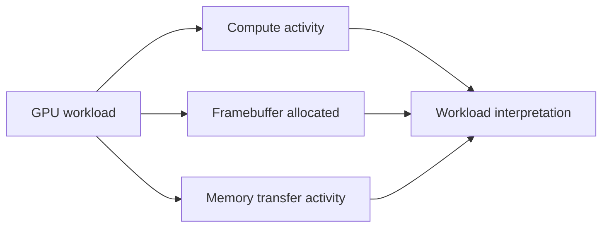

# How to Interpret GPU Compute and Memory Metrics for Idle Node Pools

Author: [nawazdhandala](https://www.github.com/nawazdhandala)

Tags: GPU, Kubernetes

Description: Distinguish GPU activity, memory allocation, and memory bandwidth before deciding a Kubernetes GPU pool is underutilized.

GPU compute utilization, framebuffer memory usage, and memory activity answer different questions. A model can reserve most of GPU memory while running little computation. Another workload can keep the device active while using a modest allocation. Neither pattern alone proves that a node pool can be safely downsized.

Identify the exact DCGM fields, their units, and hardware support. Missing or sentinel values must not be treated as real percentages. MIG, shared GPUs, and device-level aggregation can further change what a series represents.

## Inspect compute activity and allocation separately

For a device-level view, graph compute utilization by UUID:

```promql
avg by (UUID) (DCGM_FI_DEV_GPU_UTIL)
```

Then calculate the fraction of framebuffer memory allocated, when both fields are available:

```promql
max by (UUID) (DCGM_FI_DEV_FB_USED)
/
(
  max by (UUID) (DCGM_FI_DEV_FB_USED)
  + max by (UUID) (DCGM_FI_DEV_FB_FREE)
)
```

The memory fields use the same unit, so the ratio is dimensionless. Ensure the series refer to the same physical GPU or MIG entity and scrape time. `max` here avoids summing duplicate attributed copies; it is not a universal deduplication strategy for every exporter topology.



## Do not call allocation memory utilization

A memory-copy activity field or profiling DRAM activity field describes activity, not the fraction of bytes allocated. Inspect the selected field separately:

```promql
avg by (UUID) (DCGM_FI_DEV_MEM_COPY_UTIL)
```

A workload with high allocated memory and low compute can be holding a loaded model between requests. High memory-transfer activity with lower compute can indicate bandwidth-heavy work. Some profiling fields require supported hardware and configuration, so check the exporter metric list and field documentation before adding them to a dashboard.

GPU utilization is also not a universal percentage of theoretical FLOPS. It is an activity measure over the sampling interval. Short kernels, launch gaps, and the workload's arithmetic intensity affect its interpretation.

## Separate idle allocation from insufficient demand

Join device ownership with workload state and application throughput. An inference service may intentionally keep warm replicas for latency, while a training job may be stalled on input or synchronization. The same low utilization value can therefore imply very different actions.

Use a simple inventory table in your analysis, with one row per device or MIG entity:

```text
device_uuid | allocated_workload | ready | request_rate | gpu_activity | memory_allocated
GPU-example | inference-api      | true  | low          | low          | high
```

This is an illustrative analysis schema. Populate it from your own metrics and Kubernetes inventory, preserving timestamps. A device that is unallocated should be distinguished from an allocated device waiting for useful work.

## Evaluate node-pool changes against constraints

Before consolidating workloads, check GPU memory headroom, device compatibility, topology, quotas, availability requirements, and whether workloads support sharing. High memory allocation can prevent co-location even when compute is idle. Time slicing does not provide the same memory isolation or accounting as MIG.

Measure peak demand and queueing, not only a daily average. Removing warm inference replicas can increase cold-start and model-load latency. Reducing training capacity can extend job completion time even when average utilization looks low because the workload has unavoidable noncompute phases.

Run a controlled placement or replica experiment and compare useful throughput, tail latency, job duration, and errors. Record hardware and model versions so the result is reproducible. Do not promise a cost reduction from one utilization chart.

A useful dashboard names each measure precisely: compute activity, framebuffer allocation, and memory activity. With workload ownership and demand alongside them, operators can distinguish avoidable idle capacity from intentional reserves and bottlenecks outside the GPU.

## References

The [community question](https://www.reddit.com/r/kubernetes/comments/1mupefq/gke_gpu_optimisation/) motivated this investigation. The implementation references are [official reference 1](https://docs.nvidia.com/datacenter/dcgm/latest/reference/dcgm-exporter-metrics.html), [official reference 2](https://docs.nvidia.com/datacenter/dcgm/latest/dcgm-api/dcgm-api-field-ids.html), [official reference 3](https://docs.nvidia.com/datacenter/dcgm/latest/installation/install-dcgm-exporter.html).
