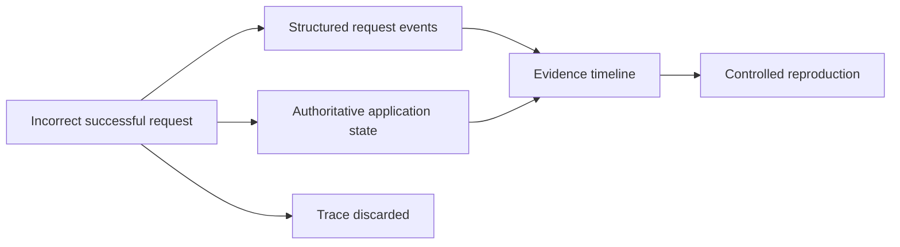

# How to Investigate Incorrect Requests When Their Traces Were Sampled Out

Author: [nawazdhandala](https://www.github.com/nawazdhandala)

Tags: OpenTelemetry, Observability

Description: Reconstruct an incorrect successful request from durable evidence, then add domain-aware capture for the next occurrence.

A request can return HTTP 200 while producing the wrong price, selecting the wrong tenant, or omitting an item. Error-based sampling may discard it because the transport succeeded. If the spans were never exported or were deliberately dropped, changing the sampling policy afterward cannot reconstruct them.

The investigation should first separate absence from retrieval failure. A trace might still exist under another service name, time range, tenant, or retention tier. Once sampling loss is confirmed, use independent evidence and design a targeted way to capture the next occurrence.

## Search using durable request identity

Use an application request ID or business-operation ID that exists in structured logs and authoritative records. A trace ID is useful when present, but it should not be the only identifier for customer support or transaction reconciliation.

This illustrative structured event records a business invariant without storing the whole request body:

```json
{
  "event": "quote.completed",
  "request_id": "req-42",
  "quote_id": "quote-901",
  "service_version": "2026.11.15.3",
  "currency": "GBP",
  "item_count": 3,
  "invariant_valid": false,
  "reason_code": "TOTAL_MISMATCH"
}
```

Use stable reason codes and redacted identifiers. Avoid logging credentials, full customer payloads, or sensitive financial details merely because a trace is missing. Establish which evidence is authoritative: a cache response log and a committed database row can legitimately describe different moments.

## Build a timeline from what actually exists

Export the relevant events into a local JSON array with timestamp, source, and request ID. Sort them while retaining the source clock and delivery delay caveats.

```python
import json
from pathlib import Path
rows = json.loads(Path("request-events.json").read_text())
matching = [r for r in rows if r.get("request_id") == "req-42"]
for row in sorted(matching, key=lambda r: r["timestamp"]):
    print(row["timestamp"], row["source"], row["event"])
```

ISO timestamps must use a consistent sortable format, preferably UTC. Across hosts, apparent order can be affected by clock skew. Use causal IDs, database commit order, or message sequence numbers when those are available rather than treating wall-clock order as proof.



Compare the deployment version, feature flags, input classification, cache state, and downstream responses with a correct request. Metrics can show whether the incident coincided with a rollout or dependency slowdown, but aggregate metrics cannot reveal the exact missing payload.

## Capture domain failures explicitly

Instrument the violated invariant at the point it is detected. Marking a business outcome with a dedicated attribute is often clearer than redefining every HTTP 200 as a transport error. A Collector Contrib 0.120.0 policy can retain that evidence:

```yaml
processors:
  tail_sampling:
    decision_wait: 20s
    num_traces: 25000
    policies:
      - name: invalid-business-result
        type: boolean_attribute
        boolean_attribute:
          key: app.invariant_failed
          value: true
      - name: healthy-comparison
        type: probabilistic
        probabilistic:
          sampling_percentage: 2
```

The attribute must reach the sampler before its decision. If the failure is discovered minutes later by reconciliation, correlate a new diagnostic trace or event with the original business ID instead of assuming the old trace can be resurrected.

## Validate the next-occurrence plan

Create a safe fixture that triggers the invariant, and verify its record, log, metric, and retained trace agree. Also test a valid result with the same HTTP status to confirm the policy distinguishes the domain outcome. Keep a baseline sample for comparison.

Record conclusions with confidence levels: observed facts, supported hypotheses, and missing evidence. The absence of a trace is not proof that a downstream call did not occur. A useful post-incident improvement makes the next investigation answerable while keeping diagnostic data proportional and protecting sensitive request content.

## References

The [community question](https://www.reddit.com/r/kubernetes/comments/1vk2v5t/how_do_you_debug_a_specific_request_when_the/) motivated this investigation. The implementation references are [official reference 1](https://opentelemetry.io/docs/concepts/sampling/), [official reference 2](https://raw.githubusercontent.com/open-telemetry/opentelemetry-collector-contrib/v0.120.0/processor/tailsamplingprocessor/README.md).
