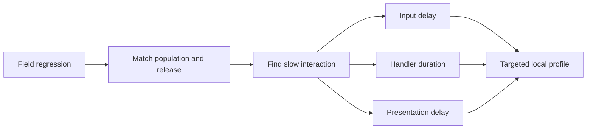

# How to Investigate INP Regressions Seen Only in Field Data

Author: [nawazdhandala](https://www.github.com/nawazdhandala)

Tags: JavaScript, Monitoring, Observability

Description: Align field and lab populations, collect INP attribution, and reproduce the slow interaction phase rather than comparing unrelated headline scores.

A fast local interaction does not contradict poor field INP. Real users may have slower devices, longer sessions, different routes, extensions, third-party scripts, or interactions your test never performs. First align the populations and measurement windows, then identify which interaction and which part of its latency is slow.

Use a pinned `web-vitals` package with its attribution build and a controlled RUM endpoint. The examples avoid sending DOM text or raw selectors. INP concerns qualifying interactions over a page visit, not merely initial load. A load-only lab run may never exercise the interaction that dominates field data.

## Compare equivalent populations

Check whether the field report is URL-level or origin-level, mobile or desktop, and which collection period it covers. CrUX has eligibility rules and a population that may differ from your own RUM. Compare percentiles of per-visit measurements, not an average of a few manual clicks against a field percentile.

```json
{"comparison":"checkout-inp","field_scope":"URL","device_class":"mobile","release":"web-208","interaction":"open-payment-methods","lab_scenario":"warm session after three route changes"}
```

The record is an internal investigation plan. Fill it with actual report metadata rather than assuming every tool uses the same URL grouping. A deployment improvement can also take time to dominate a rolling field-data window, so keep release-specific RUM beside the broader report.

## Capture latency subparts

The attribution build separates input delay, event-processing duration, and presentation delay. These fields help decide whether the main thread was busy before the handler, the handler itself was expensive, or rendering delayed the next paint.

```javascript
import { onINP } from 'web-vitals/attribution';
onINP(metric => {
  const a = metric.attribution;
  navigator.sendBeacon('/rum', JSON.stringify({
    name: metric.name, id: metric.id, value: metric.value,
    inputDelay: a.inputDelay,
    processingDuration: a.processingDuration,
    presentationDelay: a.presentationDelay,
    interactionType: a.interactionType,
    loadState: a.loadState,
  }));
});
```

Do not serialize the entire attribution object blindly. It can contain detailed entries, URLs, or selectors that need privacy review and size limits. Add a bounded application interaction name through your own instrumentation when necessary. Metric callbacks may update the same metric ID, so avoid counting each update as a new visit.



## Read a representative breakdown

The fixture identifies the largest subpart in a synthetic interaction. It does not compute INP from raw browser events; the browser and library provide the measured candidate. Use it to demonstrate how a total can point toward different work.

```python
parts = {"input_delay":180,"processing":40,"presentation":80}
print({"total_ms":sum(parts.values()),"largest_phase":max(parts,key=parts.get)})
assert sum(parts.values()) == 300
assert max(parts,key=parts.get) == "input_delay"
```

In this example, optimizing the click handler alone targets only forty milliseconds. Investigate long tasks or competing scripts before the handler for the larger input delay. For a presentation-dominated interaction, inspect style recalculation, layout, paint, and rendering work instead.

## Reproduce the actual session shape

Use the affected device class, route sequence, account state, and third-party features. Include interactions during loading and after a long session. CPU throttling can help expose scheduling problems, but it is not a perfect simulation of every device. Capture a performance profile around the specific interaction and compare it with field attribution.

Change one suspected mechanism at a time, then verify both the local profile and release-specific field distribution. Watch for traffic-mix changes that make the aggregate improve without helping the affected users. Report sample counts and missing measurements, especially for visits with no qualifying interaction.

A useful investigation ends with a reproducible interaction, a measured dominant phase, and evidence that the shipped change improved that phase for the relevant users. It does not end with choosing whichever tool reports the lowest number.

## References

The [community question](https://stackoverflow.com/questions/79263877/inp-is-over-300-according-to-google-but-lower-than-100-in-other-tools-and-real) motivated this walkthrough. Implementation references:

- [Official reference 1](https://web.dev/articles/optimize-inp)
- [Official reference 2](https://developer.chrome.com/docs/crux/methodology)
- [Official reference 3](https://github.com/GoogleChrome/web-vitals)
