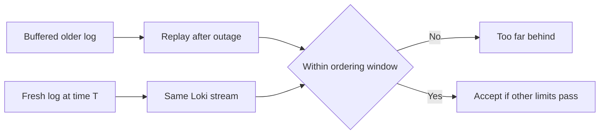

# How to Investigate Loki Entry Too Far Behind Errors After Log Delays

Author: [nawazdhandala](https://www.github.com/nawazdhandala)

Tags: Loki, Fluent Bit

Description: Distinguish per-stream ordering windows from maximum sample age, then recover delayed logs without falsifying timestamps.

After a log shipper recovers from a delay, Loki may reject old entries as too far behind. This can happen even when the entries are younger than the configured maximum sample age. Loki has separate checks for absolute age and ordering relative to newer data already received for the same stream.

A stream is defined by its complete label set. If fresh logs continue arriving while an old backlog waits, the stream's latest timestamp advances. Replaying the backlog later can fall outside the allowed out-of-order window.

## Identify the exact rejection reason

Inspect Loki's discard counters by reason and tenant:

```promql
sum by (reason, tenant) (rate(loki_discarded_samples_total[5m]))
```

Label names can differ with deployment instrumentation; inspect your actual scrape. Preserve the response body from the rejected push because it identifies the stream and timestamps involved. A shipper's generic retry message may hide the distinction between retryable rate limiting and a permanent timestamp validation failure.



## Calculate the timestamp gap

The following local fixture compares a delayed entry with the newest accepted timestamp. It uses an illustrative one-hour allowance; use the effective settings for your Loki version.

```python
from datetime import datetime
latest = datetime.fromisoformat("2026-11-15T12:00:00+00:00")
delayed = datetime.fromisoformat("2026-11-15T10:30:00+00:00")
allowed_seconds = 3600
lag = (latest - delayed).total_seconds()
print({"lag_seconds": lag, "outside_window": lag > allowed_seconds})
```

For the documented unordered-write behavior, the acceptance window is related to the ingester's chunk age configuration. Check that relationship in the release you operate. Do not assume `reject_old_samples_max_age` controls every old-entry rejection.

The absolute-age policy is configured separately:

```yaml
limits_config:
  reject_old_samples: true
  reject_old_samples_max_age: 168h
```

This fragment does not widen the per-stream ordering window. Increasing it alone will not fix an entry rejected because newer entries advanced that stream too far.

## Find why order diverged

Look for multiple shippers writing the same stream, clock skew, parsed timestamps with the wrong timezone, and a queue draining out of order. If several containers are collapsed into an identical label set, one fast producer can advance the stream while another producer is delayed.

Use a bounded source label when it reflects a real independent log source, such as application container or workload identity. Do not create a unique stream label per record to bypass ordering; that creates severe cardinality problems.

Compare original event timestamps with shipper receive and send times. A line with an incorrectly parsed year or timezone can look like backlog even when it was just emitted. Preserve the raw line during diagnosis.

## Recover with an explicit history policy

For a historical replay, consider a separate controlled replay stream or ingestion path with a bounded replay identifier and appropriate retention policy. Keep the original event timestamp. Replacing it with the current time may make ingestion succeed while corrupting incident timelines and time-based queries.

Before replaying, verify duplicate handling and the backend's accepted time ranges. Some records may already have arrived during retries, so a second replay can duplicate them. Test a small sequence-numbered subset before sending the entire backlog.

Finally, adjust buffering, delivery ordering, and alerting so the next delay is detected before the acceptance window is exceeded. A larger window may be appropriate, but it has memory and operational consequences. Treat it as a capacity decision supported by delayed-delivery measurements, not as a universal switch that makes arbitrary historical ingestion safe.

## References

The [community question](https://www.reddit.com/r/grafana/comments/18m6r4p/) motivated this investigation. The implementation references are [official reference 1](https://grafana.com/docs/loki/latest/operations/request-validation-rate-limits/), [official reference 2](https://grafana.com/docs/loki/latest/configure/).
