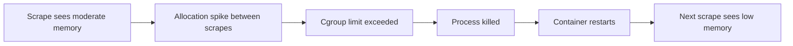

# How to Investigate OOMKilled Pods Below Their Sampled Memory Limit

Author: [nawazdhandala](https://www.github.com/nawazdhandala)

Tags: Kubernetes, Linux

Description: Use termination evidence and cgroup peaks to find short memory spikes and distinguish container OOM from node pressure.

A memory chart can remain below the container limit while Kubernetes reports `OOMKilled`. Scrapes observe selected instants, and a short allocation spike can exceed the limit between them. The process may be killed and restarted before the next sample, leaving the graph with only the lower memory usage of the replacement process.

First confirm what was killed and which limit applied. Pod-level graphs, per-container limits, node memory pressure, and runtime-managed heap statistics describe different scopes.

## Preserve the termination evidence

Inspect the previous container state and restart count:

```bash
kubectl -n checkout get pod api-example -o jsonpath='{range .status.containerStatuses[*]}{.name}{" "}{.restartCount}{" "}{.lastState.terminated.reason}{" "}{.lastState.terminated.exitCode}{"\n"}{end}'
kubectl -n checkout describe pod api-example
```

Exit code 137 indicates a SIGKILL-style termination but does not by itself prove an OOM. The Kubernetes reason, cgroup counters, and node kernel logs provide stronger context. Distinguish `OOMKilled` from eviction due to node pressure.



## Read peak and event counters where available

For cgroup v2, inspect the original container's cgroup before it disappears, or collect these values continuously through a supported agent:

```bash
cat /sys/fs/cgroup/memory.current
cat /sys/fs/cgroup/memory.max
cat /sys/fs/cgroup/memory.events
cat /sys/fs/cgroup/memory.peak
```

`memory.peak` depends on kernel support. The cgroup path must identify the affected container; reading the replacement container's new cgroup cannot reconstruct the old peak. `memory.events` distinguishes limit pressure and OOM-related events, but counters can reset when the cgroup is recreated.

Use the high-water mark as evidence, not as the only diagnosis. Node-level OOM can also kill processes, and hierarchical cgroup limits can apply above the container.

## Compare total accounting with the dashboard metric

A working-set chart is not necessarily the exact quantity enforced by the memory controller. File cache, anonymous memory, kernel memory, shared memory, and other charges can contribute differently depending on the metric and kernel.

Inspect the raw memory composition:

```bash
cat /sys/fs/cgroup/memory.stat
cat /proc/1/status
```

PID 1 is only appropriate if it is the application process in that container. For a process supervisor or sidecar, select the actual process and account for all processes charged to the cgroup.

## Capture the workload that triggers the spike

Common triggers include decompressing a large request, loading a model, compiling templates, generating a heap dump, or processing several large batches concurrently. Correlate restart time with request size, worker concurrency, deployment changes, and startup activity.

A resource fragment makes the container limit explicit:

```yaml
resources:
  requests:
    memory: 512Mi
  limits:
    memory: 1Gi
```

Do not copy this value as a fix. Set a limit from measured steady state, representative peaks, and runtime overhead. A larger limit can buy time for diagnosis, but an unbounded buffer or leak still needs correction.

Test with production-shaped payload sizes in staging and collect higher-resolution cgroup evidence around the event. Avoid running an unrestricted stress test on a shared production node. Diagnostic dumps themselves can consume memory and disk, so reserve enough headroom before collecting them.

## Keep the final conclusion specific

If a peak exceeded the limit between scrapes, explain the sampling gap and the allocation path. If kernel logs show node OOM, investigate node capacity and workload placement. If only the managed heap was small, inspect native allocations and memory mappings.

The absence of a sampled value above the limit is not contradictory evidence. It shows the chart did not observe the exact enforcement event. Preserve termination timestamps and cgroup lifecycle information so the next incident can be explained without relying on a graph that resets with the process.

## References

The [community question](https://stackoverflow.com/questions/58749290/process-inside-pod-is-oomkilled-even-though-pod-limits-not-reached) motivated this investigation. The implementation references are [official reference 1](https://kubernetes.io/docs/concepts/configuration/manage-resources-containers/), [official reference 2](https://docs.kernel.org/admin-guide/cgroup-v2.html), [official reference 3](https://raw.githubusercontent.com/google/cadvisor/master/docs/storage/prometheus.md).
