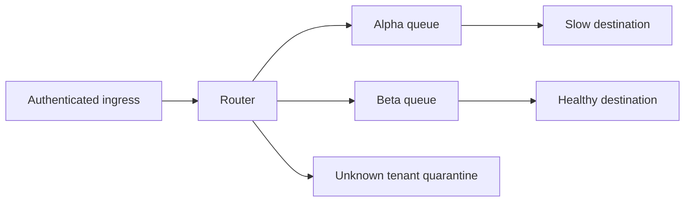

# How to Isolate Slow Tenants in an OpenTelemetry Log Pipeline

Author: [nawazdhandala](https://www.github.com/nawazdhandala)

Tags: OpenTelemetry, Observability

Description: Route tenants into separate exporter queues, bound backlog, and identify when a shared Collector needs stronger failure isolation.

A multi-tenant gateway becomes fragile when one destination's outage occupies the resources needed by every tenant. Separate routing rules alone are insufficient. Isolation depends on where batching, queuing, retrying, and memory accounting occur.

The example uses Collector Contrib 0.120.0 and two tenants. It assumes a trusted ingress has already authenticated the caller and assigned a resource attribute named `tenant.id`. Never trust a tenant attribute supplied by an untrusted client as authorization to choose another customer's destination.

## Put independent queues after the routing decision

This fragment routes each resource to its own pipeline. Unmatched records go to a quarantine pipeline that you must define with an appropriate bounded destination.

```yaml
connectors:
  routing/tenants:
    default_pipelines: [logs/quarantine]
    table:
      - context: resource
        condition: attributes["tenant.id"] == "alpha"
        pipelines: [logs/alpha]
      - context: resource
        condition: attributes["tenant.id"] == "beta"
        pipelines: [logs/beta]
```

Use separate exporter component instances. Reusing the same exporter identifier across pipelines would also reuse its component resources. The following values intentionally give each destination a finite backlog and retry horizon.

```yaml
exporters:
  otlp/alpha:
    endpoint: alpha.example.net:4317
    timeout: 5s
    sending_queue:
      queue_size: 300
      num_consumers: 2
    retry_on_failure:
      max_elapsed_time: 120s
  otlp/beta:
    endpoint: beta.example.net:4317
    timeout: 5s
    sending_queue:
      queue_size: 300
      num_consumers: 2
    retry_on_failure:
      max_elapsed_time: 120s
```

TLS is enabled by default for these exporters. Supply the appropriate authentication and certificate configuration for each destination. Credentials belong in a secret provider or controlled environment, not in tenant-uploaded routing documents.

```yaml
service:
  pipelines:
    logs/in:
      receivers: [otlp]
      processors: [memory_limiter]
      exporters: [routing/tenants]
    logs/alpha:
      receivers: [routing/tenants]
      processors: [batch/alpha]
      exporters: [otlp/alpha]
    logs/beta:
      receivers: [routing/tenants]
      processors: [batch/beta]
      exporters: [otlp/beta]
```

These are mergeable fragments, not a complete standalone configuration: define the receiver, limiter, batch components, and quarantine pipeline before validation. Keeping batching after routing avoids combining unrelated destination work into one batch.



## Measure the actual isolation boundary

For this version, queue capacity is measured in export requests, not bytes. Three hundred batches with large log bodies can consume far more memory than three hundred small batches. Estimate backlog using measured batch size and serialized payload size, then leave room for decoded objects, retries, and processor state.

During a staging test, block only Alpha's destination. Beta's accepted and successfully exported rate should remain near its baseline. Watch Alpha's queue, enqueue failures, retry expiration, total process memory, and Beta's latency. Include mixed-tenant requests in the fixture because the upstream error behavior can differ from separate tenant requests.

A shared process still has shared memory, CPU, connections, and ingress backpressure. A full queue can cause upstream failures, and callers may retry an entire mixed request. Separate exporter queues reduce coupling but do not provide a strict tenant service-level guarantee.

## Escalate isolation when needed

For high-volume or contractually isolated tenants, place a durable broker between ingress and destination workers, or run dedicated worker deployments with separate resource limits. Partition by a trusted tenant identifier and ensure a blocked partition cannot starve unrelated partitions.

Set an explicit policy for an exhausted backlog: reject new telemetry, retain to disk within a quota, or drop according to a documented rule. Infinite retries with finite storage only postpone the decision. Operationally useful isolation includes knowing which tenant lost records, why they were rejected, and how the healthy tenants behaved during the same interval.

## References

The [community question](https://stackoverflow.com/questions/79884341/multi-tenant-log-routing-with-opentelemetry) motivated this investigation. The implementation references are [official reference 1](https://raw.githubusercontent.com/open-telemetry/opentelemetry-collector-contrib/v0.120.0/connector/routingconnector/README.md), [official reference 2](https://raw.githubusercontent.com/open-telemetry/opentelemetry-collector/v0.120.0/exporter/exporterhelper/README.md).
