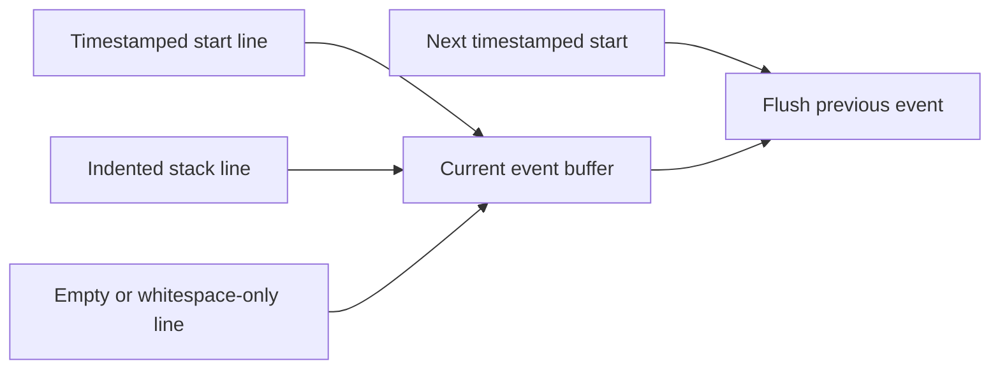

# How to Keep Blank Lines Inside Fluent Bit Multiline Events

Author: [nawazdhandala](https://www.github.com/nawazdhandala)

Tags: Fluent Bit, Observability

Description: Extend continuation rules to include empty lines while preserving event boundaries and testing whitespace and timeout behavior.

A multiline parser often recognizes continuation lines by indentation. That works for stack frames beginning with spaces, but a truly empty line contains no indentation. If the continuation regex excludes empty strings, a blank line can flush the current event and split the stack trace.

Fix the grammar rather than deleting blank lines from the source. Empty lines may carry meaningful formatting, and removing them can hide the boundary bug while changing the original event.

## Reproduce the exact whitespace

Create a fixture with an empty line, a whitespace-only line, and a new timestamped event:

```text
2026-11-15T12:00:00Z ERROR request failed
  java.lang.IllegalStateException: missing state

  at example.Worker.run(Worker.java:42)
   
2026-11-15T12:00:01Z INFO next request
```

Some editors trim whitespace-only lines. Preserve the fixture as bytes or inspect it with a representation that makes whitespace visible. A container log wrapper can also turn a blank application line into a nonblank JSON record, so test at the parser's actual input stage.

## Include empty and whitespace-only continuations

For this fixture grammar, save a custom parser with an anchored timestamp start and a continuation rule that includes indentation or an empty line:

```ini
[MULTILINE_PARSER]
    Name          timestamped_stack
    Type          regex
    Flush_Timeout 2000
    Rule          "start_state" "/^[0-9]{4}-[0-9]{2}-[0-9]{2}T/" "cont"
    Rule          "cont"        "/^(?:[ \t].*|\r?)$/"           "cont"
```

The optional carriage return accommodates an empty CRLF line when the parser sees the carriage return. The first branch includes whitespace-only lines because the remaining characters may be empty. Unindented exception lines require another explicit continuation alternative if your application emits them.



## Test the rule independently

This Python fixture checks the intended whitespace grammar. Fluent Bit uses a different regex engine, so validate the final parser with the deployed binary as well.

```python
import re
continuation = re.compile(r"^(?:[ \t].*|\r?)$")
assert continuation.fullmatch("")
assert continuation.fullmatch("   ")
assert continuation.fullmatch("\tframe")
assert continuation.fullmatch("\r")
assert not continuation.fullmatch("2026-11-15T12:00:01Z INFO next")
print("whitespace cases passed")
```

Wire the parser to a local Tail input and stdout output:

```ini
[SERVICE]
    Parsers_File parsers_multiline.conf
[INPUT]
    Name             tail
    Path             ./fixture.log
    Read_from_Head   On
    multiline.parser timestamped_stack
[OUTPUT]
    Name  stdout
    Match *
```

## Avoid overbroad continuation rules

Using `.*` as the only continuation condition accepts every following line, including the next event's start. Depending on rule ordering and state behavior, that can combine many requests into one huge record. Keep the start grammar and continuation grammar intentionally disjoint.

If an application emits arbitrary unindented body text, use explicit markers or a structured log format instead of trying to infer boundaries from whitespace alone. For interleaved writes from several threads, no regex can reliably restore missing grouping information.

With a multiline filter, enable the buffering mode required to retain events across chunks. Keep the filter first because assembled records are re-emitted through the pipeline. Do not configure several multiline filters matching the same tags.

## Verify output integrity

Check the number of emitted events and the exact newline sequence, not only whether the exception message appears. Test timeout behavior by pausing between lines longer than the configured flush timeout. That deliberately demonstrates when a slow producer can still split an event.

Also test a very large stack trace and inspect the memory or truncation controls supported by your Fluent Bit version. A correct whitespace rule can increase the amount of retained data compared with the broken parser. Preserve both correctness and a bounded resource policy before deploying it across all container logs.

## References

The [community question](https://stackoverflow.com/questions/79842007/fluentbit-multilines-filter-for-log-including-emptyline) motivated this investigation. The implementation references are [official reference 1](https://docs.fluentbit.io/manual/administration/configuring-fluent-bit/multiline-parsing), [official reference 2](https://docs.fluentbit.io/manual/data-pipeline/inputs/tail), [official reference 3](https://docs.fluentbit.io/manual/data-pipeline/filters/multiline-stacktrace).
