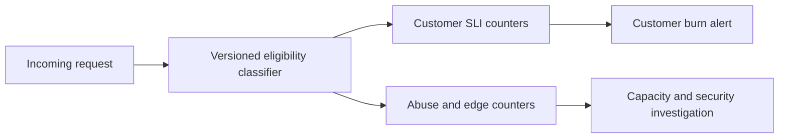

# How to Keep Bot Errors from Dominating Low-Traffic SLO Alerts

Author: [nawazdhandala](https://www.github.com/nawazdhandala)

Tags: SLO, Prometheus, SRE

Description: Define eligible traffic before outcomes occur, separate abuse signals from customer reliability, and test low-volume burn alerts honestly.

A handful of automated requests to nonexistent paths can dominate an error ratio on a quiet service. The solution is a defensible eligible-request definition, not excluding every request that failed. Decide which user journeys the SLO promises to serve, classify traffic before observing its outcome, and keep abuse monitoring visible separately.

The example uses a custom request counter with a bounded `traffic_class` label. The classification is application policy, not a built-in Prometheus feature. Use trusted routing or authentication context where possible. A user-agent string alone is easy to spoof and can misclassify real customers.

## Define the population before the result

For an authenticated export API, eligible requests might be valid requests to supported routes from authorized customers. Failed authentication and unknown-route scans can belong to security or edge monitoring. But an authentication outage affecting valid users is still user impact; excluding all authentication failures would hide it.

```yaml
# Internal eligibility policy example.
slo: customer-export-availability
eligible_routes: [/v1/exports, /v1/exports/status]
classification_source: trusted-gateway-and-application-context
excluded_classes: [known-synthetic, rejected-invalid-route]
include_service_timeouts: true
include_customer_rate_limit_failures: true
policy_version: 3
```

Write down ambiguous cases such as rate limiting, malformed input, and expired credentials. Review them with the service owner. Apply the same policy to good and total events, and version changes so a better-looking SLO cannot be mistaken for an actual reliability improvement.

## Keep separate ratios

The customer SLI should filter the explicitly eligible class. A separate dashboard should show all edge errors and rejected traffic, because a large bot campaign can still consume capacity and affect real users.

```promql
sum(rate(api_requests_total{traffic_class="eligible",outcome="failed"}[30m]))
/
sum(rate(api_requests_total{traffic_class="eligible"}[30m]))
```

Use bounded label values, not individual user IDs or arbitrary bot names. Check that timeouts and failures before application routing still enter the intended denominator through another measurement point if necessary. A counter observed only after successful middleware execution can miss the outage you need to detect.



## Demonstrate why denominator choice matters

The fixture contains two failed customer requests and fifty rejected scans. The customer ratio is 10%, so the service still has a real problem even after removing the scans. Filtering bots is not a justification for dismissing all low-volume failures.

```python
customer_total,customer_failed = 20,2
scan_total,scan_failed = 50,50
all_ratio = (customer_failed+scan_failed)/(customer_total+scan_total)
customer_ratio = customer_failed/customer_total
print({"all_error_ratio":all_ratio,"customer_error_ratio":customer_ratio})
assert customer_ratio == 0.1
```

## Tune response without hiding sparse failures

A minimum-request gate can reduce noisy burn alerts, but it can also suppress an outage affecting every request on a rare endpoint. Pair a volume-aware burn policy with a separate response for critical individual failures or a synthetic journey. Choose the response based on business urgency rather than forcing sparse traffic into a high-volume alert formula.

Replay known customer failures and bot bursts through the proposed classifier. Inspect false exclusions carefully: a legitimate customer blocked by the edge is still a customer experience, even if the application never sees the request. Maintain a sample of excluded traffic for review under your retention and privacy policy.

After rollout, display eligible count, excluded count, customer failure count, and policy version together. Alert on sudden classification shifts because a gateway change can move nearly all traffic out of the SLO. The objective is an honest measure of the promised user journey, accompanied by enough edge visibility to detect when unwanted traffic threatens that journey.

Ensure the failed outcome is represented consistently when no errors have occurred. If the instrumentation creates a failure label only after the first failure, the numerator can be absent rather than zero. Initialize bounded outcome series where practical or use a label-preserving zero fallback derived from the eligible population after confirming telemetry health. Test the fresh-deployment case explicitly. Also avoid reclassifying failed requests after the fact based on a suspicious response code; that would make eligibility depend on the outcome and bias the SLO toward success.

## References

The [community question](https://www.reddit.com/r/sre/comments/1dda0w7/) motivated this walkthrough. Implementation references:

- [Official reference 1](https://sre.google/workbook/implementing-slos/)
- [Official reference 2](https://sre.google/workbook/alerting-on-slos/)
- [Official reference 3](https://sre.google/sre-book/handling-overload/)
