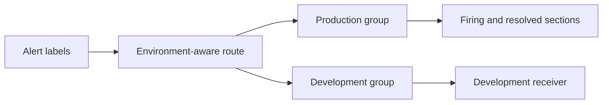

# How to Keep Development Alerts Out of Production Alert Groups

Author: [nawazdhandala](https://www.github.com/nawazdhandala)

Tags: Alertmanager, Prometheus, Monitoring

Description: Use environment-aware Alertmanager grouping and explicit firing and resolved template sections to prevent confusing mixed notifications.

A production notification that includes a resolved development alert usually reveals a grouping or template problem. Alertmanager sends groups of alerts, and a group can include both firing and resolved members. If environment is missing from the grouping key, unrelated events may be presented together.

Fix the data model first, then the message rendering. This tutorial uses a current Alertmanager configuration and a local webhook sink for testing. It assumes each alert carries a stable `environment` label. If the label exists only in a dashboard variable, Alertmanager cannot use it for routing or grouping.

## Inspect the received labels

Compare the labels on the alerts inside the webhook payload, not only the notification title. Determine whether production and development alerts genuinely have different environment values. Also check Prometheus external labels and alert relabeling, which can add or remove labels before delivery.

```json
{"alerts":[{"status":"firing","labels":{"alertname":"CheckoutErrors","environment":"prod","service":"checkout"}},{"status":"resolved","labels":{"alertname":"CheckoutErrors","environment":"dev","service":"checkout"}}]}
```

This simplified payload is illustrative and is not a complete Alertmanager API object. It makes the error visible: the same alert name and service can occur in two operationally independent environments. Grouping only by alert name merges context that responders expect to remain separate.

## Add environment to the group boundary

Use grouping keys that reflect where one person can take one coherent response action. Environment and service are often useful; an unbounded request ID is not. Missing labels deserve their own investigation because an empty environment can silently defeat the intended separation.

```yaml
route:
  receiver: review-sink
  group_by: [environment, service, alertname]
  group_wait: 30s
  group_interval: 5m
  repeat_interval: 4h
receivers:
  - name: review-sink
    webhook_configs:
      - url: http://notification-sink:8080/alerts
        send_resolved: true
```

If development and production have different receivers, use explicit child routes as well. Grouping controls aggregation; routing selects the destination. They solve related but different problems. Check inherited settings on child routes, because a nested route may override the root grouping list.



## Render status at the alert level

A group-level status is firing if at least one member is firing. It does not imply every member is currently active. For integrations that support Alertmanager templates, iterate through the filtered lists instead of printing every alert under one undifferentiated heading.

```gotemplate
{{ define "incident.text" }}
Firing:
{{ range .Alerts.Firing }}
- {{ .Labels.alertname }} in {{ .Labels.environment }}: {{ .Annotations.summary }}
{{ end }}
Resolved:
{{ range .Alerts.Resolved }}
- {{ .Labels.alertname }} in {{ .Labels.environment }}
{{ end }}
{{ end }}
```

Connect this named template to an integration field that supports templating in your configuration. Generic webhook payloads are structured data; this template is not automatically applied to arbitrary webhook bodies. If you own the webhook consumer, implement the same separation there and preserve per-alert status.

## Test transitions, not only a single alert

Send a development firing event, let it resolve, then send a production event with the same alert name and service. Verify that they land in separate groups and that production notifications contain only production members. Test a production group with one resolved instance and one firing instance to ensure the message still communicates both accurately.

Do not remove resolved messages merely to hide an incorrect group boundary. They can provide useful closure when represented clearly. Conversely, avoid excessive grouping keys that produce one page per pod for a single service outage. The acceptance criterion is operational: a production responder should see the affected environment, current active members, and completed recoveries without needing to infer them from old chat history. Capture the tested label sets and route configuration so a later rule change cannot quietly reintroduce the mixture.

## References

The [community question](https://stackoverflow.com/questions/71969959/prometheus-alertmanager-includes-resolved-alerts-in-a-new-alert) motivated this walkthrough. Implementation references:

- [Official reference 1](https://prometheus.io/docs/alerting/latest/configuration/)
- [Official reference 2](https://prometheus.io/docs/alerting/latest/notifications/)
