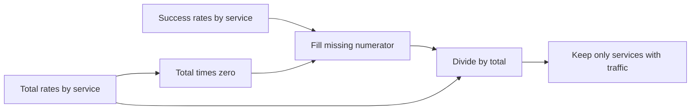

# How to Keep Missing Success Counters from Breaking Service Success Rates

Author: [nawazdhandala](https://www.github.com/nawazdhandala)

Tags: Prometheus, Monitoring

Description: Fill absent success numerators from the denominator label set while leaving zero-traffic and telemetry outages explicit.

A success-rate query can disappear for a service when its success counter has never been created. Dividing an empty numerator by an existing total does not produce zero; vector matching yields no result for that service. The fallback must preserve the denominator's service labels.

Distinguish two situations: a service handled requests and none succeeded, or it handled no requests at all. The first has a meaningful success rate of zero. The second has no observed success ratio and should not silently become either zero or one hundred percent.

## Define numerator and denominator at the same grain

Assume one counter with an `outcome` label and a bounded `service` label. Calculate rates separately, then aggregate:

```promql
sum by (service) (rate(app_requests_total{outcome="success"}[5m]))
```

```promql
sum by (service) (rate(app_requests_total[5m]))
```

Verify that the denominator includes every relevant outcome exactly once. If an attempt counter and a completed-request counter have different semantics, dividing them can produce a plausible but incorrect ratio.



## Fill from total, then gate on traffic

The following expression fills the missing success numerator using the total vector and removes services whose total rate is zero:

```promql
(
  (
    sum by (service) (rate(app_requests_total{outcome="success"}[5m]))
    or on (service)
    (0 * sum by (service) (rate(app_requests_total[5m])))
  )
  /
  sum by (service) (rate(app_requests_total[5m]))
)
and on (service)
(sum by (service) (rate(app_requests_total[5m])) > 0)
```

For a busy service with only failures, the fallback numerator is zero and the ratio is zero. For a service with no observed traffic, the final filter removes the undefined ratio. Display traffic volume alongside success rate so users can distinguish quiet services from highly reliable ones.

## Make the expression maintainable

For repeated dashboard and alert use, record the aggregated rates first. This rule fragment preserves the service label and keeps counter reset handling at the raw-series level.

```yaml
groups:
  - name: service-request-rates
    rules:
      - record: service:requests:rate5m
        expr: sum by (service) (rate(app_requests_total[5m]))
      - record: service:successful_requests:rate5m
        expr: sum by (service) (rate(app_requests_total{outcome="success"}[5m]))
```

Then build the same fallback from these recorded vectors. Validate the rule file with the Prometheus version you deploy, and evaluate how the recording interval affects your alert timing.

## Test the edge cases that change meaning

Use at least four fixtures: mixed successes and failures, only failures, no requests, and missing telemetry. Add a restart to confirm rates handle counter resets. A missing total counter should remain absent rather than becoming a fabricated service-level zero.

For low traffic, a five-minute ratio can swing sharply after one request. Consider a longer window or a minimum traffic threshold for alerting, while preserving the raw ratio for inspection. Rounding does not remove the statistical uncertainty of a tiny denominator.

Do not use `clamp_min(total, 1)` casually. That changes the denominator's units and meaning; a rate below one request per second would be divided by one even when it is valid. Likewise, `or vector(0)` cannot create the missing service labels.

If the application knows the complete bounded set of outcomes, preinitialize those counters to zero at startup. That reduces missing-series surprises but does not eliminate scrape failures or insufficient samples for `rate()`. Keep telemetry availability as its own signal so a broken monitoring path cannot masquerade as a perfect or failing service.

## References

The [community question](https://stackoverflow.com/questions/56770824/calculate-success-rate-with-prometheus-when-the-numerator-is-null) motivated this investigation. The implementation references are [official reference 1](https://prometheus.io/docs/prometheus/latest/querying/operators/), [official reference 2](https://prometheus.io/docs/prometheus/latest/querying/functions/).
