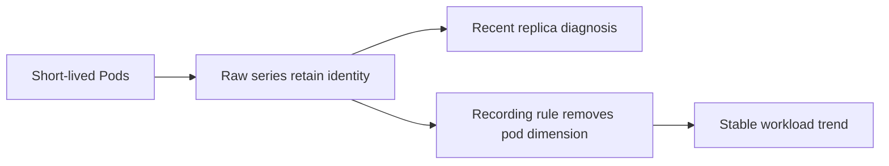

# How to Keep Pod Identity Without Unbounded Prometheus Series Churn

Author: [nawazdhandala](https://www.github.com/nawazdhandala)

Tags: Prometheus, Kubernetes

Description: Preserve per-target correctness while controlling pod-label churn through bounded dimensions, aggregation, and retention choices.

Pod labels are useful during an incident, but every changing label value creates a new time series when attached to a metric. A deployment that constantly replaces Pods can generate substantial churn even if only a few replicas exist at once.

Do not solve this by removing all target identity from raw counters. Two live replicas exposing the same metric and labels must remain distinguishable at ingestion. Otherwise their samples can collide, and counter resets become impossible to interpret correctly.

## Separate active cardinality from churn

Measure the number of currently selected Pod identities for a bounded workload:

```promql
count(count by (namespace, pod) (
  container_cpu_usage_seconds_total{namespace="checkout", container!=""}
))
```

Then inspect the server's series creation rate and correlate it with deployment events:

```promql
rate(prometheus_tsdb_head_series_created_total[15m])
```

The latter is server-wide unless you have a sharded or job-specific ingestion metric. Use TSDB cardinality statistics and label analysis to identify the source rather than attributing every creation spike to the currently investigated namespace.



## Aggregate after rate calculation

A workload-level recording rule can provide stable service views while raw Pod series remain available for diagnosis. The example assumes a reliable bounded `app` label is already attached to each source series.

```yaml
groups:
  - name: workload-cpu
    rules:
      - record: namespace_app:container_cpu_usage_seconds:rate5m
        expr: |
          sum by (namespace, app) (
            rate(container_cpu_usage_seconds_total{container!="", image!=""}[5m])
          )
```

Calculate rates before summing counters so each original series' resets are handled independently. Confirm the `app` label is present and unambiguous; missing labels would combine unrelated workloads into an unlabeled group.

A recording rule improves query shape but does not remove the storage cost of raw samples. If long-term storage should retain only workload aggregates, design separate remote-write selection or retention tiers and verify that incident workflows still have enough recent raw history.

## Control labels at the source and scrape boundary

Keep bounded operational labels such as namespace, workload, route template, and status class. Avoid adding container IDs, rollout hashes, generated run IDs, and arbitrary annotations to every application metric unless they answer a specific query.

Kubernetes discovery metadata can be used to assign a stable workload label without copying every Pod label. For example, a relabel fragment can select one known application label:

```yaml
relabel_configs:
  - source_labels: [__meta_kubernetes_pod_label_app_kubernetes_io_name]
    target_label: app
```

This fragment belongs inside the appropriate Kubernetes scrape job. It does not create a complete discovery configuration. Check the discovered target labels in Prometheus to ensure the expected metadata exists for that role.

## Validate identity before removing labels

Test at least two replicas, a rolling deployment with overlap, and a restart. Queries should correctly reflect each replica's reset and the total service rate. If removing a label causes duplicate samples or unexpected jumps, the remaining identity is insufficient.

Pod UID and Pod name have different reuse and lifecycle properties. Retain the identifier needed for your troubleshooting contract, but avoid duplicating several equivalent ephemeral identifiers across every series without a reason.

Finally, define a churn budget alongside an active-series budget. A job that creates 100 new label sets every minute can be expensive despite a modest instantaneous count. Track changes over deployment cycles, and compare the same workload before and after the label policy. The objective is stable workload analysis plus enough recent replica detail to explain failures, with no silent corruption of the raw metric identity.

## References

The [community question](https://www.reddit.com/r/devops/comments/12aygos/) motivated this investigation. The implementation references are [official reference 1](https://prometheus.io/docs/practices/naming/), [official reference 2](https://prometheus.io/docs/prometheus/latest/configuration/configuration/), [official reference 3](https://prometheus.io/docs/prometheus/latest/storage/).
