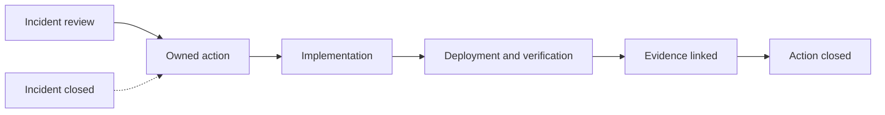

# How to Keep Postmortem Actions Visible After Incident Closure

Author: [nawazdhandala](https://www.github.com/nawazdhandala)

Tags: Incident Management, Python, SRE

Description: Track follow-up work independently from incident status with owners, due dates, verification evidence, and a reproducible overdue review.

Closing an incident should end emergency coordination, not erase the work needed to reduce recurrence. Give follow-up actions their own lifecycle and identifiers. Link them to the incident, but query them independently so the action list remains visible after the incident ticket leaves the active queue.

This tutorial uses Python 3 with an in-memory SQLite fixture. The schema is an internal example that can be mapped to your issue tracker. It focuses on visibility and verification, not on automatically creating or messaging tickets. Keep the actual owner and tracking system authoritative.

## Make each action independently accountable

An action needs a concrete outcome, one accountable owner, a due date, and a verification criterion. Avoid vague tasks such as improve monitoring. A better action names the failure mode and the test that will demonstrate the change.

```json
{"action_id":"act-17","incident_id":"inc-42","owner":"payments-platform","outcome":"alert when checkout pool acquisition stalls","due_date":"2026-11-20","status":"open","verification":"staging saturation exercise triggers the reviewed page","evidence_url":null}
```

A team can be accountable if it has a working assignment process, but everybody is not an owner. Separate implementation complete from verified. A merged change may still lack deployment, coverage, or an exercise proving that it addresses the original problem.

## Query actions without filtering on incident status

The fixture deliberately includes a closed incident with an overdue open action. The query selects actions by their own state and due date. It does not discard them because the parent incident is closed.

```python
import sqlite3
con = sqlite3.connect(":memory:")
con.execute("CREATE TABLE actions(id TEXT,incident TEXT,incident_status TEXT,owner TEXT,due TEXT,status TEXT)")
con.executemany("INSERT INTO actions VALUES(?,?,?,?,?,?)",[
 ("act-17","inc-42","closed","payments","2026-11-10","open"),
 ("act-18","inc-43","closed","platform","2026-11-30","verified"),
])
rows = con.execute("SELECT id,owner,due FROM actions WHERE status NOT IN ('verified','cancelled') AND due < ?",
                   ("2026-11-15",)).fetchall()
print(rows)
assert rows == [("act-17","payments","2026-11-10")]
```

ISO-formatted dates sort correctly in this deliberately date-only example. A production system should define timezone and business-day semantics explicitly if deadlines include times. Preserve status history so repeated rescheduling does not make an old action appear newly created.



## Publish a small review queue

Use an existing operational review to inspect overdue actions, unowned work, and actions awaiting verification. The following SQL is a query fragment against the fixture schema. In a tracker, express the same filters using supported search fields.

```sql
SELECT owner, status, COUNT(*) AS action_count
FROM actions
WHERE status NOT IN ('verified', 'cancelled')
GROUP BY owner, status
ORDER BY owner, status;
```

Do not optimize for closing the largest number of tickets. One verified prevention mechanism can matter more than ten documentation edits. Show risk or expected impact next to age so the review does not become a purely administrative exercise.

## Handle cancellation and deferral honestly

Some actions become unnecessary after an architecture change or are superseded by a stronger fix. Close them with a reason and a link to the replacement, rather than leaving them open indefinitely. A deferred action should retain the original finding, a new review date, and an accountable decision maker.

Verify completion using the criterion written at creation. If an alerting action required a saturation exercise, attach the exercise result and the deployed rule version. If a runbook action required a new responder to follow it, attach that review outcome. A status label without evidence is insufficient for important risk reduction.

Finally, sample recently closed actions during the next incident review. Check whether the promised behavior still exists and whether the original failure recurred. This creates a feedback loop between the incident, the follow-up, and observed reliability rather than treating postmortem actions as paperwork that disappears when the incident is resolved.

Track actions awaiting external dependencies separately from work that has no progress. A blocked item should identify the dependency owner and the next review date, while retaining the original risk and deadline history. This prevents an unavailable vendor fix or a shared-platform migration from becoming an invisible excuse. The review can then decide whether an interim mitigation is needed rather than repeatedly moving the due date without changing the service exposure.

## References

The [community question](https://www.reddit.com/r/devops/comments/1q30bt7/what_actually_happens_to_postmortem_action_items/) motivated this walkthrough. Implementation references:

- [Official reference 1](https://sre.google/workbook/postmortem-culture/)
- [Official reference 2](https://docs.python.org/3/library/sqlite3.html)
