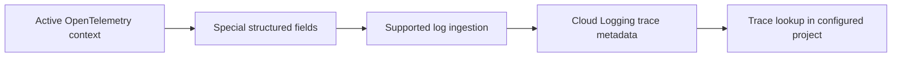

# How to Link OpenTelemetry Traces from Google Cloud Structured Logs

Author: [nawazdhandala](https://www.github.com/nawazdhandala)

Tags: OpenTelemetry, Java

Description: Map active trace context into Cloud Logging special fields and verify project, span format, and stored trace availability.

Putting a field named `trace_id` into JSON does not necessarily create a trace link in Google Cloud Logging. Cloud Logging recognizes specific structured fields and promotes them into its log-entry metadata. The trace identifier must also refer to the project and trace store you intend to open.

The mapping depends on the ingestion route. Managed stdout collection, an agent, a logging client library, and direct Logging API calls do not all process JSON in the same way. Start with a single known log entry and inspect the resulting stored `LogEntry`.

## Emit the special fields deliberately

For a structured JSON line collected by a supported Google Cloud integration, the conventional fields are:

```json
{
  "severity": "INFO",
  "message": "quote calculated",
  "logging.googleapis.com/trace": "projects/example-project/traces/4bf92f3577b34da6a3ce929d0e0e4736",
  "logging.googleapis.com/spanId": "00f067aa0ba902b7",
  "logging.googleapis.com/trace_sampled": true,
  "request_id": "req-42"
}
```

Replace the project with the project containing the trace. The span ID is a 16-character hexadecimal string, not a decimal integer. Preserve leading zeros. The sampled field is a Boolean rather than the string `"true"`.

When using a Google logging client library, set the corresponding log-entry fields through its API instead of assuming the library will promote arbitrary JSON keys. Avoid double-encoding the JSON line into a string payload.

## Build the fields from active context

This Java method fragment returns a map for your JSON encoder. It uses the OpenTelemetry API and omits trace metadata when no valid span context exists.

```java
var fields = new java.util.LinkedHashMap<String, Object>();
fields.put("message", "quote calculated");
var context = io.opentelemetry.api.trace.Span.current().getSpanContext();
if (context.isValid()) {
    fields.put("logging.googleapis.com/trace",
        "projects/" + projectId + "/traces/" + context.getTraceId());
    fields.put("logging.googleapis.com/spanId", context.getSpanId());
    fields.put("logging.googleapis.com/trace_sampled", context.isSampled());
}
```

Use the project configuration supplied by your deployment rather than deriving it from request input. Keep a separate request ID for support workflows, since a trace can be absent because of sampling or retention.



## Verify the stored representation

In Logs Explorer, query the promoted trace field, not only `jsonPayload.trace_id`. The following filter is a Cloud Logging query:

```text
trace="projects/example-project/traces/4bf92f3577b34da6a3ce929d0e0e4736"
```

If the entry appears only when searching the raw JSON payload, the collection path did not promote the special fields. Inspect whether the agent parsed the line as JSON, whether a wrapper nested it under another field, and whether the platform supports that structured-field mapping.

Next, open the trace directly by ID in the intended trace project. Correct log metadata cannot create a trace that was exported only to another vendor, dropped by sampling, or expired. The sampled flag describes context; it is not proof of storage.

## Check cross-project and async cases

A service can write logs in one project while exporting traces to another. The fully qualified trace path must identify the trace's destination project, and the viewer needs access there. A valid-looking link into the log project may simply point at an empty trace store.

For asynchronous work, record the context at the actual log call. Copying a trace ID from a stale request object can create misleading correlation after a worker is reused. Test a request log, a background log, and a log from a child operation, ensuring the span ID changes where appropriate.

Finally, retain a raw fixture and the stored log-entry view as your regression check. That verifies the complete mapping boundary without requiring every developer to infer behavior from a formatted console line.

## References

The [community question](https://stackoverflow.com/questions/76823058/how-to-associate-opentelemetry-trace-span-id-to-google-cloud-logs) motivated this investigation. The implementation references are [official reference 1](https://cloud.google.com/logging/docs/structured-logging), [official reference 2](https://opentelemetry.io/docs/languages/java/api/).
