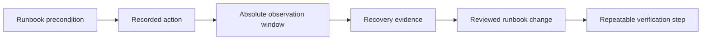

# How to Link Runbook Fixes to Evidence That They Worked

Author: [nawazdhandala](https://www.github.com/nawazdhandala)

Tags: Incident Management, Python, SRE

Description: Attach immutable evidence references, observation windows, and recovery criteria to runbook changes so responders can review why a fix is justified.

A runbook instruction such as restart the worker is incomplete without the conditions under which it helped and the evidence used to verify recovery. Link the fix to the incident's observations, preserve the relevant query window, and state the expected result. This lets a future responder distinguish a tested mitigation from a plausible guess.

The examples use Python 3 and an internal evidence record. They do not prove causality from a chart. A metric improving after an action is supporting evidence, but concurrent changes, traffic shifts, and natural recovery can provide alternative explanations. Preserve those limitations in the runbook rather than overstating certainty.

## Define the recovery criterion before editing the runbook

Choose a user-facing measure and an observation window long enough to catch immediate recurrence. A process becoming ready is weaker evidence than successful customer transactions. Record both the operational action and the effect it was intended to produce.

```yaml
# Internal runbook step metadata.
step_id: checkout-pool-recovery
precondition: connection acquisition failures with exhausted worker pools
action: deploy reviewed concurrency limit
expected_result: eligible checkout success ratio returns above 0.99
observation_window_minutes: 15
incident: inc-42
evidence_ids: [chart-42a, deploy-42b, trace-42c]
limitations: database recovery overlapped the deployment
```

The limitation is not a reason to discard the result. It tells the next responder what additional evidence is needed before repeating the action. If the original incident never established the mechanism, label the step as a mitigation with uncertain cause rather than a root-cause repair.

## Preserve a reproducible evidence reference

A dashboard URL with a relative last-hour range changes meaning every time it opens. Store absolute start and end times, datasource identity, query text, relevant labels, and the result artifact. Keep access restrictions and retention aligned with the incident record.

```json
{"evidence_id":"chart-42a","source":"metrics-prod","start":"2026-11-15T09:40:00Z","end":"2026-11-15T10:20:00Z","query":"checkout:user_success_ratio5m{environment=\"prod\"}","artifact":"evidence/inc-42/checkout-ratio.json"}
```

Use an exported artifact when live retention will expire before the runbook is revisited. Store only necessary, redacted data. An evidence link should identify what was observed, not expose credentials or unrestricted customer traces to everyone who can read the runbook.



## Check evidence integrity without overstating it

A checksum can detect changed artifact bytes. It does not prove the artifact is authentic or complete unless its provenance is protected. The fixture demonstrates a local integrity check using a synthetic result.

```python
import hashlib,json
result = {"before_success":0.82,"after_success":0.997,"window_minutes":15}
artifact = json.dumps(result,sort_keys=True,separators=(",",":")).encode()
expected = hashlib.sha256(artifact).hexdigest()
assert hashlib.sha256(artifact).hexdigest() == expected
changed = artifact+b"\n"
assert hashlib.sha256(changed).hexdigest() != expected
print(expected)
```

## Review the instruction as an experiment

Ask whether the precondition is observable, whether the action can be scoped, and whether the expected result is measurable. Include a stop condition if the result fails to appear and a rollback link if the action changes production state. Avoid runbook steps that encourage repeated execution simply because the first attempt did not help.

Test the revised step in a safe exercise where possible. A documentation reviewer should be able to find the supporting evidence, understand the result, and identify the remaining uncertainty. Do not mark a runbook fix verified merely because a pull request merged.

After the next real use, append its outcome and environment version. If the same action stops working, preserve the prior evidence and update the preconditions instead of silently deleting history. The result is a runbook whose instructions are supported by inspectable observations and whose verification criteria are useful during the incident itself.

Keep the reviewed query text with the evidence even if the dashboard panel has a stable identifier. Panels are edited, label names change, and datasource defaults can move to another environment. A frozen query and absolute time window make the claim reproducible when underlying data remains available. If the result was sampled or aggregated, record that resolution so a future reviewer does not infer a more precise recovery time than the evidence supports.

## References

The [community question](https://www.reddit.com/r/sre/comments/1vndr8z/when_a_production_incident_repeats_months_later/) motivated this walkthrough. Implementation references:

- [Official reference 1](https://sre.google/sre-book/effective-troubleshooting/)
- [Official reference 2](https://sre.google/workbook/postmortem-culture/)
- [Official reference 3](https://docs.python.org/3/library/hashlib.html)
