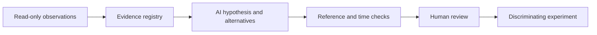

# How to Make AI Root Cause Suggestions Reviewable with Evidence

Author: [nawazdhandala](https://www.github.com/nawazdhandala)

Tags: AI, Incident Management, Python

Description: Require AI incident hypotheses to cite captured evidence, disclose uncertainty, and propose falsifiable checks before responders accept a cause.

An AI-generated root cause is useful only if a responder can inspect the evidence and challenge the reasoning. Require the system to produce a hypothesis, supporting and contradicting observations, and a next discriminating check. A fluent narrative without source links should remain an unverified suggestion.

This tutorial uses a vendor-neutral JSON schema and Python 3 checks. It does not call a model or execute tools against production. The approach applies whether suggestions come from a language model, an internal assistant, or a human-authored automation rule. The core requirement is traceability from each claim to evidence available at decision time.

## Separate observation from inference

An error log is an observation. The claim that a deployment caused the error is an inference. Keep them in separate fields so the reviewer can agree with the observation while rejecting the causal explanation. Avoid numerical confidence unless it has a defined and evaluated meaning.

```json
{"hypothesis_id":"h-17","claim":"release 208 increased connection demand","status":"unverified","supporting_evidence":["deploy-208","pool-chart-17"],"contradicting_evidence":["error-before-release"],"next_check":"compare acquisition failures on old and new release instances","alternative":"database-side connection limit changed"}
```

Contradicting evidence matters. A retrieval system that only finds supporting snippets encourages confirmation bias. Include observations that predate the suspected trigger, unaffected regions, and healthy control instances. An assistant should be allowed to conclude that available evidence is insufficient.

## Maintain an evidence registry

Each evidence object should record source, query or tool arguments, capture time, observation window, result location, and access scope. The illustrative registry below is deliberately small and contains no raw customer data.

```yaml
# Internal evidence registry entry.
evidence_id: pool-chart-17
source: metrics-prod
captured_at: 2026-11-15T10:15:00Z
window_start: 2026-11-15T09:45:00Z
window_end: 2026-11-15T10:10:00Z
query: connection acquisition failures by release
artifact: evidence/inc-42/pool-chart.json
access_group: incident-responders
```

Store an immutable or versioned artifact where feasible because live dashboard results can change with retention, backfill, or query edits. A source URL alone is weaker than a bounded query and preserved result. Record tool errors too; an empty result caused by a failed query is not evidence that the system was healthy.



## Reject dangling evidence references

The fixture checks that every cited evidence ID exists. A production validator should also check access, timestamp bounds, result integrity, and whether the cited excerpt supports the claim. Existence is necessary but far from sufficient.

```python
registry = {"deploy-208":{},"pool-chart-17":{},"error-before-release":{}}
hypothesis = {"supporting_evidence":["deploy-208","pool-chart-17"],
              "contradicting_evidence":["error-before-release"]}
refs = hypothesis["supporting_evidence"]+hypothesis["contradicting_evidence"]
missing = set(refs)-registry.keys()
assert not missing
print("All",len(refs),"evidence references resolve")
```

## Keep tool output as evidence, not authority

Logs, tickets, and retrieved documents can contain text that looks like instructions. Treat it as untrusted source content. It must not authorize new tool calls, change the assistant's policy, or cause secrets to be included in a response. Use bounded read-only tools and a separate authorization path for any production action.

During review, ask what observation would falsify the hypothesis. If the answer is merely more supporting logs, the investigation is not discriminating between explanations. Compare affected and unaffected populations or test a scoped change in a safe environment.

Finally, store the review outcome: accepted, rejected, or unresolved, with the evidence that changed the decision. Evaluate unsupported claims and incorrect causal assertions separately from helpful next-step suggestions. The system earns trust by making uncertainty and mistakes inspectable, not by sounding certain about a root cause before the evidence supports one.

Keep the hypothesis version when new evidence arrives. Editing the original claim in place can make the assistant appear to have known the correct explanation earlier than it did. Store a sequence of revisions with the evidence added at each step and the human decision. This supports later evaluation of whether the assistant helped the investigation, repeated an unsupported theory, or changed its conclusion appropriately when contradictory observations appeared.

## References

The [community question](https://www.reddit.com/r/sre/comments/1t6wqux/anyone_using_ai_for_actual_sreoncall_operations/) motivated this walkthrough. Implementation references:

- [Official reference 1](https://sre.google/sre-book/effective-troubleshooting/)
- [Official reference 2](https://docs.python.org/3/library/json.html)
