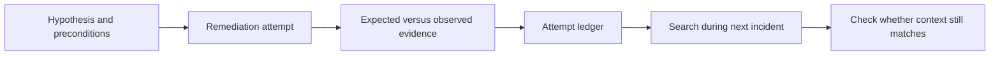

# How to Make Failed Incident Remediations Searchable

Author: [nawazdhandala](https://www.github.com/nawazdhandala)

Tags: Incident Management, Python, SRE

Description: Record failed remediation hypotheses, preconditions, evidence, and outcomes in a small searchable ledger so future responders avoid blind repetition.

The failed restart, ineffective rollback, and misleading cache flush often disappear from the final incident summary. Months later, another responder repeats them because the runbook records only the eventual fix. Preserve unsuccessful attempts as structured evidence with enough context to explain when they might still be relevant.

This walkthrough uses Python 3 and an in-memory SQLite database. It is a local prototype for an attempt ledger, not a replacement for your incident system. Store links to controlled evidence rather than copying sensitive logs into a broadly searchable document. The goal is to make previous reasoning discoverable without turning one failed attempt into a universal prohibition.

## Record the hypothesis before the action

Capture the symptom, suspected mechanism, preconditions, action, expected observation, actual observation, and outcome. Distinguish failed, inconclusive, and successful attempts. An action can be inconclusive because another change happened simultaneously or the observation window was too short.

```json
{"incident":"inc-42","service":"checkout","symptom":"connection timeout","action":"restart one worker","hypothesis":"worker-local connection leak","expected":"new worker acquires connections normally","observed":"timeouts continued on replacement","outcome":"failed","evidence":"evidence/inc-42/attempt-3"}
```

Use neutral language. The record should explain what information was available and what the experiment taught, not judge the responder. Failed hypotheses are useful when they reduce uncertainty and prevent unnecessary repetition during the next incident.

## Build a minimal searchable index

Keep the full record in the incident archive and index a small set of searchable fields. The executable fixture uses parameterized SQL and returns failed attempts for the same service and symptom. It does not execute any remediation.

```python
import sqlite3
con = sqlite3.connect(":memory:")
con.execute("CREATE TABLE attempts(service TEXT,symptom TEXT,action TEXT,outcome TEXT,evidence TEXT)")
con.executemany("INSERT INTO attempts VALUES(?,?,?,?,?)",[
 ("checkout","connection timeout","restart worker","failed","inc-42/attempt-3"),
 ("checkout","connection timeout","reduce concurrency","successful","inc-42/attempt-4"),
])
rows = con.execute("SELECT action,evidence FROM attempts WHERE service=? AND symptom LIKE ? AND outcome=?",
                   ("checkout","%timeout%","failed")).fetchall()
print(rows)
assert rows == [("restart worker","inc-42/attempt-3")]
```

For a persistent prototype, replace `:memory:` with a controlled local database path and add backups, access control, and migration handling appropriate to the environment. Use structured service names and symptom tags so spelling variations do not make related incidents invisible.



## Make retrieval context-sensitive

A search result should include version, region, dependency, and relevant configuration when those affect the conclusion. Restarting a worker failed during a database-wide outage, but that does not mean restarting can never fix a worker-local issue. Highlight the causal boundary the evidence actually tested.

```yaml
# Internal search-result context.
service: checkout
software_version: release-208
failure_scope: all-workers
dependency: postgres-primary
attempt: restart-one-worker
result: failed
lesson: replacement workers showed the same acquisition timeout
reconsider_if: evidence points to one worker only
```

## Keep the ledger useful after the incident

During review, merge duplicate attempt records and clarify inconclusive outcomes without rewriting the original timestamps. Add the successful mitigation as a related entry, but retain failed experiments that materially narrowed the investigation. Link the runbook section to the evidence that supports its preconditions.

Test retrieval with the words a new responder would actually type: the alert name, timeout text, dependency, and service. If the record is only discoverable by incident number, it will not help during a recurrence. Track broken evidence links and archive expiration separately, since a searchable conclusion without supporting data becomes less trustworthy over time.

The acceptance exercise is simple: give a teammate the original symptom without the incident number and ask them to find the prior attempts. They should understand what was tried, what changed, why it did not help, and which conditions would justify trying again. That turns failed remediation into reusable diagnostic knowledge rather than a forgotten chat transcript.

Add a retention policy for the ledger and its evidence. A search entry can remain useful after detailed logs expire, but it should state that the supporting artifact is no longer available. Avoid silently replacing a broken link with a broad dashboard URL that no longer reproduces the observation. During periodic review, mark obsolete software versions and changed preconditions so search results help the next responder evaluate applicability instead of copying an old action mechanically.

## References

The [community question](https://www.reddit.com/r/sre/comments/1vndr8z/when_a_production_incident_repeats_months_later/) motivated this walkthrough. Implementation references:

- [Official reference 1](https://sre.google/sre-book/effective-troubleshooting/)
- [Official reference 2](https://sre.google/workbook/postmortem-culture/)
- [Official reference 3](https://docs.python.org/3/library/sqlite3.html)
