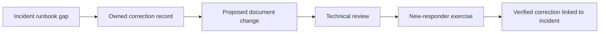

# How to Make Runbook Corrections an Owned Incident Review Deliverable

Author: [nawazdhandala](https://www.github.com/nawazdhandala)

Tags: Incident Management, SRE, Python

Description: Turn runbook gaps into assigned, reviewable changes with observable preconditions, verification steps, and a test by a new responder.

A note saying update the runbook often survives longer than the incident itself. Make the correction a concrete deliverable: identify the wrong or missing step, assign an owner, link a proposed change, and define who will verify it. The incident review should produce a reviewable document change, not a reminder with no completion criterion.

The examples use an internal correction record and Python 3 checks. They are intentionally independent of any issue tracker. Map the fields into your existing workflow and keep the runbook in the system engineers already use during incidents. A second documentation repository is rarely helpful if nobody knows it exists.

## Capture the gap while the evidence is fresh

Record what the responder expected, what the runbook said, and what actually worked or failed. Include the service version and the relevant evidence link. This avoids replacing a specific correction with a vague request to improve clarity.

```json
{"correction_id":"rb-17","incident":"inc-42","runbook":"checkout/pool-exhaustion","section":"Identify the blocking client","gap":"query omitted idle transactions","owner":"payments-platform","reviewer":"database-oncall","due_date":"2026-11-20","change_url":"pending"}
```

Separate factual corrections from new mitigation proposals. A query missing a necessary column can be corrected directly. A new restart procedure may require a staging exercise and a rollback plan before it belongs in an operational runbook. Do not let documentation review become an untested production change channel.

## Define the step contract

Every consequential step should have an observable precondition, a scoped action, an expected result, and a stop condition. This makes it possible for a responder to know when the step applies and when repeating it is unhelpful.

```yaml
# Internal runbook step contract.
step: inspect-blocking-client
precondition: database wait graph shows a persistent blocker
action: collect blocker identity and transaction age
expected_result: identify the owning service and open transaction
stop_condition: blocker disappeared or evidence cannot identify the owner
escalation: database on-call
verification: reviewer reproduces the diagnostic result in staging
```

A diagnostic step should remain read-only unless the runbook explicitly moves into remediation. Keep privileged or destructive operations behind their own preconditions and ownership. The page that links the runbook should make the entry point clear so responders do not start in the middle of a procedure.



## Check completion mechanically where possible

The fixture validates that a correction has an owner, reviewer, change reference, and verification evidence before marking it complete. It does not decide whether the content is correct; it prevents a completed status from concealing missing review artifacts.

```python
correction = {"owner":"payments-platform","reviewer":"database-oncall",
              "change_url":"changes/rb-17","verification":"drills/rb-17",
              "status":"verified"}
required = ["owner","reviewer","change_url","verification"]
assert all(correction.get(field) for field in required)
assert correction["status"] == "verified"
print("Correction has accountable review evidence")
```

In a repository, combine such metadata checks with syntax checks for embedded commands and queries where practical. Do not claim a command is operationally verified merely because it parses. Permissions, installed versions, and expected data shapes still need an environment-specific test.

## Exercise the revised path

Have a reviewer who did not perform the original mitigation follow the runbook in a safe scenario. Note missing context, inaccessible links, ambiguous output, and assumptions about shell tools or credentials. The author often fills these gaps unconsciously, which is why an independent read-through matters.

Link the verified change back to the incident and the action tracker. Keep the incident closed if user impact has ended, but leave the correction open until its own acceptance criterion is satisfied. If the correction is deferred, record the risk and a review date rather than silently removing it from the action list.

At the next relevant incident, record whether the updated section helped. Runbooks evolve with software and ownership, so retain a last-verified version or date and review them when the underlying system changes. The deliverable is complete when a responder can use the correction successfully, not when someone adds a sentence to a document.

## References

The [community question](https://www.reddit.com/r/EngineeringManagers/comments/1qmuyub/how_do_your_runbooks_actually_get_updated_after/) motivated this walkthrough. Implementation references:

- [Official reference 1](https://sre.google/workbook/postmortem-culture/)
- [Official reference 2](https://sre.google/sre-book/effective-troubleshooting/)
