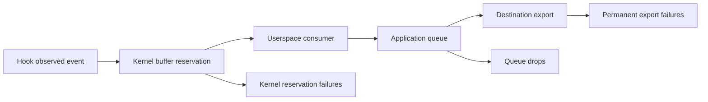

# How to Measure Event Loss in High-Throughput eBPF Pipelines

Author: [nawazdhandala](https://www.github.com/nawazdhandala)

Tags: eBPF, Linux, Observability

Description: Count failures at kernel export, userspace receive, application queues, and destination delivery with explicit denominators.

A fast eBPF program can still lose events after observing them. The kernel-to-userspace buffer may fill, the consumer may fall behind, an application queue may overflow, or the destination may reject batches. Measuring only one lost-event callback leaves several boundaries invisible.

Define counters at each stage and keep them outside the event stream they diagnose. If the loss metric travels only through the saturated buffer, the monitoring path can lose its own evidence.

## Separate attempted, submitted, and consumed events

For a BPF ring buffer, count reservation failures in a separate map. The following C fragment belongs inside a BPF program with a ring-buffer map named `events`, a counter pointer named `reserve_failures`, and an application-defined event structure.

```c
struct event *event = bpf_ringbuf_reserve(&events, sizeof(*event), 0);
if (!event) {
    if (reserve_failures)
        __sync_fetch_and_add(reserve_failures, 1);
    return 0;
}
event->timestamp_ns = bpf_ktime_get_ns();
bpf_ringbuf_submit(event, 0);
```

The fragment is intentionally not a complete loadable program. Use per-CPU counters where appropriate to reduce contention, and aggregate them in userspace. Ring-buffer reservation can fail under capacity or contextual constraints; treat the failure count as observed inability to reserve, not a complete explanation of its cause.



## Use the perf-buffer loss callback when applicable

Perf buffers and BPF ring buffers have different APIs. With libbpf perf buffers, supply a lost-event callback and preserve the per-CPU information:

```c
static void on_lost(void *ctx, int cpu, __u64 count)
{
    struct counters *stats = ctx;
    stats->lost_events += count;
    stats->last_loss_cpu = cpu;
}
```

This callback fragment assumes a single consumer thread owns the counters. Use synchronization if several threads update shared state. The callback reports perf-buffer losses; it does not count records dropped later by your application queue or exporter.

## Calculate a rate with a clear denominator

The following Python fixture models deltas over one measurement interval:

```python
attempted = 1_000_000
kernel_rejected = 5000
userspace_received = 995000
queue_dropped = 2000
assert attempted == kernel_rejected + userspace_received
print({
    "kernel_loss_ratio": kernel_rejected / attempted,
    "queue_loss_ratio_of_received": queue_dropped / userspace_received,
})
```

These are hypothetical counts. Use counter deltas and handle process restarts. Do not sum percentages with different denominators. Reconcile stage counts after allowing for in-flight events and queues at the start and end of the interval.

## Measure bursts and CPU imbalance

Perf buffers are commonly per CPU, so one hot CPU can overflow while aggregate capacity appears available. Record per-CPU loss and event rates. Ring buffers share capacity differently, but a slow consumer or large event size can still exhaust them.

Add sequence numbers when the event model permits it. Use per-CPU or per-producer sequences if a global atomic sequence would add too much overhead. Gaps must be interpreted with filtering and intentional sampling rules; a sequence gap is not automatically transport loss.

Test a controlled event generator with known expected volume. Compare attempted, submitted, received, queued, and delivered totals after the pipeline drains. Include a burst and a slow destination so each counter's boundary is exercised.

Finally, evaluate whether you need every event. Kernel-side aggregation, bounded sampling, and smaller payloads can reduce transport cost, but they change the dataset and must be explicit. A larger buffer absorbs temporary bursts; it cannot fix a consumer whose sustained service rate is below the producer rate. The useful result is a stage-specific loss budget with observable counters, not a single claim of zero drops from one callback.

## References

The [community question](https://www.reddit.com/r/kernel/comments/1m28oon/ebpf_perf_buffer_dropping_events_at_600k_opssec/) motivated this investigation. The implementation references are [official reference 1](https://docs.kernel.org/bpf/ringbuf.html), [official reference 2](https://raw.githubusercontent.com/libbpf/libbpf/master/src/libbpf.h).
