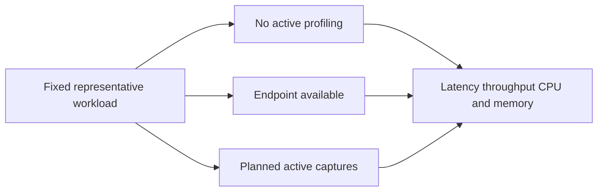

# How to Measure Go pprof Overhead Before Production Use

Author: [nawazdhandala](https://www.github.com/nawazdhandala)

Tags: Go, Profiling

Description: Compare disabled, available, and actively collecting profiling modes under representative Go workloads and explicit latency budgets.

Enabling a pprof HTTP endpoint is not the same workload as continuously collecting CPU, allocation, block, and mutex profiles. Different profiles have different collection costs. Measure the modes you intend to operate rather than accepting a universal claim that profiling is free or always expensive.

Use a representative service, fixed Go version, and repeatable request mix. Compare application latency and throughput as well as profiler process cost. A low average CPU increase can still hide an unacceptable tail-latency change.

## Expose diagnostics on a separate listener

This minimal Go program serves pprof only on loopback. It is a diagnostic fixture, not a complete application server.

```go
package main

import (
    "log"
    "net/http"
    _ "net/http/pprof"
)

func main() {
    log.Fatal(http.ListenAndServe("127.0.0.1:6060", nil))
}
```

For a real application, keep the diagnostic listener separate from public routing and apply your access controls. Profiles can expose function names, paths, and application details. Avoid registering the default pprof mux accidentally on a public listener.

## Compare distinct operating modes

Run a baseline with no active capture, a run with the endpoint available, and a run with the planned capture frequency. Use the same warm-up and load interval for each. Capture a bounded CPU profile:

```bash
curl --fail --output cpu.pprof \
  'http://127.0.0.1:6060/debug/pprof/profile?seconds=30'
go tool pprof -top ./application cpu.pprof
```

Retain the exact application binary for symbolization. CPU profiling samples active CPU execution; it does not explain all wall-clock latency spent waiting for I/O or locks.



Block and mutex profiling require explicit runtime settings. Enable only the modes needed for the investigation, and test their cost independently:

```go
runtime.SetBlockProfileRate(1000000)
runtime.SetMutexProfileFraction(10)
```

These are startup fragments requiring the `runtime` import. The block setting is a sampling rate in nanoseconds of blocking, while the mutex setting samples a fraction of contention events. Setting both to capture everything can be much more expensive than a modest sampled configuration.

## Quantify the comparison honestly

Use repeated runs and report variability. This local fixture calculates a simple throughput difference from hypothetical values:

```python
baseline_rps = [10000, 10100, 9900]
profiled_rps = [9800, 9950, 9750]
mean = lambda values: sum(values) / len(values)
change = 100 * (mean(profiled_rps) / mean(baseline_rps) - 1)
print("illustrative throughput change percent:", round(change, 2))
```

Do not present these inputs as measured performance. In the real experiment, also compare P95/P99 latency, error rate, allocations, GC pauses, profile size, and export or upload costs. Keep offered load constant when comparing latency, and separately test maximum sustainable throughput if that is the objective.

## Include failure and operational behavior

Test simultaneous profile requests, a slow profile download, and the continuous profiler's upload failure behavior. Ensure captures do not accumulate unbounded files or overlap unexpectedly. Heap profiles with forced GC can perturb the application differently from a passive heap snapshot.

Container CPU limits can magnify profiling overhead by causing extra throttling. Repeat the comparison with the resource limits used in production rather than an unconstrained developer machine.

Choose an explicit budget and rollout guardrail, such as acceptable tail-latency change under a defined workload. Canary the production setting and retain a way to disable active collection quickly. The defensible answer is a measured overhead range for specific profile types and rates, with known workload conditions, rather than one percentage applied to every Go service.

## References

The [community question](https://stackoverflow.com/questions/64057727/is-it-ok-to-use-golang-pprof-on-production-without-effecting-performance) motivated this investigation. The implementation references are [official reference 1](https://pkg.go.dev/net/http/pprof), [official reference 2](https://pkg.go.dev/runtime).
