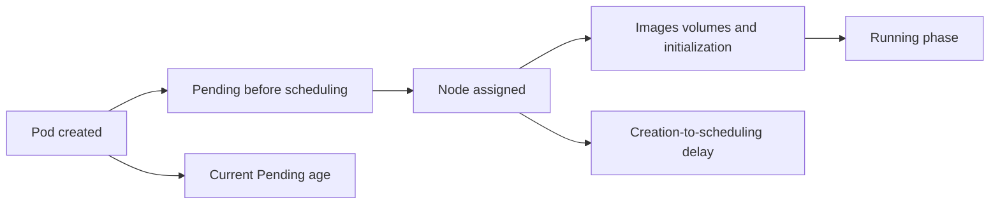

# How to Measure Kubernetes Pod Pending Time with kube-state-metrics

Author: [nawazdhandala](https://www.github.com/nawazdhandala)

Tags: Kubernetes, Prometheus

Description: Separate current Pending age from scheduling latency and historical phase duration when building PromQL dashboards.

Pod Pending time has several meanings. You may want the age of Pods that are currently Pending, the delay from creation to scheduling, or the total time each completed Pod spent in the Pending phase. Those are different measurements, and kube-state-metrics does not turn every phase transition into a durable event history.

Pending can include time waiting for scheduling and time spent preparing containers after scheduling. Image pulls, volume setup, and initialization can therefore contribute even when the scheduler has already assigned a node.

## Show the age of currently Pending Pods

Subtract creation time from the current evaluation time and filter to the Pending phase:

```promql
(time() - kube_pod_created)
and on (namespace, pod, uid)
(kube_pod_status_phase{phase="Pending"} == 1)
```

The result is seconds since creation for Pods currently Pending. It is not a stored final Pending duration for Pods that have already moved to Running. Include cluster identity in the match labels when querying a multi-cluster store.



## Measure scheduling latency separately

Where your kube-state-metrics version exposes the scheduled timestamp, subtract creation time:

```promql
kube_pod_status_scheduled_time
- on (namespace, pod, uid)
kube_pod_created
```

This measures creation-to-scheduling time for the represented Pod lifecycle. It excludes later image pulling and container startup. Check metric availability and stability in the version you deploy; an absent timestamp is not a zero-second scheduling delay.

For currently unscheduled Pods, use the scheduled condition rather than the broader Pending phase:

```promql
(time() - kube_pod_created)
and on (namespace, pod, uid)
(kube_pod_status_scheduled{condition="false"} == 1)
```

This helps separate scheduler capacity problems from post-scheduling setup problems.

## Understand the limits of sampled phase duration

You can approximate time spent Pending within a historical window using a sampled phase gauge, but the estimate depends on scrape and evaluation intervals. Short transitions between scrapes may be missed, and deleted Pods disappear from current-state metrics.

For example, a recording rule can sample current Pending age for later inspection:

```yaml
groups:
  - name: pod-pending
    interval: 30s
    rules:
      - record: pod:pending_age_seconds
        expr: |
          (time() - kube_pod_created)
          and on (namespace, pod, uid)
          (kube_pod_status_phase{phase="Pending"} == 1)
```

The maximum recorded age before leaving Pending is an approximation with a resolution bounded by sampling. It is not an exact transition timestamp. A Pod that is Pending for only a few seconds may never appear in the recorded series.

## Use events for exact lifecycle accounting

If you need a histogram of completed startup durations or precise per-job billing, collect Pod lifecycle transitions through a controller or event pipeline and write a durable observation when the transition occurs. Preserve Pod UID so reused names do not merge separate lifecycles.

Kubernetes Events are useful for diagnosis but have retention and aggregation behavior; do not assume an ad hoc Events query is a permanent audit trail. Design a dedicated record if exact historical accounting is required.

## Investigate the reason behind long Pending age

For a specific Pod, inspect scheduling conditions and Events for insufficient resources, affinity conflicts, image pulls, volume attachment, and admission constraints. A high Pending-age graph without reason context tells you where to look, not what to change.

Compare the same UID across creation, scheduled time, container start, and readiness. Running does not imply Ready, so choose the final milestone that matches your application objective.

Finally, name dashboards precisely: current Pending age, scheduling delay, or time to readiness. That prevents a convenient PromQL subtraction from being interpreted as an exact measurement of a different lifecycle phase.

## References

The [community question](https://www.reddit.com/r/PrometheusMonitoring/comments/1ioamkb/how_to_best_query_and_graph_pods_duration_in/) motivated this investigation. The implementation references are [official reference 1](https://raw.githubusercontent.com/kubernetes/kube-state-metrics/main/docs/metrics/workload/pod-metrics.md), [official reference 2](https://kubernetes.io/docs/concepts/workloads/pods/pod-lifecycle/), [official reference 3](https://prometheus.io/docs/prometheus/latest/querying/functions/).
