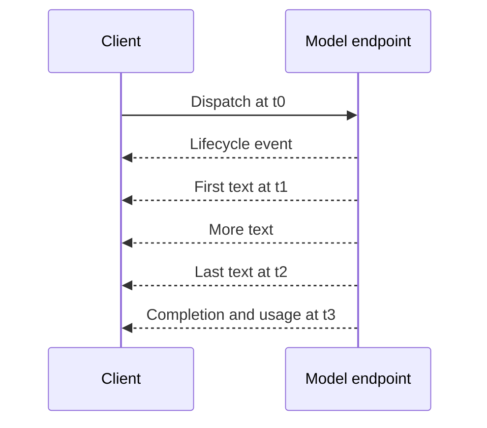

# How to Measure LLM First-Token Latency and Generation Speed

Author: [nawazdhandala](https://www.github.com/nawazdhandala)

Tags: AI, LLM, Python, Observability

Description: Measure first visible text, stream duration, and generation throughput independently without mistaking HTTP chunks for model tokens.

A response that starts quickly can still feel slow if the remaining text arrives in bursts. Conversely, a model can generate text quickly after spending several seconds preparing the first output. A single request-duration number hides this distinction. Measure the first visible text, the arrival of subsequent content, and the terminal response separately.

This tutorial uses Python 3.11 or later. The first example is an offline fixture; the SDK example requires the `openai` package, an API key, and a model enabled for your account. Select the model through configuration so the measurement does not silently change when you edit application code.

## Define the boundaries before collecting data

Start the client clock immediately before dispatch. Record first content only for a nonempty text delta. Connection establishment, response headers, and a lifecycle event are useful milestones, but none proves the user has text to read. Record the last text delta separately from completion because usage accounting and termination can arrive later.



A network chunk is not a tokenizer token. One delta can contain multiple tokens, and several transport reads can belong to one event. A precise decode-rate calculation requires token arrival information from the serving engine. With a hosted API, call the ratio based on final output usage and the visible-text interval an estimate. Reasoning and other nonvisible output tokens make that estimate unsuitable as a pure visible-text rate.

## Check the arithmetic offline

The fixture assumes an engine emitted exactly one token at each timestamp. Run it as a standalone Python file. There are three token-generation intervals after the first token, so dividing four tokens by that interval would overstate the rate.

```python
started = 10.0
token_times = [10.8, 10.9, 11.0, 11.1]
completed = 11.2
ttft = token_times[0] - started
interval = token_times[-1] - token_times[0]
decode_tps = (len(token_times) - 1) / interval
assert round(ttft, 3) == 0.8
assert round(decode_tps, 3) == 10.0
print({"ttft_s": round(ttft, 3), "decode_tps": round(decode_tps, 3),
       "completion_s": round(completed - started, 3)})
```

The expected first-token latency is 0.8 seconds, the decode rate is 10 tokens per second, and completion takes 1.2 seconds. These numbers are synthetic. They validate the formula, not a provider's performance.

## Collect the same milestones from a stream

The Responses API exposes typed streaming events. This example measures first text and terminal success without printing prompt content. An empty or tool-only response retains a missing first-text value. Treat that as a separate outcome rather than recording a zero-second latency.

```python
import os
import time
from openai import OpenAI

client = OpenAI()
start = time.perf_counter()
first_text = last_text = None
usage = None
completed = False
with client.responses.create(
    model=os.environ["OPENAI_MODEL"],
    input="Explain a retry budget in three sentences.",
    stream=True,
) as stream:
    for event in stream:
        now = time.perf_counter()
        if event.type == "response.output_text.delta" and event.delta:
            first_text = now if first_text is None else first_text
            last_text = now
        elif event.type == "response.completed":
            completed = True
            usage = event.response.usage
print({"ttft_s": None if first_text is None else first_text - start,
       "text_interval_s": None if first_text is None else last_text - first_text,
       "total_s": time.perf_counter() - start,
       "completed": completed,
       "output_tokens": None if usage is None else usage.output_tokens})
```

Use a monotonic clock such as `perf_counter` for elapsed time. Wall clocks can jump when synchronization adjusts the system clock. Persist timestamps in one clock domain, or export durations; do not subtract a browser clock from a server clock.

## Compare like requests

Create a small application-owned record with dimensions that explain variation. The following example deliberately has no customer identifier as a metric label.

```json
{
  "experiment": "stream-baseline-v1",
  "model_revision": "deployment-under-test",
  "input_token_bucket": "1024-2047",
  "concurrency": 1,
  "cache_state": "unknown",
  "terminal_state": "completed",
  "measurement": "client-visible-text"
}
```

Compare latency percentiles within the same input bucket, model revision, concurrency, and cache condition. A mix containing more long prompts can move the overall median even when serving performance is unchanged. Keep failed and interrupted requests in a separate completion-rate series so a fast failure cannot improve the success latency chart.

If first text is delayed but the text interval is stable, investigate connection reuse, queueing, prefill, and buffering. If the text interval expands, inspect server load and inter-delta gaps. Client measurements alone cannot distinguish queueing from prefill. Add engine spans when you control serving, and label conclusions as hypotheses until those spans agree.

## References

This tutorial addresses the problem in the [community question](https://www.reddit.com/r/LocalLLaMA/comments/1kk1dkh/time_to_first_token_and_tokenssecond/). Implementation details were checked against these primary sources:

- [Official documentation 1](https://developers.openai.com/api/docs/guides/streaming-responses)
