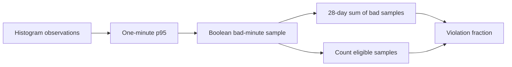

# How to Measure Minutes That Violate a 28-Day Latency SLO

Author: [nawazdhandala](https://www.github.com/nawazdhandala)

Tags: SLO, Prometheus, Monitoring

Description: Record one latency assessment per minute, count violating eligible minutes, and report missing coverage separately from the SLO result.

A time-based latency SLO asks what fraction of eligible minutes met a condition. That differs from asking what fraction of requests were fast. A quiet minute and a busy minute receive equal weight in the first definition. Choose this intentionally and state the per-minute condition before writing a 28-day query.

The example uses a classic Prometheus histogram named `http_request_duration_seconds`, a 300-millisecond threshold, and a rule group evaluated every minute. It classifies a minute by the estimated p95 over the preceding minute. This is a policy example; it is not equivalent to a request-based 95% latency SLO over the full window.

## Record the minute-level decision

Create a Boolean sample for every minute with traffic. `bool` is essential: without it, a comparison filters out good minutes, making the denominator wrong. The traffic condition removes zero-request periods from this particular policy's eligible population.

```yaml
groups:
  - name: minute-latency
    interval: 1m
    rules:
      - record: service:latency_bad_minute
        expr: |
          (
            histogram_quantile(0.95,
              sum by (service, le) (rate(http_request_duration_seconds_bucket[1m]))
            ) > bool 0.3
          )
          and on (service)
          (sum by (service) (increase(http_request_duration_seconds_count[1m])) > 0)
```

A one-minute rate range needs several scrapes. With a one-minute scrape interval this definition is unsuitable; shorten the scrape interval or choose a wider measurement window and describe the overlapping-window semantics. Histogram bucket boundaries affect quantile accuracy, so include useful boundaries near the threshold.

## Count bad minutes and observed eligible minutes

Once the recording rule has accumulated history, sum its zero-or-one values and divide by its sample count. This avoids repeatedly evaluating an expensive histogram query over 28 days.

```promql
sum_over_time(service:latency_bad_minute[28d])
/
count_over_time(service:latency_bad_minute[28d])
```

The result is the fraction of observed eligible minute assessments that were bad. Multiply by 100 for a percentage. A missing rule evaluation is absent, not a zero, so this query alone does not measure calendar coverage. If the rule has run for only two days, it cannot truthfully report a complete 28-day result.



## Validate the denominator with a fixture

Represent no traffic and missing telemetry distinctly in your review dataset. The arithmetic below excludes both from the observed ratio but reports them separately. Production reporting should determine expected active minutes from the service schedule or another authoritative source.

```python
minutes = [0,0,1,0,"idle","missing",1,0]
observed = [x for x in minutes if isinstance(x,int)]
ratio = sum(observed)/len(observed)
print({"bad_fraction":ratio,"observed_minutes":len(observed),
       "idle":minutes.count("idle"),"missing":minutes.count("missing")})
assert sum(observed) == 2 and len(observed) == 6
```

## Interpret the result without overclaiming

A one-third violation fraction in this fixture means two of six observed eligible assessments were bad. It does not mean one-third of users had slow requests. For a user-weighted latency objective, count requests in a threshold bucket and divide by all eligible requests instead.

Decide how maintenance windows, idle periods, and missing telemetry affect eligibility before incidents occur. Excluding missing monitoring data from the denominator can make the score look better during a monitoring outage, so display a separate coverage indicator and refuse to present an unqualified result when coverage is insufficient.

Test the rule with healthy traffic, slow traffic, no traffic, missing scrapes, and counter resets. Check the recording interval and retention of the resulting series. The completed dashboard should show violation percentage, eligible minute count, assessment coverage, and the policy definition together. That gives a reviewer enough information to distinguish a real latency improvement from a changed denominator.

When the rule misses evaluations, increasing a chart query step does not recreate the missing assessments. Preserve the original recording interval and measure actual sample coverage. If you backfill the rule, mark the backfilled period and use the same eligibility policy and histogram schema. A report mixing observed and reconstructed assessments should disclose that difference, especially when the reconstruction cannot reproduce the exact scrape timing used during the incident.

## References

The [community question](https://stackoverflow.com/questions/52724435/how-do-i-query-an-api-latency-error-budget-from-prometheus) motivated this walkthrough. Implementation references:

- [Official reference 1](https://prometheus.io/docs/practices/histograms/)
- [Official reference 2](https://prometheus.io/docs/prometheus/latest/querying/functions/)
- [Official reference 3](https://prometheus.io/docs/prometheus/latest/querying/operators/)
