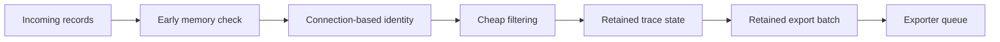

# How to Order Batching, Sampling, and Collector Memory Limits

Author: [nawazdhandala](https://www.github.com/nawazdhandala)

Tags: OpenTelemetry, Performance

Description: Place Collector processors according to their context and buffering needs, and distinguish batch thresholds from memory protection.

Processor ordering affects both correctness and resource usage. A pipeline that exports valid telemetry at low volume can fail during a burst because it buffers too much before checking memory. Another can remain healthy while losing the connection context required to identify the source Pod.

For Collector Contrib 0.120.0, a useful starting order is memory limiting, context-dependent enrichment, inexpensive filtering, tail sampling when required, and export batching. Each step has a reason. Treat this as a set of dependencies, not a magic sequence to copy without understanding the components.

## Start with admission pressure

The memory limiter belongs near the receiver so it can refuse new work before additional processors retain it. The following example targets a Collector whose container has more memory than the configured hard threshold.

```yaml
processors:
  memory_limiter:
    check_interval: 1s
    limit_mib: 768
    spike_limit_mib: 160
```

The soft threshold is the hard threshold minus the spike allowance, here 608 MiB. A periodic check is not an instantaneous process memory cap. Leave room for non-heap allocations and growth between checks, and coordinate the Go runtime memory target with the container limit.

Refused telemetry still needs an upstream component capable of retrying. Otherwise limiting can prevent a crash while dropping data. Observe receiver refusal and exporter enqueue failures alongside process memory.

## Preserve context before retaining traces

Kubernetes association can need the incoming connection, so run it before tail sampling or batching. Tail sampling then retains trace state while waiting for a decision. Its memory budget is separate from exporter queues and batches.

```yaml
processors:
  tail_sampling:
    decision_wait: 15s
    num_traces: 20000
    expected_new_traces_per_sec: 800
    policies:
      - name: errors
        type: status_code
        status_code:
          status_codes: [ERROR]
```

These numbers are illustrative. At 800 new traces per second, a 15-second window already implies roughly 12,000 concurrently undecided traces before burst allowance. Large traces can dominate memory even when trace count looks comfortable.



## Batch the records that remain

Batching after sampling avoids assembling large export batches only to discard most of their contents. Set both the send trigger and the maximum if the destination needs bounded record counts per request.

```yaml
processors:
  batch:
    timeout: 1s
    send_batch_size: 512
    send_batch_max_size: 1024
```

The send trigger is not a hard maximum. Also, a record-count maximum is not a byte limit: a single log body or span event can be very large. If the backend rejects payload size, inspect actual serialized requests and reduce large attributes or events as well as batch counts.

Wire the components explicitly; declaring a component alone does not enable it.

```yaml
service:
  pipelines:
    traces:
      receivers: [otlp]
      processors: [memory_limiter, k8sattributes, tail_sampling, batch]
      exporters: [otlp/backend]
```

## Test the pipeline under the intended stress

Use three staging workloads: normal traffic, a burst of short traces, and a smaller number of unusually large traces. Then make the backend temporarily slow. Record accepted and refused spans, queue utilization, process memory, sampling decisions, and exporter failures.

If memory rises with slow export while undecided trace count stays flat, investigate queues and batches. If memory follows trace duration or cardinality, tune sampling retention or redesign long traces. Increasing the memory limit without identifying the retained state merely moves the failure threshold.

Do not place independent tail samplers behind arbitrary per-request load balancing. Ordering is correct only when all spans belonging to a trace arrive at the same sampler. Likewise, a generic filter that removes one service can produce incomplete distributed traces. Validate both resource behavior and the resulting trace structure before promoting a processor reorder.

## References

The [community question](https://stackoverflow.com/questions/77893695/whats-the-recommended-processor-ordering-for-opentelemetry-collector-configurat) motivated this investigation. The implementation references are [official reference 1](https://raw.githubusercontent.com/open-telemetry/opentelemetry-collector/v0.120.0/processor/memorylimiterprocessor/README.md), [official reference 2](https://raw.githubusercontent.com/open-telemetry/opentelemetry-collector/v0.120.0/processor/batchprocessor/README.md), [official reference 3](https://raw.githubusercontent.com/open-telemetry/opentelemetry-collector-contrib/v0.120.0/processor/tailsamplingprocessor/README.md).
