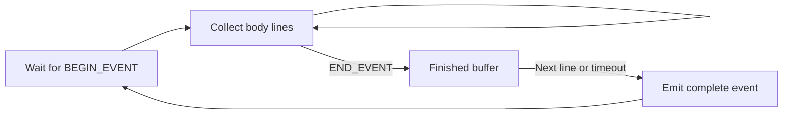

# How to Parse Multiline Logs with Explicit Start and End Markers

Author: [nawazdhandala](https://www.github.com/nawazdhandala)

Tags: Fluent Bit, Observability

Description: Model Fluent Bit multiline parsing as a state machine and test marker boundaries, incomplete events, and container log wrappers.

Explicit start and end markers make multiline logs easier to recognize, but they still require a state machine. A parser must know when a message begins, which lines belong inside it, and what to do when the end marker never arrives. Matching every line with one broad regex can accidentally combine unrelated requests.

The example uses Fluent Bit's multiline core with a classic parser file. Test it with the exact Fluent Bit image you deploy. The fixture is plain text; Docker or CRI-wrapped container logs need their transport wrapper reconstructed before application multiline grouping.

## Define a small, unambiguous fixture

Use markers that cannot appear in ordinary payload lines:

```text
BEGIN_EVENT id=42
request validation failed
  missing field: currency
END_EVENT
BEGIN_EVENT id=43
request accepted
END_EVENT
```

If several threads interleave these blocks on the same stream, a line-oriented multiline parser cannot reliably reconstruct their original grouping. Prefer one structured JSON record per event or separate stream keys when interleaving is possible.

## Express the parser states

Save this as `parsers_multiline.conf`:

```ini
[MULTILINE_PARSER]
    Name          marked_event
    Type          regex
    Flush_Timeout 2000
    Rule          "start_state" "/^BEGIN_EVENT(?:\s|$)/" "body"
    Rule          "body"        "/^END_EVENT$/"          "finished"
    Rule          "body"        "/^(?!BEGIN_EVENT(?:\s|$)|END_EVENT$).*$/" "body"
    Rule          "finished"    "/a^/"                   "start_state"
```

The end-marker rule is listed before the body rule. The `finished` state has an intentionally nonmatching expression, so the next line causes the completed buffer to flush and is reconsidered as a possible new event. The final event can also flush on timeout. Do not assume this configuration emits immediately on reading the end marker; the timeout and following-record behavior are part of the contract.



## Wire the parser into Tail

A minimal local configuration reads a fixture file and prints assembled events:

```ini
[SERVICE]
    Flush        1
    Parsers_File parsers_multiline.conf

[INPUT]
    Name             tail
    Path             ./fixture.log
    Read_from_Head   On
    multiline.parser marked_event

[OUTPUT]
    Name  stdout
    Match *
```

Use a fresh fixture path or a dedicated state database when repeating the test. Otherwise saved offsets can make a correct parser appear inactive.

```bash
fluent-bit -c fluent-bit.conf
```

## Check failure boundaries, not just the happy case

Add fixtures with a missing end marker, a new start marker before the old event ends, blank lines, and a marker-like substring inside the body. Confirm the output count and exact assembled body. The flush timeout trades delivery latency against tolerance for slow line production; it is not a guarantee that an incomplete event will become complete.

For Docker or CRI logs, first use the built-in transport multiline handling to reconstruct records split by the container runtime. Then apply the application multiline parser to the decoded log field using the supported multiline filter. Keep that filter first and avoid multiple matching multiline filters, which can create re-emission loops.

Bound event size and memory according to your Fluent Bit release. A process that emits `BEGIN_EVENT` followed by unbounded text can retain a large buffer even if ordinary single-line tail limits look small. Observe truncation or flush behavior with a deliberately oversized test.

Finally, retain the marker grammar as an application contract. Changing the prefix, adding ANSI color codes, or escaping newlines in JSON can invalidate the parser. A regression fixture should travel with every logging-format change so event assembly remains predictable.

## References

The [community question](https://stackoverflow.com/questions/75770565/fluent-bit-rule-when-using-multiline-log-start-and-end-tags) motivated this investigation. The implementation references are [official reference 1](https://docs.fluentbit.io/manual/administration/configuring-fluent-bit/multiline-parsing), [official reference 2](https://docs.fluentbit.io/manual/data-pipeline/filters/multiline-stacktrace), [official reference 3](https://docs.fluentbit.io/manual/data-pipeline/inputs/tail).
