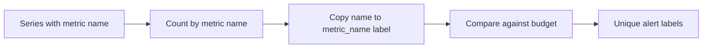

# How to Preserve Metric Names in Prometheus Cardinality Alerts

Author: [nawazdhandala](https://www.github.com/nawazdhandala)

Tags: Prometheus, Monitoring

Description: Copy metric names into a normal label before alert arithmetic so high-cardinality series remain identifiable without collisions.

A cardinality query often groups by `__name__` to count series per metric. That works in the expression browser, but later arithmetic, Boolean comparisons, recording rules, or alert construction can remove or replace the metric name. Several results can then become indistinguishable and trigger duplicate-label errors.

Preserve the original metric name in an ordinary label before the operation that removes it. Use a label such as `metric_name`, and keep the selector bounded so the cardinality diagnostic does not become an expensive whole-server query during an incident.

## Count the relevant active series

Start with a job-scoped query:

```promql
count by (__name__) ({job="checkout"})
```

This counts currently selected series, not all historical series in retained blocks. It is useful for active cardinality but cannot by itself explain churn from thousands of short-lived Pod identities.

Copy the metric name before converting the result into another shape:

```promql
label_replace(
  count by (__name__) ({job="checkout"}),
  "metric_name", "$1", "__name__", "(.+)"
)
```

The output now has an ordinary `metric_name` label that survives operations which remove `__name__`. If grouping by job or cluster is necessary, preserve those dimensions explicitly as well.



## Keep alert values meaningful

A complete rule file can compare the count without `bool`, retaining the actual count as the alert value:

```yaml
groups:
  - name: cardinality
    rules:
      - alert: MetricSeriesBudgetExceeded
        expr: |
          label_replace(
            count by (__name__) ({job="checkout"}),
            "metric_name", "$1", "__name__", "(.+)"
          ) > 10000
        for: 15m
        labels:
          severity: warning
        annotations:
          summary: 'Metric {{ $labels.metric_name }} exceeds its series budget'
          description: 'Current active series count is {{ $value }}.'
```

The threshold is illustrative. Set a budget using the metric's expected label combinations and the server's measured capacity. A useful alert identifies the owning team and the deployment that changed cardinality rather than merely announcing that a large number exists.

Validate the file with the `promtool` version matching your Prometheus deployment:

```bash
promtool check rules cardinality.rules.yml
```

Add a rule unit test with at least two different metric names exceeding the threshold. That catches the exact collision this design is intended to prevent. Also test a metric below threshold and one disappearing from the selector.

## Avoid moving the collision elsewhere

Do not overwrite `metric_name` with a constant in rule labels. That would collapse the distinguishing dimension again. Likewise, a recording rule should preserve the normal name label while assigning its own new `__name__` to the recorded series.

A `bool` comparison produces zero or one values and can remove the metric name according to operator semantics. That is useful for a binary indicator, but a non-Boolean comparison is usually better for an alert whose annotation should show the actual series count.

Check external labels and alert relabeling too. If the query is unique but notifications collide, the distinguishing label may be removed later in the alert pipeline.

## Interpret the result carefully

Series count is a useful first approximation of cost, not an exact memory bill. Label lengths, churn, scrape interval, native histograms, and query activity also matter. Inspect TSDB statistics and process memory before deciding which labels to remove.

Avoid dropping an identity label directly from raw samples unless you prove the remaining label set stays unique. Relabeling is not aggregation: two counters that become identical can produce duplicate samples rather than a correct combined counter. Preserve alert identity first, then make a measured instrumentation or ingestion change with a clear data-model contract.

## References

The [community question](https://stackoverflow.com/questions/64426698/how-to-alert-on-metrics-with-a-high-cardinality-in-prometheus) motivated this investigation. The implementation references are [official reference 1](https://prometheus.io/docs/prometheus/latest/querying/operators/), [official reference 2](https://prometheus.io/docs/prometheus/latest/querying/functions/), [official reference 3](https://prometheus.io/docs/prometheus/latest/configuration/alerting_rules/).
