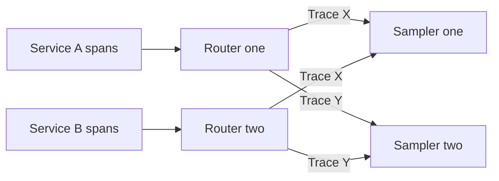

# How to Preserve Trace Affinity When Scaling Tail-Sampling Collectors

Author: [nawazdhandala](https://www.github.com/nawazdhandala)

Tags: OpenTelemetry, Kubernetes

Description: Use trace-aware routing, consistent endpoint discovery, and deliberate membership changes to protect tail-sampling decisions.

Tail sampling needs a coherent view of each trace. If spans from one trace land on different Collector replicas, each sampler decides using only its fragment. The result can be missing parents, lost error spans, and inconsistent keep decisions even when every Pod is healthy.

Place a stateless routing tier in front of stateful sampling workers. For Collector Contrib 0.120.0, the load-balancing exporter can hash trace IDs to discovered endpoints. Every router must see a consistent backend membership set for that mapping to work across services.

## Route by trace ID

This exporter fragment uses DNS discovery and direct worker endpoints:

```yaml
exporters:
  loadbalancing:
    routing_key: traceID
    resolver:
      dns:
        hostname: tail-samplers.observability.svc.cluster.local
        port: "4317"
    protocol:
      otlp:
        tls:
          insecure: true
```

The insecure transport is for a controlled in-cluster example; configure TLS for the actual network trust boundary. A headless Service exposes worker addresses instead of one virtual IP that would hide the individual samplers.

```yaml
apiVersion: v1
kind: Service
metadata:
  name: tail-samplers
  namespace: observability
spec:
  clusterIP: None
  selector:
    app: tail-sampler
  ports:
    - name: otlp-grpc
      port: 4317
      targetPort: 4317
```

The routing Collector's traces pipeline should export through `loadbalancing`. The workers should receive OTLP, run the tail sampler, and export to the trace backend. Avoid another arbitrary load-balancing hop between the router and worker address.



## Verify discovery before testing sampling

Inspect EndpointSlices and DNS answers from each router's network environment. A readiness mismatch or stale resolver can make two routers compute different destinations for the same trace.

```bash
kubectl -n observability get endpointslices \
  -l kubernetes.io/service-name=tail-samplers -o wide
kubectl -n observability get pods -l app=tail-sampler -o wide
```

Send a known distributed trace whose spans originate from several services and routers. Temporarily inspect which worker receives each span. All spans with that trace ID should converge while membership is stable. Repeat with several trace IDs to confirm work is distributed across workers.

## Treat membership changes as a correctness event

Consistent hashing limits how many routes move when workers are added or removed, but it does not preserve every in-flight trace. A newly added worker can receive later spans for a trace whose earlier spans are still buffered elsewhere. A graceful process shutdown alone cannot transfer that retained state.

For planned changes, use a stable worker pool where practical and schedule capacity additions before overload. Observe trace completeness across the change, not just ingestion rate. A blue-green routing epoch can isolate new traces from old ones, but it requires an application or routing design that consistently assigns a trace to an epoch across all producers.

For scale-down, stop assigning new work to a worker and allow its decision and export queues to drain under a coordinated design. Simply removing its endpoint first may reroute late spans. Document the residual loss risk if the system cannot preserve affinity during that transition.

Do not retry failed delivery by randomly choosing another sampler without considering trace state. The load-balancing exporter has queues and retries at multiple layers; review their defaults and failure semantics for the pinned release. Capacity, affinity, and retry policy must be designed together. A cluster with spare CPU can still produce incomplete traces if its routing membership is inconsistent.

## References

The [community question](https://www.reddit.com/r/Observability/comments/1ri32cx/is_tail_sampling_at_scale_becoming_a_scaling/) motivated this investigation. The implementation references are [official reference 1](https://raw.githubusercontent.com/open-telemetry/opentelemetry-collector-contrib/v0.120.0/exporter/loadbalancingexporter/README.md), [official reference 2](https://raw.githubusercontent.com/open-telemetry/opentelemetry-collector-contrib/v0.120.0/processor/tailsamplingprocessor/README.md).
