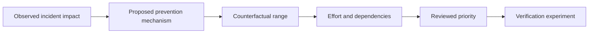

# How to Prioritize Incident Follow-Ups by Preventable User Impact

Author: [nawazdhandala](https://www.github.com/nawazdhandala)

Tags: Incident Management, SRE, Python

Description: Estimate which follow-ups reduce affected users or outage duration, show uncertainty, and avoid double-counting overlapping mitigations.

A postmortem can produce more follow-ups than the team can complete immediately. Prioritize them by the user impact they plausibly reduce, the confidence in that mechanism, and the effort required. Keep counterfactual estimates clearly labeled: you did not observe the outage that would have happened if the fix already existed.

This walkthrough uses synthetic incident data and Python 3. It is a decision aid, not a financial valuation model. The unit is affected-user minutes, which can be useful for comparing duration and scope within the same service. Use another unit when users or workflows have materially different consequences.

## Separate the mechanism of benefit

A prevention action reduces the chance of recurrence. A detection action shortens the time before responders notice. A mitigation action shortens recovery or reduces the affected population. Describe which part of the incident timeline each action changes, and avoid claiming all three benefits without evidence.

```yaml
# Internal follow-up proposal.
action: add automatic rollback guard
incident: inc-42
mechanism: shorten exposure after a faulty deployment
observed_affected_users: 2000
observed_duration_minutes: 30
estimated_minutes_saved: [10, 20]
confidence: medium
engineering_days: 4
```

The estimate should refer to a concrete trigger and a tested or testable response. If the rollback guard would not have detected the incident's actual failure signal, the apparent benefit is fictional. Record dependencies, such as needing a reliable canary metric first.

## Calculate a range rather than a magic score

The fixture ranks two illustrative actions by a range of avoided user-minutes per engineering day. It does not assign numerical probabilities to vague confidence labels. Keep confidence as a separate review field unless you have evidence supporting a probability estimate.

```python
actions = [
 {"name":"rollback guard","users":2000,"saved":(10,20),"days":4},
 {"name":"regional isolation","users":600,"saved":(20,30),"days":2},
]
for a in actions:
    low,high = (a["users"]*minutes/a["days"] for minutes in a["saved"])
    print(a["name"],{"low":low,"high":high,"unit":"user-minutes per engineering day"})
assert actions[0]["users"]*actions[0]["saved"][0] == 20000
```

These ranges overlap, so the arithmetic alone cannot establish a clear winner. Consider confidence, recurrence exposure, operational complexity, and whether the work enables other fixes. A short, high-confidence action may be attractive even if its maximum estimated benefit is lower.



## Avoid counting the same saved minutes twice

Detection and rollback improvements may overlap. If faster detection already removes ten minutes from the timeline, the rollback estimate must be recalculated on the remaining timeline. Do not sum isolated benefits and claim more avoided impact than the original incident caused.

```python
observed_user_minutes = 2000*30
isolated_claims = [2000*20,2000*15]
naive_total = sum(isolated_claims)
print({"observed":observed_user_minutes,"naive_claim":naive_total})
assert naive_total > observed_user_minutes
```

The assertion flags an impossible aggregate under this simple model. Capping the sum is only a sanity check; it does not solve overlap. Review the combined scenario step by step and state which action changes each segment.

## Keep exceptional risks visible

Some work protects data integrity, security boundaries, or rare catastrophic recovery paths that are poorly represented by recent user-minutes. Give those items an explicit review path rather than forcing them into a score dominated by frequent minor incidents. Similarly, infrastructure simplification may reduce many failure modes without mapping neatly to one postmortem.

For the selected actions, define an acceptance experiment and record the result. A rollback guard should be tested with a representative bad release in a safe environment. An isolation change should demonstrate that one region's failure does not propagate. Update the expected benefit when the experiment contradicts the initial assumption.

Revisit the queue after subsequent incidents and major architecture changes. The useful outcome is a transparent order of work with documented reasoning and uncertainty, not a precise-looking number that discourages engineering judgment.

## References

The [community question](https://www.reddit.com/r/devops/comments/1q30bt7/what_actually_happens_to_postmortem_action_items/) motivated this walkthrough. Implementation references:

- [Official reference 1](https://sre.google/workbook/postmortem-culture/)
- [Official reference 2](https://sre.google/workbook/implementing-slos/)
