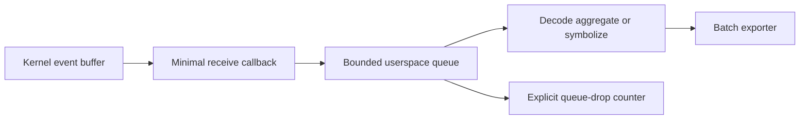

# How to Profile Userspace Work When eBPF Buffers Drop Events

Author: [nawazdhandala](https://www.github.com/nawazdhandala)

Tags: eBPF, Profiling, Linux

Description: Measure consumer callback cost, queue pressure, and export blocking before increasing eBPF buffer capacity.

When eBPF events drop, the kernel buffer is often blamed first. But a userspace consumer that formats JSON, resolves symbols, writes logs, or waits on network export inside its callback can prevent the buffer from draining. Increasing capacity only delays failure if the sustained processing rate remains too low.

Profile the consumer as its own application. Measure events received per second, callback time, queue depth, CPU, allocations, and destination latency. Keep kernel production and loss counters so the comparison does not hide discarded work.

## Estimate the processing budget

At a given arrival rate, each event has a small average CPU budget. This local calculation illustrates the constraint for one fully utilized consumer core:

```python
events_per_second = 600_000
nanoseconds_per_second = 1_000_000_000
print("single-core ns per event:", nanoseconds_per_second / events_per_second)
```

The result is about 1,667 nanoseconds per event before other work. It is a theoretical budget, not a benchmark. Copying large payloads, allocating objects, or resolving stack symbols on every event can quickly exceed it.



## Capture the consumer's CPU work

Use a bounded process-scoped profile on Linux:

```bash
perf record -F 99 -g -p 1234 -o consumer.data -- sleep 30
perf report -i consumer.data --stdio
```

Resolve the host-visible PID and preserve the matching binary. For Go or Java consumers, use their runtime profiler as an additional view when it improves symbolization or allocation analysis. Do not enable several high-overhead profilers simultaneously without measuring the effect.

Look for serialization, memory allocation, lock contention, symbol lookup, compression, and synchronous logging. A high percentage in buffer polling may be expected in an idle consumer; compare CPU time with the event rate.

## Separate draining from expensive processing

A callback should validate the record, copy any data whose lifetime ends with the callback, enqueue bounded work, and return promptly. Do not retain a pointer into a libbpf-managed buffer after the callback returns unless the API explicitly guarantees that lifetime.

The following pseudocode describes the ownership contract:

```text
on_event(buffer_pointer, length):
    validate record header and length
    copy required bytes into owned storage
    if bounded_queue has capacity:
        enqueue owned record
    else:
        increment userspace_queue_drops
    return immediately
```

Moving work to a queue does not eliminate its cost. If workers cannot keep up, the queue must expose pressure and a deliberate drop or backpressure policy. An unbounded queue trades kernel loss for process memory exhaustion.

## Measure each optimization against delivered work

Try batching serialization, caching symbol lookups with bounded memory, reducing copied fields, or aggregating in the kernel where semantics allow. Compare output correctness and delivered events, not only a lower kernel-loss count.

A diagnostic run that discards all records immediately can establish the maximum drain rate of the transport path. A run that decodes but does not export can isolate decoding cost. A full run then reveals destination overhead. Label these modes clearly so a benchmark of discard mode is not presented as end-to-end throughput.

Inspect per-CPU production when using perf buffers. One busy CPU can lose events even if other buffers are empty, and one polling strategy can delay servicing that CPU. Increasing page count may help bursts but does not repair expensive callback work.

Finally, test recovery after a destination slowdown. The consumer should maintain bounded memory, expose queue drops or pressure, and drain backlog when capacity returns. Record CPU cost per received and per delivered event, plus loss at every boundary. That gives a useful performance model for the whole observability pipeline instead of optimizing one buffer in isolation.

## References

The [community question](https://www.reddit.com/r/kernel/comments/1m28oon/ebpf_perf_buffer_dropping_events_at_600k_opssec/) motivated this investigation. The implementation references are [official reference 1](https://raw.githubusercontent.com/libbpf/libbpf/master/src/libbpf.h), [official reference 2](https://docs.kernel.org/bpf/ringbuf.html), [official reference 3](https://raw.githubusercontent.com/torvalds/linux/master/tools/perf/Documentation/perf-record.adoc).
