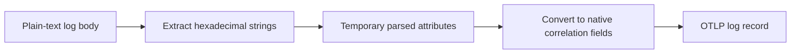

# How to Promote Plain-Text Trace IDs into OpenTelemetry Log Fields

Author: [nawazdhandala](https://www.github.com/nawazdhandala)

Tags: OpenTelemetry, Observability

Description: Parse embedded identifiers with the filelog receiver and populate native trace correlation fields instead of ordinary attributes.

A log body containing `trace_id=...` is searchable text, but it is not automatically an OpenTelemetry correlated log record. Native correlation lives in the log record's trace ID and span ID fields. A parser must extract the identifiers and assign those fields using the appropriate data types.

For Collector Contrib 0.120.0, the filelog receiver's Stanza operators provide a straightforward path: parse the text into attributes, then use `trace_parser` to promote them. This is useful for legacy applications whose logging format cannot immediately be changed.

## Define a precise input format

Use a representative line with full hexadecimal identifiers. Do not truncate trace IDs in the source pattern.

```text
INFO trace_id=4bf92f3577b34da6a3ce929d0e0e4736 span_id=00f067aa0ba902b7 quote completed
```

A parser should preserve the original body while extracting only the fields it understands. The following receiver fragment matches identifiers anywhere after the trace marker and leaves nonmatching lines available for error handling.

```yaml
receivers:
  filelog/application:
    include: [/var/log/application/*.log]
    start_at: end
    operators:
      - type: regex_parser
        regex: 'trace_id=(?P<trace_id>[0-9a-fA-F]{32})\s+span_id=(?P<span_id>[0-9a-fA-F]{16})'
        parse_from: body
        parse_to: attributes
        on_error: send
      - type: trace_parser
        trace_id:
          parse_from: attributes.trace_id
        span_id:
          parse_from: attributes.span_id
        on_error: send
```

Define an exporter and a logs pipeline referencing `filelog/application` in the complete configuration. `start_at: end` avoids historical ingestion on first startup; use a separate fixture file and an intentional beginning position for a local test.



## Test the extraction independently

This Python fixture uses the same pattern shape for a quick local check. The Collector uses Go regular expressions, so this does not replace runtime validation, but the pattern uses the supported shared subset.

```python
import re
pattern = re.compile(r"trace_id=(?P<trace_id>[0-9a-fA-F]{32})\s+span_id=(?P<span_id>[0-9a-fA-F]{16})")
line = "INFO trace_id=4bf92f3577b34da6a3ce929d0e0e4736 span_id=00f067aa0ba902b7 quote completed"
match = pattern.search(line)
assert match is not None
assert len(bytes.fromhex(match["trace_id"])) == 16
assert len(bytes.fromhex(match["span_id"])) == 8
print(match.groupdict())
```

Add negative fixtures: missing span ID, shortened trace ID, invalid hexadecimal text, and the all-zero invalid IDs. Decide whether those lines should remain uncorrelated, be quarantined, or trigger a parser error metric. Do not invent a random trace ID to make an invalid line appear correlated.

## Inspect the native fields at the next boundary

Use a debug exporter in an isolated test and confirm the record's native Trace ID and Span ID are populated. Merely seeing `attributes.trace_id` proves extraction but not promotion. Then verify the destination's OTLP log mapping preserves the native fields.

If a multiline stack trace is split into several records, only the first line may contain the identifiers. Combine multiline records before extracting context, or change the application format to include structured context on each complete event. Copying the previous line's trace ID into unrelated lines is unsafe under concurrent logging.

Preserve resource identity separately: the service name and Pod metadata still belong on the resource. Trace correlation does not identify which application emitted the event by itself.

Finally, prefer native structured logs or an OpenTelemetry logging bridge when you can change the application. Text parsing remains sensitive to format changes, escaping, and interleaved output. Keep the parser's fixture set next to the application logging contract so a harmless-looking pattern edit does not silently remove correlation.

## References

The [community question](https://stackoverflow.com/questions/75026679/parsing-traceid-spanid-from-log-line-using-opentelemetry-logprocessor) motivated this investigation. The implementation references are [official reference 1](https://raw.githubusercontent.com/open-telemetry/opentelemetry-collector-contrib/v0.120.0/pkg/stanza/docs/operators/regex_parser.md), [official reference 2](https://raw.githubusercontent.com/open-telemetry/opentelemetry-collector-contrib/v0.120.0/pkg/stanza/docs/operators/trace_parser.md).
