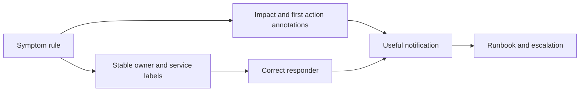

# How to Put Ownership and User Impact Into Every Page

Author: [nawazdhandala](https://www.github.com/nawazdhandala)

Tags: Prometheus, Alertmanager, Incident Management

Description: Add stable ownership labels, precise impact annotations, runbook links, and escalation steps to alert rules, then check their completeness in review.

A page is useful when the responder can identify the affected service, understand the user impact, and take the first safe action without searching through unrelated systems. Put stable routing information in labels and explanatory context in annotations. This keeps alert identity predictable while allowing the message to describe current evidence.

This example assumes Prometheus 3.x, Alertmanager, and a service catalog maintained by your team. The URLs and custom recording-rule metric are placeholders for your environment. Replace them with real, access-tested destinations before enabling the rule. A syntactically valid link is not proof that an on-call engineer can open it.

## Define the response contract in the rule

Choose labels that route and group the alert: service, team, environment, and severity. Put changing measurements and response instructions in annotations. Never put a live error percentage or free-form incident summary in a label, because changes can create a new alert identity.

```yaml
groups:
  - name: checkout-impact
    rules:
      - alert: CheckoutUserFailures
        expr: checkout:user_error_ratio5m > 0.05
        for: 5m
        labels:
          service: checkout
          team: payments
          environment: prod
          severity: critical
        annotations:
          summary: Customers cannot complete checkout reliably
          impact: 'More than 5 percent of eligible checkout requests are failing.'
          runbook_url: https://runbooks.example.com/checkout/failures
          dashboard_url: https://dashboards.example.com/checkout
          first_step: Compare failures by release and payment provider
          escalation: Escalate to payments secondary if no owner responds in 10 minutes
```

The impact statement defines what the metric measures. If it counts internal retries rather than customer attempts, rewrite the metric or the wording. A page that overstates impact trains responders to distrust future notifications. Include the affected region or integration when that dimension changes the response.

## Check completeness during review

The fixture below validates a simplified rule record. It is an internal linting example, not a full Prometheus parser. In a repository, run the equivalent check over parsed rule files and combine it with `promtool check rules`.

```python
rule = {"labels":{"service":"checkout","team":"payments","environment":"prod"},
        "annotations":{"impact":"Checkout failures","runbook_url":"https://runbooks.example.com/x",
                       "first_step":"Check release comparison","escalation":"Contact secondary"}}
required_labels = {"service","team","environment"}
required_annotations = {"impact","runbook_url","first_step","escalation"}
assert required_labels <= rule["labels"].keys()
assert required_annotations <= rule["annotations"].keys()
assert all(rule["annotations"][key].strip() for key in required_annotations)
print("Response context is present")
```

Presence checks catch omissions, not correctness. Add a human review for ownership and a scheduled access check for links. Team names change, dashboards move, and escalation policies evolve. Store the service catalog reference so the rule can be updated when ownership changes.



## Render each alert's context

For integrations supporting Alertmanager templates, iterate through individual firing alerts. Common annotations can disappear when group members have different values, so do not assume every field exists at group level.

```gotemplate
{{ define "page.context" }}
{{ range .Alerts.Firing }}
Service: {{ .Labels.service }} / {{ .Labels.environment }}
Owner: {{ .Labels.team }}
Impact: {{ .Annotations.impact }}
First step: {{ .Annotations.first_step }}
Runbook: {{ .Annotations.runbook_url }}
Escalation: {{ .Annotations.escalation }}
{{ end }}
{{ end }}
```

Connect the template to a supported integration field and test the actual rendered message on a non-production receiver. Mobile display length and link formatting can make an otherwise complete page hard to use. Put the first action early enough that it remains visible in a compact notification.

## Exercise the page with a new responder

Ask someone unfamiliar with the service to follow the page in a staging incident exercise. Measure whether they find the owner, inspect user impact, and reach the runbook without private bookmarks. Record confusing terms and broken access as defects in the alert itself.

Avoid including destructive commands directly in a short notification. Link to a runbook that explains preconditions, expected results, rollback, and escalation. The page should orient the responder quickly; the runbook should support careful action. Review this contract after every incident where the first useful step differed from the one in the message.

Keep an explicit distinction between the accountable service team and the person currently on call. The alert can carry the stable team identifier while the paging system resolves the current schedule. Embedding a personal name in hundreds of rules makes rotations and departures difficult to manage. Include a fallback owner for catalog gaps and test it with a deliberately unknown service in a non-production receiver. This exposes ownership drift before a real outage depends on a stale contact or an inaccessible team channel.

## References

The [community question](https://www.reddit.com/r/devops/comments/1vv7m7w/how_do_you_handle_alerts_issues/) motivated this walkthrough. Implementation references:

- [Official reference 1](https://prometheus.io/docs/prometheus/latest/configuration/alerting_rules/)
- [Official reference 2](https://prometheus.io/docs/alerting/latest/notifications/)
- [Official reference 3](https://prometheus.io/docs/practices/alerting/)
