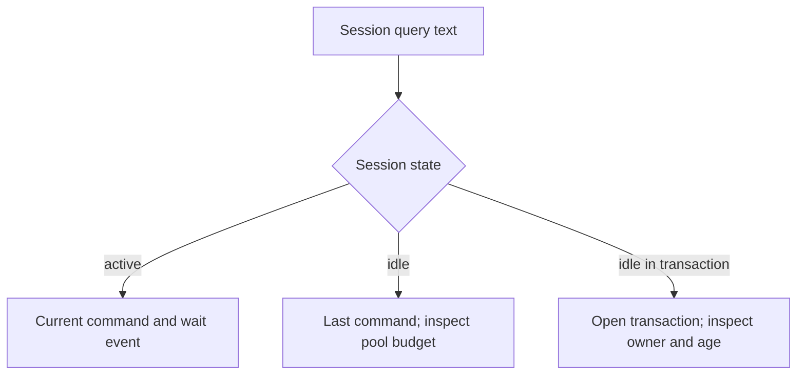

# How to Read Idle PostgreSQL Sessions Without Misreading Their Query

Author: [nawazdhandala](https://www.github.com/nawazdhandala)

Tags: PostgreSQL, Monitoring, SRE

Description: Interpret pg_stat_activity state, query_start, state_change, and transaction age so idle COMMIT or ROLLBACK text is not mistaken for active execution.

An idle PostgreSQL session showing `COMMIT` or `ROLLBACK` in its query column is usually displaying the last command, not a transaction command that has been running for hours. Interpret the query text together with `state`, `query_start`, `state_change`, and `xact_start`. These fields answer different questions.

The queries below target PostgreSQL 17 and require appropriate visibility into other sessions. They are read-only. Query text can contain sensitive data, so collect only the portion needed for diagnosis and store it with restricted access. A pooled application's idle sessions are not automatically a leak or an outage.

## Start with state and timestamps

The query column describes the current command for an active backend and the most recent command for a non-active backend. `state_change` tells you when the backend entered its current state. `xact_start` indicates an open transaction when present.

```sql
SELECT pid, application_name, state,
       clock_timestamp() - state_change AS time_in_state,
       clock_timestamp() - xact_start AS transaction_age,
       query_start, LEFT(query, 120) AS query_sample
FROM pg_stat_activity
WHERE backend_type = 'client backend'
ORDER BY state_change;
```

An idle session with no transaction start and a last query of COMMIT is consistent with a pool holding a reusable connection. Its old `query_start` does not mean COMMIT is still consuming CPU. Conversely, `idle in transaction` means the client has an open transaction while waiting to send another command.

## Count states before investigating individual queries

A state summary helps distinguish ordinary pool capacity from suspicious transaction retention. Group by application name so one service's behavior does not disappear in a database-wide total.

```sql
SELECT application_name, state, COUNT(*) AS sessions
FROM pg_stat_activity
WHERE backend_type = 'client backend'
GROUP BY application_name, state
ORDER BY sessions DESC;
```

A large idle pool can still consume scarce connection slots, so normal does not mean free. Compare it with the application replica count, pool minimum and maximum, and server budget. A sudden increase after deployment may indicate extra pools or overlapping replicas rather than a query execution problem.



## Focus on open idle transactions

The next query selects only idle transaction states and shows transaction age. A null transaction start in other states should not be converted into a large age or treated as evidence of a leak.

```sql
SELECT pid, application_name, client_addr, state,
       clock_timestamp() - xact_start AS transaction_age,
       wait_event_type, wait_event, LEFT(query, 120) AS last_query
FROM pg_stat_activity
WHERE state IN ('idle in transaction', 'idle in transaction (aborted)')
ORDER BY xact_start;
```

An aborted transaction still requires the client to roll back before normal work can continue. An idle transaction can hold locks or snapshots and interfere with other work. Investigate application control flow, exception handling, and transaction disposal rather than blaming the last SQL statement by itself.

## Avoid destructive cleanup based on appearance

Do not terminate all sessions whose query text says COMMIT or whose `query_start` is old. First establish state, ownership, and actual impact. A healthy pool may recreate the connections immediately, producing churn without freeing durable capacity. Terminating a session also rolls back any open work and can affect users.

For recurring idle-in-transaction problems, review transaction scopes and consider a carefully scoped `idle_in_transaction_session_timeout` policy after testing application behavior. It is a guardrail, not a substitute for correct disposal. Apply settings through the supported database change process and account for migrations or legitimate long transactions.

During diagnosis, use fresh activity snapshots and correlate backend PIDs with application logs. Record whether the session is active, waiting, idle, or idle in a transaction before interpreting its query text. That small discipline prevents a common false conclusion and directs attention toward the connection lifecycle that actually needs repair.

## References

The [community question](https://stackoverflow.com/questions/44275684/postgres-sessions-are-idle-with-query-commit-or-rollback) motivated this walkthrough. Implementation references:

- [Official reference 1](https://www.postgresql.org/docs/17/monitoring-stats.html)
- [Official reference 2](https://www.postgresql.org/docs/17/runtime-config-client.html)
