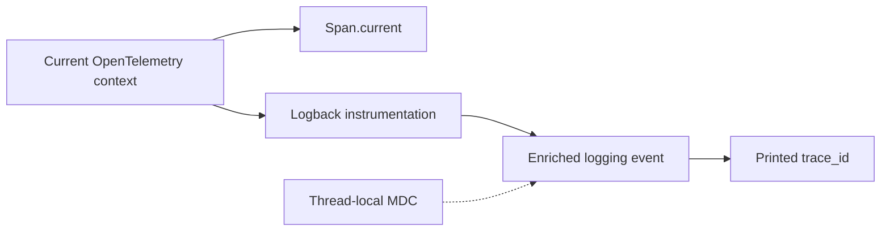

# How to Read Java Trace IDs When Logback MDC.get Returns Null

Author: [nawazdhandala](https://www.github.com/nawazdhandala)

Tags: OpenTelemetry, Java

Description: Read tracing context through the OpenTelemetry API and understand why Logback event enrichment may not populate thread-local MDC.

A Logback line can contain `trace_id` even when `MDC.get("trace_id")` returns null in application code. That is possible because a logging integration can enrich the logging event's context map without permanently inserting the same value into the thread-local MDC storage exposed by SLF4J.

Use the tracing API as the source of truth for the active trace. MDC is a logging integration surface, not a general OpenTelemetry context API. Depending on its implementation details makes application logic sensitive to changes in appenders, agents, and logging frameworks.

## Read and validate the active SpanContext

A small helper can return an optional trace ID. This avoids returning the all-zero invalid identifier as though it were a real trace.

```java
import io.opentelemetry.api.trace.Span;
import io.opentelemetry.api.trace.SpanContext;
import java.util.Optional;

public final class TraceIds {
    private TraceIds() {}
    public static Optional<String> current() {
        SpanContext context = Span.current().getSpanContext();
        return context.isValid()
            ? Optional.of(context.getTraceId())
            : Optional.empty();
    }
}
```

Use the helper only for correlation. Do not use a client-controlled trace ID as an authorization token or a unique business transaction identifier. Tracing context can be propagated from outside your trust boundary.

## Scope the context to the operation

The current span is obtained from the current OpenTelemetry context. Creating a span without making it current does not change what `Span.current()` returns.

```java
Span child = tracer.spanBuilder("calculate-tax").startSpan();
try (io.opentelemetry.context.Scope scope = child.makeCurrent()) {
    logger.info("active trace {}", TraceIds.current().orElse("none"));
    calculateTax();
} finally {
    child.end();
}
```

This fragment assumes a configured tracer and application operation. Closing the scope restores the previous context. Ending the span and closing the scope serve different purposes, so keep both lifecycle steps.



## Carry context across executors deliberately

When application work moves to a plain executor without instrumentation, capture the current context at submission time and wrap the task. Do not capture it later inside the worker, where the original request context may already be absent.

```java
io.opentelemetry.context.Context captured =
    io.opentelemetry.context.Context.current();
executor.execute(captured.wrap(() -> {
    logger.info("worker trace {}", TraceIds.current().orElse("none"));
    runBackgroundStep();
}));
```

Prefer your framework's supported context propagation for structured concurrency, reactive pipelines, and managed executors. A wrapper around a task does not automatically define the intended lifetime of a long background operation. If the work outlives the request, consider a linked trace and stable job ID.

## Avoid manually copying tracing IDs into MDC

A manual `MDC.put` can make one logging pattern work while introducing stale identifiers on pooled threads. If a legacy component truly needs MDC, scope the value with cleanup in a `finally` block and restore any previous value. Do not treat that compatibility code as the source of truth for tracing.

Test context inside an incoming request, inside a child span, after leaving the child scope, and on an unrelated worker task. The child should share the trace ID but have a different span ID. An unrelated task should not inherit a prior request's identifiers.

A valid `SpanContext` can describe a non-recording span, so `isValid()` and `isSampled()` answer different questions. Use validity to decide whether a correlation ID exists; inspect the sampled flag only when explaining retention behavior. Even a sampled flag cannot guarantee successful export or backend storage. This distinction keeps application correlation robust while allowing the logging integration to evolve independently.

## References

The [community question](https://stackoverflow.com/questions/75633901/unable-to-get-opentelemetrys-trace-id-through-mdc-even-though-mdc-was-working) motivated this investigation. The implementation references are [official reference 1](https://opentelemetry.io/docs/languages/java/api/), [official reference 2](https://raw.githubusercontent.com/open-telemetry/opentelemetry-java-instrumentation/main/instrumentation/logback/logback-mdc-1.0/library/README.md).
