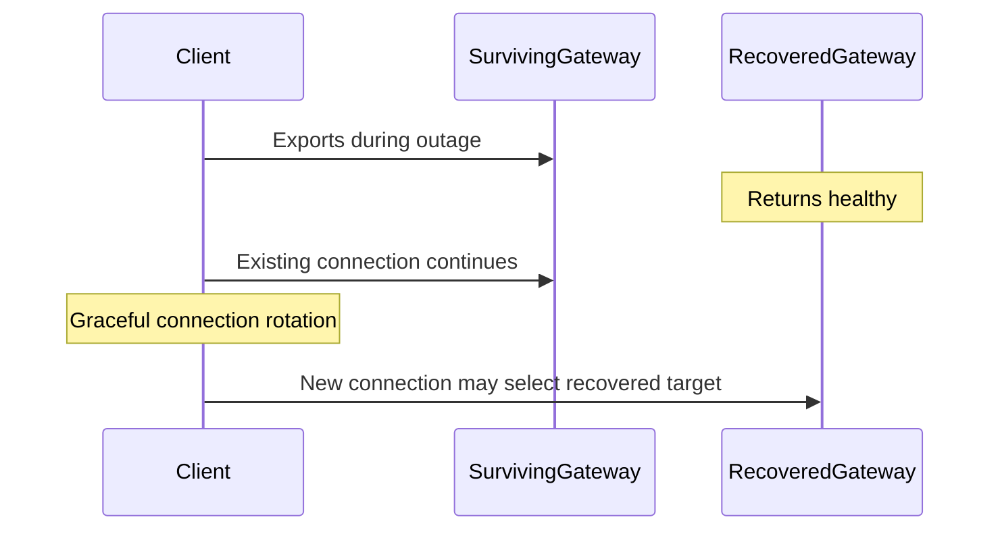

# How to Rebalance OTLP Traffic After a Collector Gateway Recovers

Author: [nawazdhandala](https://www.github.com/nawazdhandala)

Tags: OpenTelemetry, Kubernetes

Description: Restore traffic to a recovered gateway by distinguishing target health, connection lifetime, and safe client redistribution.

A recovered Collector can remain almost idle even after a load balancer declares it healthy. During the outage, clients established connections to surviving gateways. Those connections can continue serving requests indefinitely. Recovery restores eligibility for new connections; it does not automatically move existing traffic.

Treat rebalancing as a connection-lifecycle problem. First establish that the recovered process is accepting OTLP and exporting successfully. A health endpoint only proves the process is responding, while an empty queue can mean either excellent throughput or no traffic at all.

## Establish a recovery baseline

Compare per-instance accepted traffic before the outage, during failover, and after recovery. Retain the gateway instance label instead of aggregating across the deployment.

```promql
sum by (instance) (rate(otelcol_receiver_accepted_spans[5m]))
```

Use a separate query for failed sends, and inspect the exporter and endpoint dimensions exposed by your release. A target with accepted traffic but failed exports is not ready to absorb more load.

```promql
sum by (instance, exporter) (
  rate(otelcol_exporter_send_failed_spans[5m])
)
```

Check DNS and target registration from the sending tier. For a headless Service, confirm that the recovered Pod appears in DNS and EndpointSlices. For a cloud network load balancer, inspect registration and health in its control plane. These are separate discovery mechanisms.

```bash
kubectl -n observability get endpointslices \
  -l kubernetes.io/service-name=otel-gateways -o wide
```



## Make connection rotation deliberate

Collector 0.120.0 exposes gRPC server connection-age settings. The following receiver fragment asks clients to reconnect periodically, with time for in-flight work to finish. The values are a starting hypothesis, not a universal recommendation.

```yaml
receivers:
  otlp:
    protocols:
      grpc:
        endpoint: 0.0.0.0:4317
        keepalive:
          server_parameters:
            max_connection_age: 10m
            max_connection_age_grace: 1m
```

A reconnection only creates another opportunity for distribution. It cannot guarantee equal traffic when there are few clients, highly unequal client volumes, stale DNS, or a load-balancer policy that repeatedly selects the same target. TCP keepalive or gRPC ping frequency is not a substitute: liveness checks do not themselves select a new backend.

Roll out the setting to a small gateway subset first. Monitor connection establishment failures, export retries, queue depth, and the recovered gateway's ingestion rate. Avoid simultaneously restarting every application merely to force a connection refresh. A synchronized reconnect wave can stress TLS handshakes and produce a second outage.

## Prefer structural fixes for recurring incidents

If recovery repeatedly leaves the surviving gateway overloaded, use a gRPC-aware proxy or direct client discovery of multiple gateways. Ensure any client balancing option actually receives multiple backend addresses. A hostname resolving only to one virtual IP still leaves endpoint selection to the network load balancer.

For tail sampling, retain trace affinity while changing membership. Removing an instance can split in-flight traces even if client reconnection is graceful. Drain ingress and account for the sampling decision window before terminating stateful workers.

Finally, define recovery in terms of accepted traffic and successful delivery, not elapsed time alone. Compare a fixed-load recovery test with the baseline and preserve the graphs. The correct timeout is the one that restores acceptable distribution within your recovery objective while keeping connection churn and exporter errors within your measured budget.

## References

The [community question](https://www.reddit.com/r/OpenTelemetry/comments/1ciojw4) motivated this investigation. The implementation references are [official reference 1](https://raw.githubusercontent.com/open-telemetry/opentelemetry-collector/v0.120.0/config/configgrpc/README.md), [official reference 2](https://opentelemetry.io/docs/collector/scaling/).
