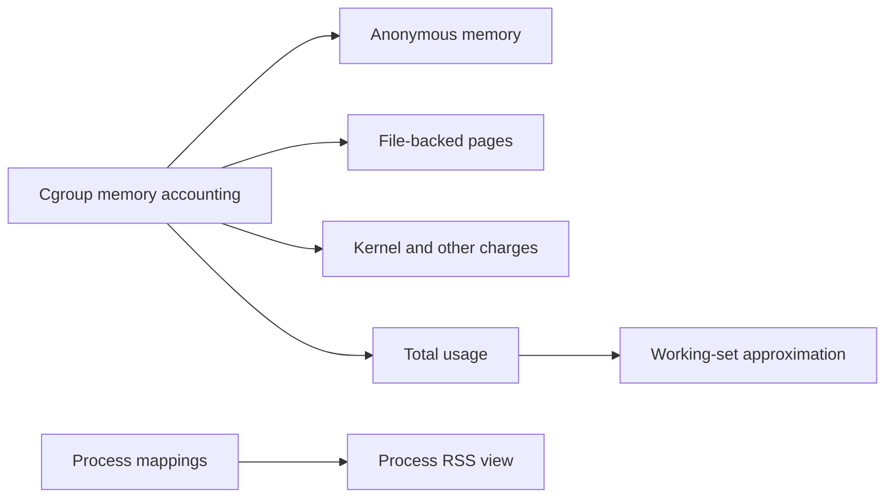

# How to Reconcile Kubernetes Working Set, RSS, and Cache Metrics

Author: [nawazdhandala](https://www.github.com/nawazdhandala)

Tags: Kubernetes, Prometheus

Description: Compare memory metrics at the same container and timestamp and understand why working set is not simply application heap.

Working set, RSS, cache, and total cgroup usage are related but not interchangeable. A high working-set value with a smaller RSS does not automatically mean the exporter is wrong. The metrics can include different categories, use different accounting sources, or represent different points in time.

Before increasing memory limits, align the scope: one container, one cgroup, one timestamp, and one kernel version. Pod aggregates can include sidecars, while process RSS may cover only one process.

## Compare the raw series without hiding labels

Inspect the relevant cAdvisor metrics for a specific container:

```promql
container_memory_working_set_bytes{namespace="checkout",pod="api-example",container="api"}
```

```promql
container_memory_rss{namespace="checkout",pod="api-example",container="api"}
```

```promql
container_memory_cache{namespace="checkout",pod="api-example",container="api"}
```

Check that each selector returns the expected single series. Duplicate scrape jobs or container lifecycle labels can produce several series that a dashboard silently sums. Compare units and timestamps before doing arithmetic.



## Understand the working-set approximation

cAdvisor commonly calculates working set by subtracting inactive file pages from usage, with a floor at zero. That is a reclaimability heuristic, not a precise measure of the application's irreducible memory demand. Active file pages and some other charges can remain included.

The following arithmetic illustrates the model with hypothetical inputs:

```python
usage_bytes = 900 * 2**20
inactive_file_bytes = 300 * 2**20
working_set_bytes = max(0, usage_bytes - inactive_file_bytes)
print("illustrative working set MiB:", working_set_bytes / 2**20)
```

Do not assume `RSS + cache == working set`. The categories can differ in scope and accounting, and the same labels do not guarantee that every metric is a disjoint component of one total.

## Read cgroup composition directly

For a cgroup v2 container, inspect memory statistics and limits from the correct cgroup namespace:

```bash
cat /sys/fs/cgroup/memory.current
cat /sys/fs/cgroup/memory.stat
cat /sys/fs/cgroup/memory.max
```

Look at anonymous memory, file-backed memory, active and inactive file pages, slab, socket memory, and shared-memory categories available in the running kernel. Some fields are subsets of others, so summing every line double-counts memory.

Compare with process mappings through `/proc/PID/smaps_rollup` when permissions allow. RSS can count shared pages in several processes, while proportional set size apportions shared mappings. Neither is identical to the cgroup's charged total.

## Determine whether the memory is actually under pressure

Check cgroup memory events, pressure stall information, reclaim activity, and application latency. A large cache that is reclaimed without disrupting the workload differs from growing anonymous memory that approaches the hard limit and causes OOM kills.

File-backed mappings can still be operationally important. Reclaiming them may cause repeated disk reads and latency, even though they are technically reclaimable. Conversely, treating all working-set bytes as permanent application heap can lead to unnecessarily large limits.

Run a controlled workload phase, an idle phase, and another workload phase. Observe which categories grow and shrink. If anonymous memory rises across cycles, investigate retained objects or native allocations. If file memory tracks dataset reads, investigate cache behavior and I/O performance.

Finally, document the metric used in each dashboard and why it is useful. Use total cgroup accounting for enforcement context, runtime heap metrics for managed allocations, and working set as one operational indicator. A resource decision should consider peak demand, reclaim cost, and failure evidence rather than one unexplained subtraction between unrelated charts.

## References

The [community question](https://stackoverflow.com/questions/78762663/cadvisor-reports-high-wss-but-low-rss-and-cache-memory-usage) motivated this investigation. The implementation references are [official reference 1](https://docs.kernel.org/admin-guide/cgroup-v2.html), [official reference 2](https://raw.githubusercontent.com/google/cadvisor/master/docs/storage/prometheus.md), [official reference 3](https://kubernetes.io/docs/concepts/configuration/manage-resources-containers/).
