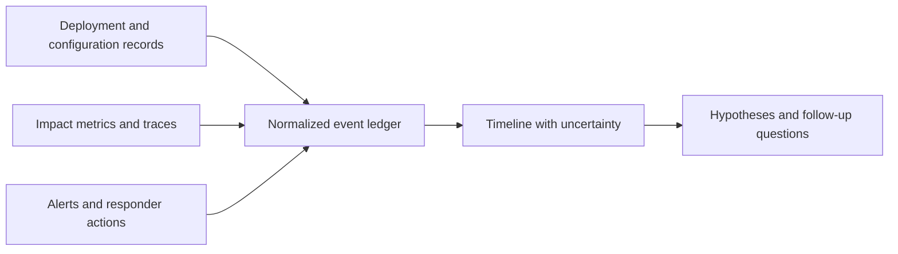

# How to Reconstruct Incident Timelines from Alerts and Changes

Author: [nawazdhandala](https://www.github.com/nawazdhandala)

Tags: Incident Management, OpenTelemetry, Python

Description: Normalize event timestamps, preserve observation delays and uncertainty, and build a reproducible timeline without mistaking correlation for cause.

An incident timeline should distinguish when users were affected, when monitoring noticed, when responders acted, and when recovery was verified. These are different clocks. A deployment timestamp near an error spike is useful evidence, but it does not establish cause. Build the timeline from source records and preserve uncertainty rather than forcing a tidy story.

The examples use Python 3 timezone-aware timestamps and synthetic events. OpenTelemetry's distinction between event timestamp and observed timestamp is a useful model even when your sources do not use OpenTelemetry. Keep both when available, especially if telemetry was delayed during the incident.

## Define a common event record

Store the original source timestamp, normalized UTC time, ingestion or observation time, source link, and confidence or uncertainty. Do not overwrite the raw timestamp after normalization. A later reviewer may need to correct an assumed timezone or a clock offset.

```json
{"event_id":"e-17","kind":"user-impact","event_time":"2026-11-15T10:02:00Z","observed_time":"2026-11-15T10:04:00Z","uncertainty_seconds":60,"source":"metrics/checkout-errors","description":"first interval with elevated eligible request failures"}
```

A chart point often represents an aggregation window, not an exact event instant. If a five-minute rate first crosses a threshold at 10:05, do not claim the outage began precisely at 10:05. Record the measurement resolution and inspect finer-grained evidence where available.

## Normalize and sort reproducibly

The fixture includes timestamps with different offsets. Sorting their raw strings can be misleading; parse them as aware datetimes and convert to UTC. Reject naive timestamps until their source timezone is established.

```python
from datetime import datetime,timezone
events = [
 ("deploy","2026-11-15T11:00:00+01:00"),
 ("impact","2026-11-15T10:02:00+00:00"),
 ("page","2026-11-15T10:07:00+00:00"),
]
normalized = [(name,datetime.fromisoformat(ts).astimezone(timezone.utc)) for name,ts in events]
for name,ts in sorted(normalized,key=lambda x:x[1]):
    print(ts.isoformat(),name)
assert normalized[0][1].hour == 10
```

## Calculate response intervals explicitly

Once impact and notification times are established, calculate detection delay and recovery duration from the chosen definitions. Do not substitute incident-ticket creation time for first user impact unless that is the metric you intend to measure.

```python
from datetime import datetime
parse = datetime.fromisoformat
impact = parse("2026-11-15T10:02:00+00:00")
page = parse("2026-11-15T10:07:00+00:00")
recovered = parse("2026-11-15T10:32:00+00:00")
print({"detection_minutes":(page-impact).total_seconds()/60,
       "impact_minutes":(recovered-impact).total_seconds()/60})
assert (recovered-impact).total_seconds() == 1800
```



## Preserve disagreements between sources

If application logs show recovery before user metrics do, include both. The application may have recovered while queues drained, or the clocks may differ. If a deployment system records completion after the first changed instance served traffic, use rollout events to explain the overlap rather than moving timestamps to fit the narrative.

Mark inferred events separately from directly observed ones. A statement such as connection pressure likely began during rollout is a hypothesis. Link it to the observations supporting it and list plausible alternatives. Keep failed remediation attempts in the timeline because they explain both elapsed time and knowledge gained.

Review the assembled timeline with responders and source owners. Ask them to correct factual gaps without rewriting decisions using hindsight. Export the normalized ledger and the small transformation script alongside the written review so the timeline can be regenerated.

The final timeline should let another engineer answer four questions: when impact began, when the team knew, what changed during response, and what evidence established recovery. If the available data cannot resolve one of those points, an explicit uncertainty range is more useful than an invented exact timestamp.

Use a separate column for action initiation and action completion when a mitigation takes time. A rollback request at 10:20 may not remove the faulty instances until 10:25, and user recovery may follow later as queues drain. Collapsing those events into one timestamp obscures which interval the next improvement should target. Preserve the action's scope too: recovery in one region does not establish global recovery until the remaining affected populations have been checked.

## References

The [community question](https://www.reddit.com/r/RedditEng/comments/1se5gmu/incident_reviews_or_how_we_transform_outages_into/) motivated this walkthrough. Implementation references:

- [Official reference 1](https://sre.google/workbook/incident-response/)
- [Official reference 2](https://docs.python.org/3/library/datetime.html)
- [Official reference 3](https://opentelemetry.io/docs/specs/otel/logs/data-model/)
